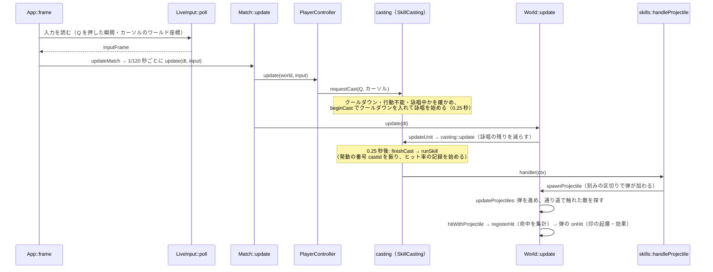

# ソースコードの歩き方

このソースコードを初めて読む人向けに、どの順番で読むと動作と仕組みを理解しやすいかをまとめます。

## 1. 読む前に知っておくとよいこと

| 知識 | どこで使っているか | 知らない時 |
|---|---|---|
| C++20（`std::optional`・`std::format`・ラムダ・`std::function`・構造化束縛） | すべて | `std::format` は `printf` の代わり、`std::optional` は「値が無いかもしれない」を表す型、と分かれば読めます |
| raylib（C で書かれたゲーム用ライブラリ） | ウィンドウ・入力・図形の描画・`Vector2` 型 | `Vector2` は `{x, y}` の構造体。`raymath.h` が `+` `-` `*` などの演算子を足しています |
| Dear ImGui（即時モードの GUI ライブラリ） | メニュー・HUD の文字・デバッグパネル | 「毎フレーム、画面の部品を描く関数を呼ぶ。ボタンを押したフレームだけ `Button()` が `true` を返す」という仕組みです |
| ImPlot（Dear ImGui 用のグラフ） | 統計の画面だけ | 統計の画面を触らないなら不要です |
| nlohmann/json | 設定ファイル・リザルトの読み書き | `j.value("key", 既定値)` で読む、と分かれば読めます |
| ゲームループと固定時間刻み | `App::frame`・`App::updateMatch` | [40-cross-cutting.md の「時間の進め方」](40-cross-cutting.md#2-時間の進め方) を先に読んでください |
| MOBA のスキルの用語（スキルショット・詠唱・クールダウン・CC など） | ゲームのすべて | [41-glossary.md](41-glossary.md) |

仕様（何を作ろうとしているか）は、次の 2 つのファイルに書かれています。コードを読む前に、少なくとも README と指示書の「追加の仕様」をざっと読むと、コードの意図が分かりやすくなります。

- [README.md](../../README.md): 遊び方と操作
- [claude_directive.txt](../../claude_directive.txt): 要件（指示書）と、開発中に決まった仕様（「追加の仕様」）
- [character_traits.txt](../../character_traits.txt): キャラとスキルの仕様

## 2. まず動かしてみる

コードを読む前に一度動かすと、どの画面がどのコードかの見当が付きます。

1. `build.bat` でビルドする（`build\release\moba_trainer.exe` と `build\release\moba_tests.exe` ができる）
2. `moba_trainer.exe` を起動して、練習場・スキルドッジ・スキルショットを遊ぶ
3. プレイ中に **F1** でデバッグパネルを開く（FPS・集計・敵 AI の状態が見える）
4. `logs/` フォルダのログを開く（起動中でも読める）。スキルの発動・命中・敵 AI の判断が 1 行ずつ出ている
5. `moba_tests.exe` を実行する（ゲームの動きの自動テスト）

ログの各行の `[skill]` `[hit]` `[ai]` などの分類名は、コードの `log::info("skill", ...)` の第 1 引数です。気になる行の文字列でソースコードを検索すると、その処理の場所がすぐに見つかります。

## 3. おすすめの読む順番

全体 → ゲームの 1 刻み → スキル → AI → 画面、の順に読むのがおすすめです。各段階で「何が分かればよいか」を書いておきます。

### 段階 1: 全体の形をつかむ（30 分）

| 読むもの | 分かればよいこと |
|---|---|
| [02-architecture.md](02-architecture.md) | フォルダの役割と依存の向き。`app` → `ui`/`render` → `game` → `data` → `core` の順に、上が下を使う |
| [src/main.cpp](../../src/main.cpp) | 起動の手順（data フォルダを探す → ログを始める → 引数を読む → `App` を動かす） |
| [src/app/App.h](../../src/app/App.h) の `App::run` と `App::frame` | 1 フレームの流れ（設定ファイルの確認 → 入力 → ゲームの更新 → 描画） |

ここでは `App.cpp` を全部読む必要はありません。`frame()` と `updateMatch()` と `draw()` の 3 つだけ読めば十分です。

### 段階 2: 設定ファイルとデータの流れ（30 分）

| 読むもの | 分かればよいこと |
|---|---|
| [src/data/GameData.h](../../src/data/GameData.h) | すべての設定ファイルを `GameData` 1 つが持っている。1 秒ごとに変更を調べて読み直す |
| [src/data/CharacterDef.h](../../src/data/CharacterDef.h) | キャラとスキルは「共通の項目」＋「handler の名前」＋「handler ごとの params」で書く |
| [data/characters/like_ezreal.jsonc](../../data/characters/like_ezreal.jsonc) | 実際の設定ファイルの形。上の構造体と見比べる |

このゲームは**データ駆動**です。スキルの数値は C++ に書かず、設定ファイルの `params` から読みます。この形を最初に押さえると、後の `skills/` のコードがすぐ読めます。

### 段階 3: ゲームの 1 刻み（1 時間）

ゲームの中身の中心は `World` です。ここが一番大事です。

| 読むもの | 分かればよいこと |
|---|---|
| [src/game/Unit.h](../../src/game/Unit.h) | キャラ 1 体が持つ状態（位置・移動先・詠唱・状態異常・クールダウン・HP） |
| [src/game/Entities.h](../../src/game/Entities.h) | 弾（`Projectile`）・範囲（`AreaEffect`）・設置物（`Prop`）・演出（`Vfx`）。弾と範囲は「当たった時の処理」を関数（`std::function`）として持つ |
| [src/game/World.h](../../src/game/World.h) と `World::update` | 1 刻みの処理の順番（キャラ → 弾 → 範囲 → 設置物 → 演出 → 追加・削除）。弾・範囲の追加は刻みの区切りでまとめて行う |
| [src/game/Match.h](../../src/game/Match.h) と `Match::update` | `World` の外側で、自キャラの操作・ダミー・敵 AI・的の AI を動かし、制限時間を見る |

詳しくは [14-game-world.md](14-game-world.md) と [17-game-modes.md](17-game-modes.md)。

### 段階 4: スキルが出るまで（1 時間）

| 読むもの | 分かればよいこと |
|---|---|
| [src/game/SkillCasting.h](../../src/game/SkillCasting.h) の先頭のコメント | キーを押してからスキルが出るまでの流れ（クールダウンの確認 → 射程外なら接近 → 詠唱 → 処理） |
| [src/game/SkillCasting.cpp](../../src/game/SkillCasting.cpp) | `requestCast` → `beginCast` → `finishCast` → `runSkill` の順に追う |
| [src/game/skills/Skill.h](../../src/game/skills/Skill.h) | handler の形（`void (*)(SkillContext&)`）と、共通の部品 |
| [src/game/skills/CommonSkills.cpp](../../src/game/skills/CommonSkills.cpp) の `handleProjectile` | 最も簡単なスキル（直線の弾）。これを読めば、他のスキルも同じ形で読める |

詳しくは [15-game-skills.md](15-game-skills.md)。

### 段階 5: AI（必要なら。1〜2 時間）

| 読むもの | 分かればよいこと |
|---|---|
| [src/game/ai/Aim.h](../../src/game/ai/Aim.h) | 敵の狙い方。「着弾時に自キャラがいそうな位置」の候補に重みを付けて、命中見込みが最も高い所を狙う |
| [src/game/ai/EnemyAI.h](../../src/game/ai/EnemyAI.h) | スキルドッジの敵。移動先を決め直す・撃てる時に撃つ |
| [src/game/ai/SkillShotTarget.h](../../src/game/ai/SkillShotTarget.h) の先頭のコメント | スキルショットの的。「避ける」と「パターンで動く」の 2 つ |

詳しくは [16-game-ai.md](16-game-ai.md)。

### 段階 6: 画面（必要なら）

| 読むもの | 分かればよいこと |
|---|---|
| [src/render/Renderer.cpp](../../src/render/Renderer.cpp) の `drawWorld` | ゲーム画面は raylib で図形を描く。描く順番 |
| [src/render/Hud.cpp](../../src/render/Hud.cpp) の `drawHud` | 文字（日本語）は Dear ImGui で重ねて描く |
| [src/ui/MainMenu.cpp](../../src/ui/MainMenu.cpp) | メニューは Dear ImGui。選んだ内容を `MatchConfig` にして `App` に返す |

詳しくは [19-render.md](19-render.md) と [20-ui.md](20-ui.md)。

### 段階 7: テスト

テストは「仕様の実例」としても読めます。例えば [tests/test_world.cpp](../../tests/test_world.cpp) の `TEST_CASE` の名前を上から読むだけで、各スキルがどう動くべきかが分かります。詳しくは [30-tests.md](30-tests.md)。

## 4. 1 つの操作を追ってみる: Q キーを押してから弾が当たるまで

全体のつながりを知るには、1 つの操作をコードで追うのが早道です。練習場で like ezreal の Q（直線の弾）を撃った時の流れです。

順番に読むファイルは次のとおりです。

1. [src/input/LiveInput.cpp](../../src/input/LiveInput.cpp) `LiveInput::poll`: Q を押した瞬間を `skillPressed[0]` にする
2. [src/app/App.cpp](../../src/app/App.cpp) `App::updateMatch`: たまった時間の分だけ `Match::update` を 1/120 秒ずつ呼ぶ
3. [src/game/PlayerController.cpp](../../src/game/PlayerController.cpp) `PlayerController::update`: `casting::requestCast` を呼ぶ
4. [src/game/SkillCasting.cpp](../../src/game/SkillCasting.cpp) `requestCast` → `beginCast`: クールダウンを入れ、詠唱を始める
5. [src/game/World.cpp](../../src/game/World.cpp) `World::updateUnit` → `casting::update`: 詠唱が終わったら `finishCast` → `runSkill`
6. [src/game/skills/CommonSkills.cpp](../../src/game/skills/CommonSkills.cpp) `handleProjectile`: 弾を作り、当たった時の処理（`onHit`）を付けて `spawnProjectile`
7. [src/game/World.cpp](../../src/game/World.cpp) `World::updateProjectiles` → `hitWithProjectile` → `registerHit`: 当たりの判定と集計
8. [src/render/Renderer.cpp](../../src/render/Renderer.cpp) `drawProjectile`: 弾を描く

ログでは、この流れが `[input] Q キー` → `[skill] ... を発動 castId=N` → `[hit] castId=N ... に命中` の順に出ます。

## 5. 目的別の入口

| やりたいこと | 最初に開くファイル | 関係する設計書 |
|---|---|---|
| スキルの数値を変えたい | `data/characters/*.jsonc`（コードの変更は不要） | [data-files.md](../data-files.md) |
| 新しいスキルの動きを作りたい | [src/game/skills/Skill.h](../../src/game/skills/Skill.h) と [SkillRegistry.cpp](../../src/game/skills/SkillRegistry.cpp) | [15-game-skills.md](15-game-skills.md)、[40-cross-cutting.md](40-cross-cutting.md#7-拡張の手順) |
| 新しいキャラを足したい | 既存のキャラの jsonc をまねる。足りない動きだけ handler を作る | [40-cross-cutting.md](40-cross-cutting.md#7-拡張の手順) |
| 新しい状態異常を足したい | [src/data/EffectSpec.h](../../src/data/EffectSpec.h) と [src/game/StatusEffects.cpp](../../src/game/StatusEffects.cpp) | [14-game-world.md](14-game-world.md) |
| 敵の強さを変えたい | `data/ai.jsonc`（コードの変更は不要） | [16-game-ai.md](16-game-ai.md) |
| 敵の考え方を変えたい | [src/game/ai/EnemyAI.cpp](../../src/game/ai/EnemyAI.cpp) の `tryCast` と `planMovement` | [16-game-ai.md](16-game-ai.md) |
| ステージを足したい | `data/stages/*.jsonc` を足す（コードの変更は不要） | [data-files.md](../data-files.md) |
| 壁の当たり・経路探索を直したい | [src/game/Terrain.cpp](../../src/game/Terrain.cpp) | [14-game-world.md](14-game-world.md) |
| ヒット率・ドッジ率の数え方を知りたい | [src/game/CastStats.h](../../src/game/CastStats.h) と `World::finishCastRecord` | [18-game-results.md](18-game-results.md) |
| メニューの項目を足したい | [src/ui/MainMenu.cpp](../../src/ui/MainMenu.cpp) と [src/game/MatchConfig.h](../../src/game/MatchConfig.h) | [20-ui.md](20-ui.md) |
| HUD の表示を変えたい | [src/render/Hud.cpp](../../src/render/Hud.cpp) | [19-render.md](19-render.md) |
| リザルトの保存形式を変えたい | [src/game/ResultStore.cpp](../../src/game/ResultStore.cpp) の `toJson` / `savedResultFromJson` | [18-game-results.md](18-game-results.md)、[results.md](../results.md) |
| 文字が小さい・大きい | [src/ui/UiScale.h](../../src/ui/UiScale.h) | [dpi-scaling.md](../dpi-scaling.md) |
| 不具合を再現したい | ログの「乱数の種」と `--seed`、入力スクリプト（`--script`） | [13-input.md](13-input.md)、[40-cross-cutting.md](40-cross-cutting.md#3-乱数と再現性) |

## 6. 読む時のコツ

- **関数名にマウスを乗せる**: すべての関数・クラス・構造体・列挙型に `///` の説明コメントがあり、VSCode ではポップアップに出ます。宣言（ヘッダー）の上に書いてあるので、`.cpp` から読み始めても説明が見られます。
- **ヘッダーの先頭のコメントを読む**: 多くのヘッダーの先頭に、そのファイルの考え方が数行でまとめてあります（例: `SkillCasting.h` の発動の流れ、`Terrain.h` の経路探索の方法、`ResultStore.h` の保存のルール）。
- **`.cpp` の無名名前空間**: `namespace { ... }` の中は、そのファイルの中だけで使う関数です。外から呼ばれないので、ファイルを読む時は後回しにしてかまいません。
- **ラムダの中は後で実行される**: スキルの処理（`skills/*.cpp`）では、弾に `p.onHit = [..](World&, Projectile&, Unit&) {...}` のように「当たった時の処理」を渡します。この中身は handler を呼んだ時ではなく、**弾が当たった時**に実行されます。
- **入力スクリプトで再現する**: `tests/scripts/*.txt` を `--script` で渡すと、毎回同じ操作で動き、スクリーンショットも保存できます。気になる動きを止めて見たい時に便利です。
- **テストを動かしながら読む**: `moba_tests.exe -tc="エマ Q*"` のように、名前でテストを選んで動かせます（doctest の機能）。
