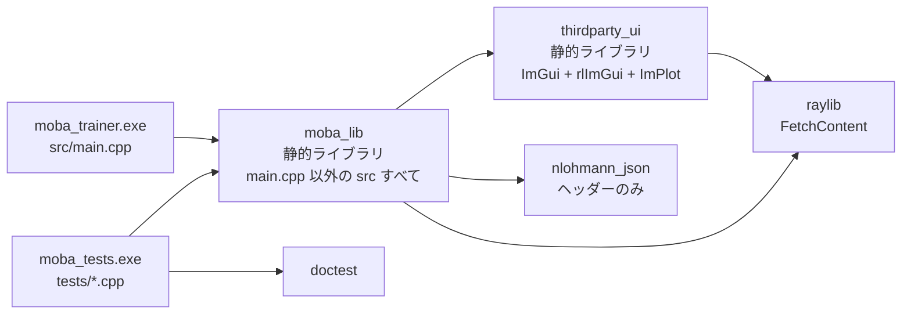
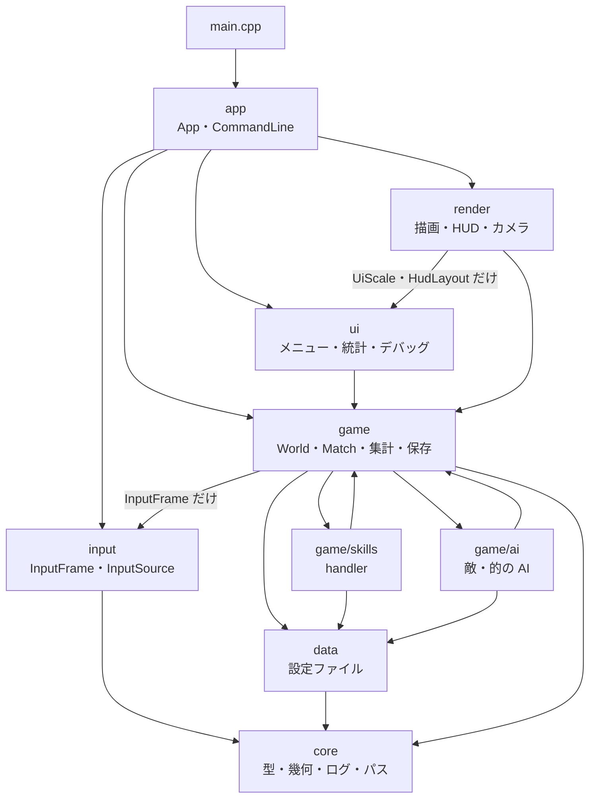
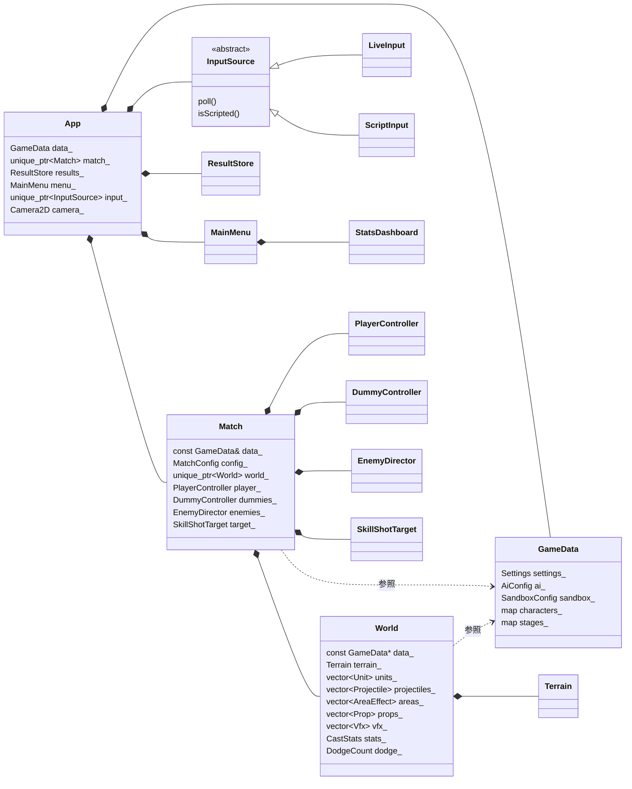
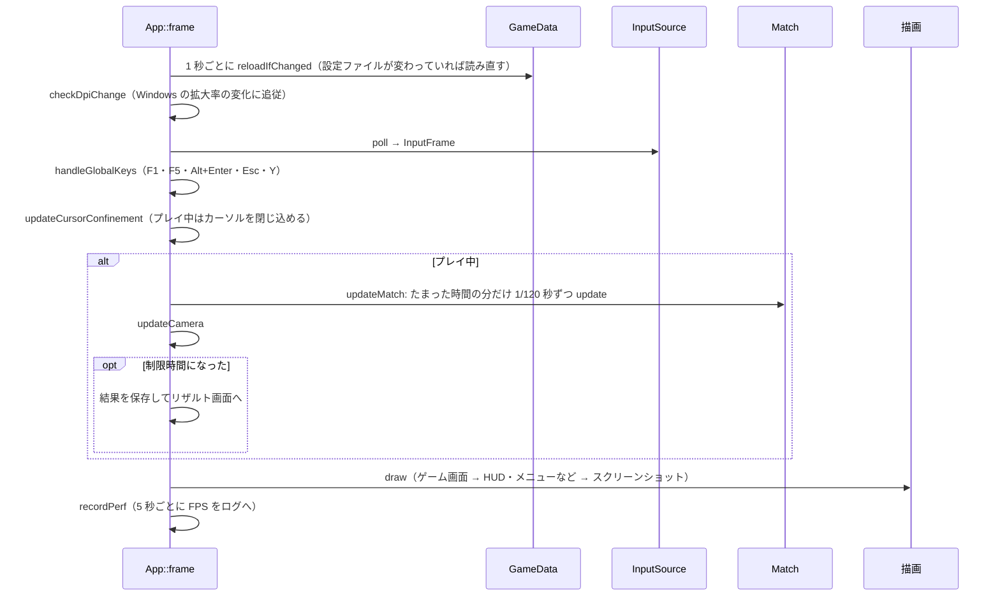
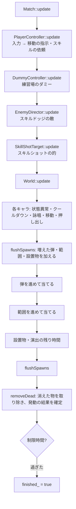
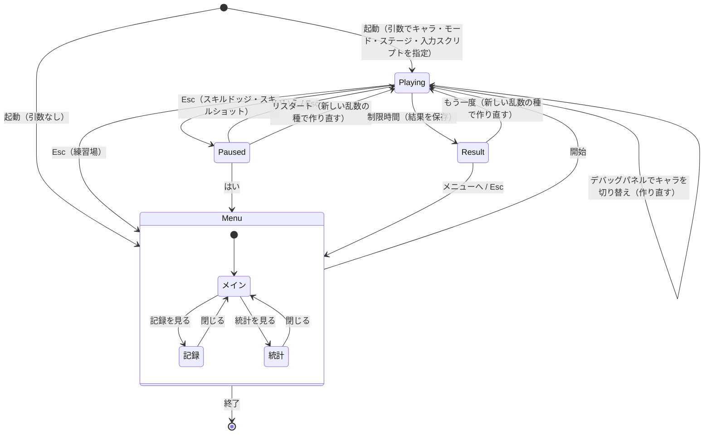

# 全体の構成

## 1. どんなアプリか

MOBA（LoL・エターナルリターンなど）のスキルショット（スキルを当てる）とスキルドッジ（スキルを避ける）を練習する、Windows 用のデスクトップアプリです。FPS のエイム練習ソフト（Kovaak's など）の MOBA 版を目指しています（根拠: [claude_directive.txt](../../claude_directive.txt) の「状況」）。

| モード | 内容 | 制限時間 | 結果の保存 |
|---|---|---|---|
| 練習場（Sandbox） | ダミーを相手にスキルを試す | なし | しない |
| スキルドッジ（SkillDodge） | 1〜5 体の敵が撃ってくるスキルを避ける。ドッジ率を測る | 1〜5 分 | する |
| スキルショット（SkillShot） | 動き回り、スキルを避けようとする的にスキルを当てる。ヒット率を測る | 1〜5 分 | する |

どのモードでも、ステージ（障害物なし・路地裏・森）とキャラ（like emma・like ezreal・like brand）を選べます。

## 2. 使っている技術

| 項目 | 内容 | 選んだ理由 |
|---|---|---|
| 言語 | C++20（MSVC、`/utf-8 /W4 /permissive-`） | 背景（根拠: ユーザーの共通設定「デスクトップアプリは C++」） |
| ウィンドウ・入力・図形の描画 | raylib 6.0 | 背景（推測）: 小さく、2D の図形を手軽に描けるため |
| GUI（メニュー・文字） | Dear ImGui 1.92.7 ＋ rlImGui（raylib との橋渡し） | 背景（根拠: `Renderer.h` のコメント「文字は日本語を出すため、Hud.cpp で Dear ImGui を使って描く」）。raylib の文字描画では日本語を扱いにくいため |
| グラフ | ImPlot 1.0 | 統計の画面のグラフ用（根拠: `0498fab`） |
| JSON | nlohmann/json 3.12.0 | コメント付き JSON（`.jsonc`）を読めるため（根拠: `JsonFile.h`） |
| テスト | doctest 2.5.3 | 背景（推測）: ヘッダーだけで使え、軽いため |
| ビルド | CMake（FetchContent でライブラリを自動取得）＋ Ninja、`build.bat` | ライブラリを手で入れなくてよいように（根拠: README「初回ビルド時に自動で取得」） |

ライブラリのバージョンは [CMakeLists.txt](../../CMakeLists.txt) で固定しています。rlImGui だけは、raylib 6.0 と ImGui 1.92.7 に対応したコミットで固定しています。

## 3. 実行する時のファイルの配置

```text
<ルート>/                ← data/settings.jsonc がある場所。exe のフォルダから親へさかのぼって探す
├─ data/                 設定ファイル（読み込みと、sandbox.jsonc の "preset" の書き戻しだけ）
│   ├─ settings.jsonc    全体の設定
│   ├─ ai.jsonc          敵 AI・的の AI
│   ├─ sandbox.jsonc     練習場のダミー
│   ├─ characters/*.jsonc キャラとスキル
│   └─ stages/*.jsonc    ステージ
├─ logs/                 開発者用ログ（起動時に作る）
└─ results/              保存したリザルト（dodge/ と shot/）
```

exe を `build/release/` に置いたままでも、親フォルダへさかのぼってソースの `data/` を見つけます（`locateAppPaths`）。これにより、ビルドした exe でソースの設定ファイルを直接編集・再読み込みできます（根拠: `Paths.h` のコメント）。

## 4. ビルドの構成

[CMakeLists.txt](../../CMakeLists.txt) は、次の 4 つのターゲットを作ります。



| ターゲット | 中身 | 要点 |
|---|---|---|
| `thirdparty_ui` | Dear ImGui・rlImGui・ImPlot の `.cpp` | 上流に CMakeLists が無いので、ここで静的ライブラリにする。`NO_FONT_AWESOME` を定義（rlImGui のアイコンフォントを使わない） |
| `moba_lib` | `src/main.cpp` 以外のすべての `.cpp` | **ゲームの本体をライブラリにして、テストからも同じコードを使う**ため（根拠: CMakeLists のコメント）。`MOBA_VERSION` を定義。`imm32`（IME の無効化）をリンク |
| `moba_trainer` | `src/main.cpp` | Release では `/SUBSYSTEM:WINDOWS`（コンソール窓を出さない）。Debug ではコンソールにもログが出る |
| `moba_tests` | `tests/*.cpp` | `MOBA_SOURCE_DIR`（ソースのルート）を定義し、テストからソースの `data/` を読む |

MSVC のランタイムは静的リンク（`MultiThreaded`）で、exe 1 つで動きます。プリコンパイル済みヘッダーは使いません（根拠: 指示書「`#include` の書き忘れに気づけなくなる欠点のほうが大きいため」）。

## 5. フォルダ（モジュール）の役割

| フォルダ | 名前空間 | 役割 | 主なファイル |
|---|---|---|---|
| `src/`（直下） | — | プログラムの入口 | `main.cpp` |
| `src/app/` | `moba` | アプリ本体。ウィンドウ・メインループ・画面の切り替え・コマンドライン引数 | `App`、`CommandLine` |
| `src/core/` | `moba`、`moba::geo`、`moba::log`、`moba::platform` | どこからでも使う土台。基本の型・2D の幾何計算・ログ・パス・JSON の読み込み・Windows 固有の処理 | `GameTypes.h`、`Geometry.h`、`Log`、`Paths`、`JsonFile`、`Platform` |
| `src/data/` | `moba` | 設定ファイルの読み込み（JSON → C++ の構造体）。値を範囲に収め、誤りをエラー・警告として残す | `GameData`、`CharacterDef`、`StageDef`、`AiConfig`、`SandboxConfig`、`Settings`、`EffectSpec` |
| `src/input/` | `moba` | 入力の取得。実際のマウス・キーボードと、入力スクリプトを同じ形（`InputFrame`）にする | `InputSource`、`LiveInput`、`ScriptInput` |
| `src/game/` | `moba`、`moba::casting` | ゲームのルール。キャラ・弾・範囲・地形・状態異常・スキルの発動の流れ・1 回のプレイ・集計・リザルトの保存 | `World`、`Unit`、`Entities`、`Terrain`、`SkillCasting`、`Match`、`ResultStore`、`ResultStats` |
| `src/game/skills/` | `moba::skills` | スキルの処理（handler）。設定ファイルの `"handler"` の名前で選ばれる | `Skill.h`、`SkillRegistry.cpp`、`*Skills.cpp` |
| `src/game/ai/` | `moba::ai` | 敵 AI（スキルドッジ）と的の AI（スキルショット） | `EnemyAI`、`SkillShotTarget`、`Aim`、`PlayerObserver` |
| `src/render/` | `moba` | ゲーム画面の描画（raylib の図形）と HUD（Dear ImGui の文字）、カメラの計算 | `Renderer`、`Hud`、`CameraControl` |
| `src/ui/` | `moba`、`moba::ui` | 画面の部品（Dear ImGui）。メニュー・ポーズ・リザルト・記録・統計・デバッグパネル・フォント・文字の倍率 | `MainMenu`、`StatsDashboard`、`DebugPanel`、`UiScale` |
| `tests/` | — | 自動テスト（doctest）と入力スクリプト | `test_*.cpp`、`scripts/*.txt` |

### 名前空間の使い分け

ほとんどの型と関数は `moba` に入っています。次のものだけ、名前空間を分けています。

| 名前空間 | 中身 | 分けた理由 |
|---|---|---|
| `moba::geo` | `distanceSqToSegment` などの幾何計算 | 背景（推測）: `str()` `perpendicular()` のような短い名前が `moba` の他の関数とぶつからないように |
| `moba::log` | ログ（`log::info` など） | `info` `warn` `error` という短い名前を、呼ぶ側で `log::` 付きで書けるように |
| `moba::platform` | Windows API を使う処理 | Windows 固有の処理だと、呼ぶ側で一目で分かるように（根拠: `Platform.h` の先頭「windows.h は raylib と名前がぶつかるため、このファイルの .cpp だけで使う」） |
| `moba::casting` | スキルの発動の流れ（`requestCast` など） | 背景（推測）: `update` `cancelCast` などの名前が `World::update` と紛れないように、自由関数のまとまりとして分けた |
| `moba::skills` | handler と、その共通の部品 | handler は数が増えるので、まとまりとして分けた（推測） |
| `moba::ai` | AI のクラスと計算 | 同上（推測） |
| `moba::ui` | フォント・文字の倍率（`ui::px`） | `px()` は描画のコードで何度も使うので、`using ui::px;` で短く書けるように（推測） |

`MainMenu` `StatsDashboard` などの画面のクラスは `moba::ui` ではなく `moba` にあります。`moba::ui` は「どの画面からも使う部品」だけ、という分け方です（推測）。

### 分け方の意図

1. **ゲームのルール（`game/`）は画面を知らない**。`game/` は `render/` と `ui/` を `#include` しません。そのため、テストでは画面を出さずに `World` や `Match` を動かせます（根拠: `test_world.cpp` の先頭「画面を出さずに World を動かして確かめる」）。
2. **計算と表示を分ける**。テストしたい計算は、画面のファイルから切り出しています。
   - カメラの計算 → `render/CameraControl`（根拠: `0575b7f`「カメラの計算は src/render/CameraControl に分け、tests/test_camera.cpp でテストする」）
   - 統計の計算 → `game/ResultStats`（根拠: `0498fab`「計算は game/ResultStats に分けてテストする」）
   - ログの保持ルール → `core/LogRetention`（根拠: `LogRetention.h`「ファイル操作はしない（テストしやすくするため）」）
   - 敵の狙い → `game/ai/Aim`（根拠: `Aim.h`「World に依存しない計算だけなので、テストで直接確かめられる」）
   - ウィンドウの大きさ → `ui/UiScale` の `fitWindowSize`
3. **数値はコードに書かず、設定ファイルに書く**（データ駆動）。スキル・AI・ステージ・ダミーの数値は `data/` にあり、ゲームの起動中に保存すると自動で読み直されます（根拠: 指示書「数値はファイルで調整できるようにする」）。
4. **Windows 固有の処理は `core/Platform.cpp` と `core/Log.cpp` に閉じ込める**。`windows.h` は raylib と名前（`DrawText` `CloseWindow` など）がぶつかるためです。

## 6. 依存の向き

矢印は「`#include` して使う」向きです。上の層が下の層を使い、逆向きの依存はありません。



補足:

- `game` と `game/skills`・`game/ai` は互いに使い合います（`SkillCasting.cpp` が `skills::findHandler` を呼び、`skills/*.cpp` が `World` を使う。`Match` が `ai::EnemyDirector` を持ち、`EnemyAI.cpp` が `World` と `casting::requestCast` を使う）。3 つで 1 つの「ゲームのルール」のまとまりと考えてください。
- `game` が `input` に依存するのは、`Match::update` と `PlayerController::update` が `InputFrame`（1 フレームの入力のデータ）を受け取るためだけです。入力の取得元（`InputSource`）は知りません。
- `render/Hud.cpp` が `ui/` を使うのは、文字・枠の大きさに倍率（`ui::px`。`UiScale.h`）を掛けるためと、スキルバーの大きさ（`HudLayout.h`。練習場のパネルと共通の定数）のためだけです。逆向き（`ui` → `render`）の依存はありません。
- **`game` は raylib の型（`Vector2`・`Color`・`Rectangle`）を使っています**。raylib の関数のうち `game` が使うのは、数学（`raymath.h`）と当たり判定（`CheckCollisionPointRec` など）だけで、ウィンドウや描画の関数は使いません。そのため、テストではウィンドウを開かずに動かせます。

## 7. 主なクラスの持ち物（所有関係）



- **継承を使っているのは `InputSource` だけ**です（`LiveInput` と `ScriptInput`）。他は構造体と、値として持つクラスの組み合わせです。
- 弾・範囲の「当たった時の処理」は、継承ではなく `std::function` のメンバで差し替えます（[14-game-world.md](14-game-world.md)）。
- スキルの処理は、関数ポインタ（`skills::SkillHandler`）の表から名前で選びます（[15-game-skills.md](15-game-skills.md)）。
- `Match` は 1 回のプレイごとに作り直します（「もう一度」「リスタート」「キャラの切り替え」でも作り直す）。`GameData` と `ResultStore` はアプリが終わるまで 1 つです。

## 8. 1 フレームの処理

`App::frame()` が 1 フレームに 1 回呼ばれます（垂直同期で、たいてい 60 回 / 秒）。



ゲームの時間は描画とは別に、**1/120 秒の固定刻み**で進めます（`App::kFixedDt`）。詳しくは [40-cross-cutting.md](40-cross-cutting.md#2-時間の進め方)。

### 1 刻みの中の順番（`Match::update` → `World::update`）



使っていないモードの部品も毎刻み呼ばれますが、中で何もしません（例: 練習場では `EnemyDirector` に敵がいないので何もしない）。

## 9. 画面の切り替え

`App` は 4 つの画面（`App::Screen`）を切り替えます。メニューの中の「記録」「統計」は、`MainMenu` の中の表示の切り替えです。



## 10. 外から見た入出力

| 入出力 | 内容 | 担当 |
|---|---|---|
| 設定ファイル（読み） | `data/*.jsonc`。1 秒ごとに更新日時を見て、変わっていれば読み直す | `GameData` |
| 設定ファイル（書き） | `sandbox.jsonc` の `"preset"` の値だけ。コメントや他の行は変えない | `saveSelectedSandboxPreset` |
| リザルト（読み書き） | `results/dodge/<YYYY-MM-DD>.json` と `results/shot/<YYYY-MM-DD>.json` | `ResultStore` |
| ログ（書き） | `logs/moba_trainer_YYYYMMDD_HHMMSS.log`。1 ファイル 20MB まで、10 日分 | `core/Log` |
| 入力スクリプト（読み） | `--script` で渡したテキストファイル | `ScriptInput` |
| スクリーンショット（書き） | 入力スクリプトの `screenshot` 命令。カレントディレクトリに PNG | `App::saveScreenshot` |
| Windows | IME の無効化・拡大率の取得・カーソルの閉じ込め・エラーのダイアログ・クラッシュ時の記録 | `core/Platform` |
