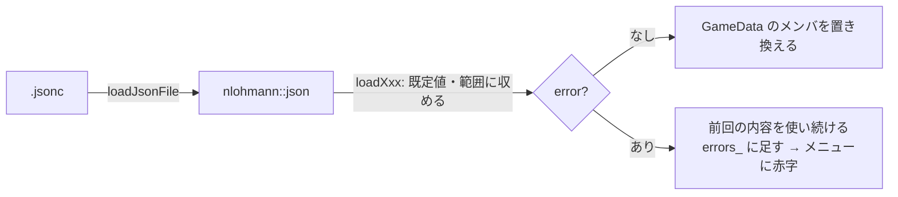

# data モジュール（`src/data/`）

## 1. 概要

`data/` フォルダの設定ファイル（.jsonc）を読み、C++ の構造体にします。ゲームの数値（スキル・AI・ステージ・ダミー・全体の設定）は、すべてここを通ってゲームに渡ります。

**各項目の意味と書き方は [data-files.md](../data-files.md) にあります**。この設計書では、読み込みの仕組みと、構造体・関数の役割を説明します。

| ファイル | 読む設定ファイル | 主な型 |
|---|---|---|
| [GameData.h](../../src/data/GameData.h) / [.cpp](../../src/data/GameData.cpp) | すべて（下の各関数を呼ぶ） | `GameData` |
| [Settings.h](../../src/data/Settings.h) / [.cpp](../../src/data/Settings.cpp) | `settings.jsonc` | `Settings`、`CastMode`、`CameraMode` |
| [AiConfig.h](../../src/data/AiConfig.h) / [.cpp](../../src/data/AiConfig.cpp) | `ai.jsonc` | `AiConfig`、`AiLevel`、`SkillShotConfig`、`SkillShotLevel`、`TargetSize` |
| [SandboxConfig.h](../../src/data/SandboxConfig.h) / [.cpp](../../src/data/SandboxConfig.cpp) | `sandbox.jsonc`（読み・書き） | `SandboxConfig`、`SandboxPreset`、`DummyDef` |
| [CharacterDef.h](../../src/data/CharacterDef.h) / [.cpp](../../src/data/CharacterDef.cpp) | `characters/*.jsonc` | `CharacterDef`、`SkillDef`、`Targeting` |
| [EffectSpec.h](../../src/data/EffectSpec.h) / [.cpp](../../src/data/EffectSpec.cpp) | スキルの `"onHit"` などの中 | `EffectSpec`、`EffectType` |
| [StageDef.h](../../src/data/StageDef.h) / [.cpp](../../src/data/StageDef.cpp) | `stages/*.jsonc` | `StageDef`、`Shape`、`Obstacle`、`ObstacleKind` |
| [DataWarnings.h](../../src/data/DataWarnings.h) / [.cpp](../../src/data/DataWarnings.cpp) | —（スキルを使う時に見つかった、設定ファイルの誤りを集める） | 関数だけ |

### 型の一覧

すべて継承はありません。

| 型 | 種類 | 定義 |
|---|---|---|
| `GameData` | クラス | GameData.h |
| `CastMode`、`CameraMode` | 列挙型 | Settings.h |
| `Settings`、`SettingsLoadResult` | 構造体 | Settings.h |
| `AiLevel`、`SkillShotLevel`、`TargetSize`、`SkillShotConfig`、`AiConfig`、`AiConfigLoadResult` | 構造体 | AiConfig.h |
| `DummyDef`、`SandboxPreset`、`SandboxConfig`、`SandboxConfigLoadResult` | 構造体 | SandboxConfig.h |
| `Targeting` | 列挙型 | CharacterDef.h |
| `SkillDef`、`CharacterDef`、`CharacterLoadResult` | 構造体 | CharacterDef.h |
| `EffectType` | 列挙型 | EffectSpec.h |
| `EffectSpec` | 構造体 | EffectSpec.h |
| `Shape`、`Shape::Kind`、`ObstacleKind`、`Obstacle`、`StageDef`、`StageLoadResult` | 構造体・列挙型 | StageDef.h |

## 2. 読み込みの共通の決まり

どの設定ファイルも、次の同じ形で読みます。

1. `loadJsonFile`（core）でコメント付き JSON を読む
2. `j.value("key", 既定値)` で各項目を読む。**書かれていない項目は既定値**にする
3. 値を決められた範囲に収める（`std::clamp` / `std::max`）。例: `uiScale` は 0.5〜3.0、`radius` は 10〜300
4. 結果は `XxxLoadResult` 構造体で返す。`error` が空なら成功
   - `error`: そのファイルを使えない誤り（開けない・書き方の誤り・必須の項目が無い・型が違う）
   - `warnings`: 読めたが、値がおかしかった項目（知らない `cameraMode` など。既定値で続ける）
5. `GameData::loadAll` が、`error` ならログとエラーの一覧に出し、**前回読めた内容をそのまま使い続ける**



**背景**（根拠: 指示書「数値はファイルで調整できるようにする」「ゲームの起動中に保存すると、自動で再読み込みされる」、`d771af6`）: ゲームを止めずに数値を調整できるようにするためです。保存の途中など、書きかけのファイルを読んで失敗しても、遊んでいるプレイが壊れないように、前回の内容を使い続けます。

**注意事項**: 型が違う値（数のはずが文字列など）は、nlohmann/json の例外になり、**そのファイル全体**が `error` になります。範囲外の数は `error` にならず、範囲に収められます。

---

## 3. `GameData`（クラス）

**役割**: 設定ファイル一式を持ち、読み込みと、変更を検知した時の再読み込みを行います。アプリに 1 つで、`App` が持ちます。`World` と `Match` は参照（ポインタ）で使います。

**背景**（根拠: `d771af6`「起動中の保存で自動再読み込み」）: 設定ファイルを 1 か所で持ち、どこからでも同じ内容を見られるようにしています。

### 3.1 メンバ変数

| 変数 | 型 | 説明 |
|---|---|---|
| `paths_` | `AppPaths` | 各ファイルの場所 |
| `settings_` | `Settings` | settings.jsonc |
| `ai_` | `AiConfig` | ai.jsonc |
| `sandbox_` | `SandboxConfig` | sandbox.jsonc |
| `sandboxRevision_` | `int` | ダミーの設定が**中身ごと**変わるたびに増える番号 |
| `characters_` | `map<string, CharacterDef, less<>>` | id → キャラ。`less<>` で `string_view` のまま探せる |
| `stages_` | `map<string, StageDef, less<>>` | id → ステージ |
| `fileTimes_` | `map<path, file_time_type>` | 前回読んだ時の、各ファイルの更新日時 |
| `errors_` | `vector<string>` | 直近の読み込みで起きたエラー・警告 |
| `generation_` | `int` | 読み込みのたびに増える番号 |

### 3.2 メンバ関数

| 関数 | 説明 |
|---|---|
| `explicit GameData(AppPaths paths)` | 場所を覚えるだけ。読み込みは `loadAll()` |
| `void loadAll()` | すべてのファイルを読み直す。エラーの一覧を空にしてから、settings → ai → sandbox → キャラ → ステージの順に読む。最後に更新日時を覚え直し、`generation_` を増やす |
| `bool reloadIfChanged()` | 更新日時が前回と違えば `loadAll()` して `true`。`App` が 1 秒ごとに呼ぶ |
| `const AppPaths& paths() const` | 各ファイルの場所 |
| `const Settings& settings() const` | settings.jsonc の内容 |
| `Settings& mutableSettings()` | **デバッグパネルからの一時的な変更用**。ファイルには保存しないので、次の再読み込みで上書きされる |
| `const AiConfig& ai() const` | ai.jsonc の内容 |
| `const SandboxConfig& sandbox() const` | sandbox.jsonc の内容 |
| `bool selectSandboxPreset(std::string_view name)` | 練習場のダミーのプリセットを選び、sandbox.jsonc の `"preset"` に書き戻す。その名前のプリセットが無ければ `false`。保存に失敗しても選択は反映して `true`（エラーは一覧に足す）。保存に成功したら更新日時を覚え直す（**自分で書いた変更で再読み込みが起きないように**） |
| `int sandboxRevision() const` | ダミーの設定の番号。`Match` が覚えておき、変わっていたらダミーを置き直す |
| `const CharacterDef* character(std::string_view id) const` | id でキャラを探す。無ければ `nullptr` |
| `vector<const CharacterDef*> characterList() const` | キャラの一覧。`menuOrder` の小さい順、同じなら id の順（`stable_sort`）。**最初のキャラがメニューの初期値** |
| `vector<const CharacterDef*> enemyCandidates() const` | スキルドッジで敵として出られるキャラ（`usedByEnemy` のスキルを 1 つ以上持つ）。並びは `characterList()` と同じ |
| `const StageDef* stage(std::string_view id) const` | id でステージを探す |
| `vector<const StageDef*> stageList() const` | ステージの一覧（`menuOrder` の順） |
| `vector<string> errors() const` | 設定ファイルのエラー（メニューとデバッグパネルに赤字で出す）。直近の読み込みで起きたエラー（`errors_`）と、その後にスキルを使った時に見つかった誤り（`dataWarnings()`）を、この順に並べて**値で**返す |
| `void addError(std::string message)` | 読み込んだ後の確認で見つかった誤りを足す（`App::validateData` が使う） |
| `int generation() const` | 読み込みの回数 |
| `map<path, file_time_type> scanFileTimes() const`（private） | 監視するすべてのファイルの更新日時を取る |
| `static vector<path> jsoncFilesIn(const path& dir)`（private） | フォルダの中の .jsonc（名前順）。フォルダが無ければ空 |

### 3.3 注意事項

- **`characters_` と `stages_` は読み直すたびに作り直します**。そのため、`character()` などで得たポインタは、次の `loadAll()` の後は使えません。`World` や `Match` は、ポインタを覚えずに**毎回 id で引き直す**作りになっています（`World::characterOf`）。新しいコードでも、`CharacterDef*` をメンバとして覚えないでください。
- 読めなかったキャラのファイルは、前回そのファイルから読めたキャラ（`sourceFile` が同じもの）を使い続けます。
- id が他のファイルと重複したキャラ・ステージは、後に読んだ方（ファイル名の順で後）を使わず、エラーにします。
- `sandboxRevision_` は、sandbox.jsonc の**中身が変わった時だけ**増えます（`sameSandboxConfig` で比べる）。キャラのファイルを保存しただけで、練習場のダミーが置き直されないように（根拠: GameData.cpp のコメント）。
- 監視するのは「ファイルの更新日時」で、中身は比べません。ファイルを足した・消した時も、日時の一覧が変わるので読み直します。

---

## 4. Settings.h / .cpp

### 4.1 `CastMode`（列挙型）

| 値 | 意味 |
|---|---|
| `Quick` | キーを押した瞬間にカーソル方向へ発動（クイックキャスト） |

今は `Quick` だけです。設定ファイルに他の値を書くと警告を出して `Quick` を使います。

**背景**（根拠: 指示書「スキルはキーを押した瞬間に発動する（クイックキャスト）。後で設定画面から切り替えられるようにする」）: 将来、範囲を表示してから離した時に撃つ方式などを足すための場所です。

### 4.2 `CameraMode`（列挙型）と関数

| 値 | 意味 |
|---|---|
| `Locked` | 自キャラに固定（自キャラが常に画面の中央） |
| `Free` | 固定しない（画面の端にカーソルを置くと動く） |

| 関数 | 説明 |
|---|---|
| `constexpr string_view toString(CameraMode)` | 設定ファイルでの表記（`"locked"` / `"free"`） |
| `constexpr string_view displayName(CameraMode)` | 画面に出す名前（「自キャラに固定」/「固定しない」） |

### 4.3 `Settings`（構造体）

| メンバ | 既定値 | 範囲 | 説明 |
|---|---|---|---|
| `castMode` | `Quick` | — | スキルの発動方式 |
| `cameraMode` | `Locked` | — | 起動時のカメラ |
| `cameraViewHeight` | 1500 | 400〜6000 | 画面の縦に映るゲーム内の距離（カメラの拡大率を決める） |
| `cameraEdgeScrollSpeed` | 2500 | 0 以上 | 画面の端でカメラが動く速さ（/秒） |
| `cameraEdgeMargin` | 12 | 1〜100 | 画面の端からこの幅（拡大率 100% の時のピクセル）でカメラが動く |
| `bushRevealTime` | 3 | 0〜30 | ブッシュの中で対象指定のスキルを使った時に、外から見える時間 |
| `cooldownScale` | 0.25 | 0 以上 | クールダウン「標準」の倍率の初期値 |
| `showHitboxes` | `true` | — | 弾・範囲の当たり判定の円を描く |
| `uiScale` | 1.0 | 0.5〜3.0 | 文字・ボタンの倍率（拡大率にさらに掛ける） |
| `windowWidth` / `windowHeight` | 1600 / 900 | 640 / 360 以上 | 起動時のウィンドウの大きさ（拡大率 100% の時）。JSON では `"window": { "width", "height" }` |
| `logLevel` | `Debug` | — | ログの最低レベル |

### 4.4 `SettingsLoadResult` と `loadSettings`

```cpp
struct SettingsLoadResult { Settings settings; std::string error; std::vector<std::string> warnings; };
SettingsLoadResult loadSettings(const std::filesystem::path& file);
```

知らない `castMode` / `cameraMode` / `logLevel` は既定値にして `warnings` に書きます。

---

## 5. EffectSpec.h / .cpp

### 5.1 `EffectType`（列挙型）

スキルが当たった相手に与える効果の種類です。各効果で何ができなくなるかは `StatusEffects`（[14-game-world.md](14-game-world.md)）が決めます。

| 値 | 設定ファイル | 画面の名前 | 意味（`amount` の使い方） |
|---|---|---|---|
| `Slow` | `"slow"` | スロウ | 移動速度低下（`amount` = 低下率 0〜1） |
| `Snare` | `"snare"` | 拘束 | 移動不可（スキルは使える） |
| `Stun` | `"stun"` | スタン | 行動不能 |
| `Knockup` | `"knockup"` | 打ち上げ | 打ち上げ（行動不能） |
| `Polymorph` | `"polymorph"` | 変身 | 移動だけできる（`amount` = 移動速度の低下率） |
| `Mark` | `"mark"` | マーク | 印。`tag` で種類を区別する（エズリアルの W など） |

### 5.2 `EffectSpec`（構造体）

設定ファイルの `{ "type": ..., "duration": ..., "amount": ..., "tag": ... }` の中身です。

| メンバ | 説明 |
|---|---|
| `type` | 効果の種類 |
| `duration` | 長さ（秒） |
| `amount` | 割合（0.4 = 40%） |
| `tag` | 印の名前（`Mark` の時） |

### 5.3 関数

| 関数 | 説明 |
|---|---|
| `string_view toString(EffectType)` | 設定ファイルでの表記 |
| `string_view displayName(EffectType)` | 画面の名前 |
| `bool effectTypeFromString(string_view text, EffectType& out)` | 表記を種類にする。知らない表記なら `false`（`out` は変えない） |
| `vector<EffectSpec> parseEffects(const json& value, string_view context)` | JSON の配列から効果の一覧を作る。`null` なら空。配列でない・要素がオブジェクトでない・知らない種類は、**警告を出して飛ばす**（読み込みのエラーにはしない）。警告は WARN のログと `DataWarnings`（メニューの赤字）に出す。同じ誤りの警告は、設定ファイルを読み直すまで 1 回だけ。`context` は警告に出す場所の説明 |
| `EffectName`・`kEffectNames`（.cpp の中だけ） | 種類・表記・画面の名前の組（`EffectName`）と、その対応表（`kEffectNames`）。3 つの関数はこの表を引く |

**注意事項**: `parseEffects` は、handler がスキルを使うたびに呼ばれます（`SkillDef::effects`）。そのため誤りは、設定ファイルを読み込んだ時ではなく、そのスキルを初めて使った時に見つかります。

---

## 6. CharacterDef.h / .cpp

### 6.1 `Targeting`（列挙型）

スキルの対象の取り方です。発動の流れ（[15-game-skills.md](15-game-skills.md)）が、これを見て対象を選びます。

| 値 | 設定ファイル | 意味 |
|---|---|---|
| `None` | `"none"` | 対象なし（自己強化など） |
| `Direction` | `"direction"` | 方向指定（カーソルの方向）。**既定値** |
| `Point` | `"point"` | 地点指定（カーソルの位置。射程より遠ければ射程の端） |
| `Unit` | `"unit"` | 対象指定（カーソルの位置にいる敵。射程外なら近づいてから発動） |
| `Prop` | `"prop"` | 自分の設置物などを指定（エマの R。射程外なら近づいてから発動） |

関数: `toString(Targeting)`、`targetingFromString(string_view, Targeting&)`。

### 6.2 `SkillDef`（構造体）

スキル 1 つの定義（設定ファイルの `"Q": { ... }` の中身）です。**すべてのスキルに共通の項目**と、**handler ごとの個別の値 `params`** に分かれます。

**背景**（根拠: [Skill.h](../../src/game/skills/Skill.h) の先頭「数値はすべて設定ファイルの params から読むので、調整はファイルの編集だけで済む」）: スキルの動き（C++ の handler）と数値（設定ファイル）を分け、数値の調整にビルドを要らなくするためです。共通の項目は、発動の流れ（クールダウン・詠唱・射程）や集計・AI が見る値です。

| メンバ | 型 | 既定値 | 説明 |
|---|---|---|---|
| `characterId` | `string` | — | 持ち主のキャラの id（警告ログに使う） |
| `slot` | `SkillSlot` | — | キー |
| `name` | `string` | キーの名前 | 表示名 |
| `handler` | `string` | — | 処理の種類（`SkillRegistry.cpp` の名前）。**必須** |
| `targeting` | `Targeting` | `Direction` | 対象の取り方 |
| `castTime` | `float` | 0 | 詠唱時間（キーを押してからスキルが出るまで） |
| `lockMovement` | `bool` | `true` | 硬直。`true` なら詠唱の間は移動できない（根拠: `c659b6c`。エマの W のように歩きながら使えるスキルのため） |
| `cooldown` | `float` | 0 | クールダウン（秒。倍率を掛ける前） |
| `range` | `float` | 0 | 射程 |
| `countsForHitRate` | `bool` | `false` | ヒット率の集計に含めるか（方向指定・地点指定の攻撃スキルだけ `true` にする） |
| `movementSkill` | `bool` | `false` | 移動系のスキルか（`WorldRules::movementSkillsOnly` 用。今はどのモードでも使っていない） |
| `usedByEnemy` | `bool` | `false` | スキルドッジで敵が使うか |
| `aiPriority` | `float` | 1 | 敵 AI がスキルを選ぶ時の重み |
| `usableDuringCast` | `vector<SkillSlot>` | 空 | **このスキルの詠唱中でも**、詠唱を中断せずにすぐ使えるスキル（詠唱時間 0 のものだけ）。エマの Q の溜めの間の R（根拠: `6700cb2`） |
| `params` | `nlohmann::json` | `{}` | handler ごとの個別の値 |

#### params を読む関数

handler は、`params` を直接触らずに次の関数で読みます。

| 関数 | 用途 | 書かれていない時 |
|---|---|---|
| `float num(string_view key, float fallback) const` | **必須**の数値 | 警告を **1 回だけ**出して `fallback`（WARN のログと、メニューの赤字） |
| `float numOr(string_view key, float fallback) const` | 任意の数値 | 警告せずに `fallback` |
| `bool flagOr(string_view key, bool fallback) const` | 任意の true / false | `fallback` |
| `string text(string_view key, string_view fallback) const` | 任意の文字列 | `fallback` |
| `vector<string> texts(string_view key) const` | 文字列の配列（例: `["dove", "hat"]`） | 空 |
| `Color color(string_view key, Color fallback) const` | 色（`[R, G, B]` か `[R, G, B, A]`） | `fallback` |
| `vector<EffectSpec> effects(string_view key) const` | 効果の配列（`"onHit"` など） | 空 |

**注意事項**:

- `num` の「1 回だけ」は、キャラ・キー・項目の組ごとに、**設定ファイルを読み直すまで**覚えています（`DataWarnings`）。直さずに読み直すと、次にそのスキルを使った時にもう一度出ます。
- params は handler がスキルを使う時に読むので、書き忘れは**そのスキルを初めて使った時**に見つかります（読み込みの時点では分かりません）。
- params の値は**範囲に収めません**。0 や負の値もそのまま handler に渡ります。
- `num` と `numOr` の使い分けは handler を書く人が決めます。設定ファイルに書き忘れると困る値は `num` にします。

### 6.3 `CharacterDef`（構造体）

キャラ 1 体の定義（`data/characters/*.jsonc` の 1 ファイル）です。

| メンバ | 既定値 | 説明 |
|---|---|---|
| `id` | — | `"like_ezreal"` など。**必須** |
| `displayName` | id | 画面に出す名前 |
| `origin` | 空 | 元のゲーム（`"LoL"` / `"ER"`）。メニューに「（LoL のキャラ風）」と出す |
| `menuOrder` | 1000 | メニューに並べる順（小さいほど先）。根拠: `845816d`「エマ → エズリアル → ブランド。以降のキャラは実装順に末尾へ足す」 |
| `moveSpeed` | 325 | 移動速度 |
| `hitboxRadius` | 65 | 当たり判定の半径（1 以上） |
| `color` | 灰色 | 体の色 |
| `skills` | — | Q〜F のスキル（`array<optional<SkillDef>, 6>`）。`null` や書かれていないキーはスキル無し |
| `sourceFile` | — | 読んだファイル（読み込みに失敗した時に、前回の内容を探すため） |
| `const SkillDef* skill(SkillSlot slot) const` | — | そのキーのスキル。無ければ `nullptr` |

### 6.4 関数

| 関数 | 説明 |
|---|---|
| `CharacterLoadResult loadCharacterFile(const path& file)` | キャラのファイルを 1 つ読む。`id` と `skills` は必須。スキルに誤り（handler が無い・`targeting` や `usableDuringCast` の値が不明・`params` がオブジェクトでない）があれば、**そのキャラ全体**がエラー |
| `Color colorFromJson(const json& value, Color fallback)` | `[R, G, B]` か `[R, G, B, A]`（各 0〜255。範囲外は収める）を色にする。要素が 3 つ未満なら `fallback`。sandbox の色にも使う |
| `parseSkill`（.cpp の中だけ） | スキル 1 つを読む |
| `warnMissingOnce`（.cpp の中だけ） | 必須の params が無い警告を、組ごとに 1 回だけ出す（`recordDataWarning` が初めての誤りと判断した時だけ、ログにも出す） |
| `findParam`（.cpp の中だけ） | `params` から値を探す |

**注意事項**: `handler` の名前が**実在するか**は、ここでは確かめません（`data` は `game/skills` を知らないため）。`App::validateData` が読み込んだ後に確かめて、エラーに足します。

---

## 7. StageDef.h / .cpp

### 7.1 `Shape`（構造体）

障害物やブッシュの形です。

| メンバ | 説明 |
|---|---|
| `kind` | `Shape::Kind::Rect`（長方形）か `Circle`（円） |
| `rect` | 長方形: 左上の x, y と幅・高さ（raylib の `Rectangle`） |
| `center` / `radius` | 円: 中心と半径 |

設定ファイルでは `{ "rect": [左, 上, 幅, 高さ] }` か `{ "circle": [x, y, 半径] }` です。幅・高さ・半径は 1 以上に収めます。

### 7.2 `ObstacleKind`（列挙型）と `Obstacle`（構造体）

| 値 | 設定ファイル |
|---|---|
| `Building` | `"building"` |
| `Wall` | `"wall"`（既定値） |
| `Tree` | `"tree"` |
| `Crate` | `"crate"` |

**種類が違うのは見た目だけ**で、どれも同じように通れません（根拠: StageDef.h のコメント）。`Obstacle` は種類と形の組です。関数: `toString(ObstacleKind)`、`obstacleKindFromString`。

### 7.3 `StageDef`（構造体）

| メンバ | 説明 |
|---|---|
| `id` | `"open"` / `"alley"` / `"forest"`。**必須** |
| `displayName` | 「路地裏」など |
| `description` | メニューに出す説明 |
| `menuOrder` | メニューに並べる順 |
| `bounds` | ステージの広さ。**中心が (0, 0)** になるように、`size: [幅, 高さ]` から作る（各 1000 以上） |
| `obstacles` | 通れない場所 |
| `bushes` | ブッシュ（重なっているものは 1 つとして扱う。まとめるのは `Terrain`） |
| `sourceFile` | 読んだファイル |

### 7.4 関数

| 関数 | 説明 |
|---|---|
| `StageLoadResult loadStageFile(const path& file)` | ステージのファイルを 1 つ読む。障害物・ブッシュの形や種類に誤りがあれば、「obstacles の 3 番目: …」のように場所を示してエラー |
| `parseShape`（.cpp の中だけ） | 形を 1 つ読む |

**背景**（根拠: `8c72709`、指示書「ステージ」）: 手順 3 で、指示書の「障害物なし・路地裏・森」の 3 つのステージを、設定ファイルで配置を調整できる形で作りました。

---

## 8. AiConfig.h / .cpp

`ai.jsonc` には、スキルドッジの敵 AI と、スキルショットの的の AI の 2 つの設定があります。各項目が AI のどの動きに効くかは [16-game-ai.md](16-game-ai.md)、書き方は [data-files.md の 4 章](../data-files.md#4-aijsoncスキルドッジの敵-aiスキルショットの的) を参照してください。

### 8.1 `AiLevel`（構造体）: スキルドッジの敵の賢さ 1 段階分

| メンバ | 既定値 | 説明 |
|---|---|---|
| `name` | 番号 | 賢さの名前（「ふつう」など） |
| `reactionTime` | 0.3 | 自キャラの動きを認識するまでの遅れ |
| `castIntervalMin` / `Max` | 2 / 3 | スキルを撃つ間隔（この範囲でランダム）。JSON では `"castInterval": [最小, 最大]` |
| `aimError` | 60 | 狙いのぶれ |
| `predictStay` / `predictContinue` / `predictDodge` | 1 / 0 / 0 | 狙う時に想定する、自キャラの位置の重み（留まる・移動を続ける・避ける）。JSON では `"predict": { "stay", "continue", "dodge" }` |
| `adaptive` | `false` | 自キャラが左右どちらに避けやすいかを学ぶ |
| `minHitChance` | 0 | この命中見込みに満たない時は、しばらく撃たずに待つ |
| `strafe` | 0 | 横移動の多さ（0〜1） |
| `flank` | `false` | 他の敵と離れて、囲むように動く |
| `punishCC` | `false` | 自キャラが動けない時は、間隔を待たずに撃つ（`AiConfig::punishMinInterval` 秒は空ける） |
| `engageRangeRatio` | 0.85 | 自キャラとの距離を「射程 × この値」に保つ（0.3〜1.0） |

### 8.2 `kMinTargetReactionTime` と `SkillShotLevel`（構造体）: スキルショットの的の賢さ 1 段階分

`kMinTargetReactionTime = 0.15f` は、的の反応の遅れの下限です。設定ファイルに小さい値を書いても 0.15 秒にします（根拠: `a20c8d7`、指示書「人の視覚の反応の限界と言われる 0.15 秒より短くしない」）。

| メンバ | 既定値 | 説明 |
|---|---|---|
| `name` | 番号 | 賢さの名前 |
| `reactionTime` | 0.5 | 自キャラの弾・範囲・詠唱に気づいて動き始めるまでの遅れ（0.15 以上） |
| `dodgeChance` | 0 | 気づいた弾・範囲を避けようとする確率 |
| `readCast` | `false` | 詠唱を見て、弾・範囲が出る前に避け始める |
| `sideRandom` | 0 | 直線の弾を、近い側ではなく遠い側へ避ける確率 |
| `weightStrafe` / `weightApproach` / `weightWander` / `weightStop` | 1 / 0 / 0 / 0 | 動き方のパターン（往復・接近・ランダム・停止）を選ぶ重み。JSON では `"patterns": { "strafe", "approach", "wander", "stop" }`。**`patterns` を書くと、書かなかったパターンは 0** |
| `strafeSwingsMin` / `Max` | 4 / 4 | 往復で切り返す回数 |
| `strafeWidthMin` / `Max` | 200 / 200 | 往復の幅 |
| `rhythmBreak` | 0 | 往復のリズムを崩す確率 |
| `stopTimeMin` / `Max` | 0.8 / 1.5 | 立ち止まる時間 |

### 8.3 `TargetSize`・`SkillShotConfig`（構造体）

| メンバ | 説明 |
|---|---|
| `TargetSize::name` / `radius` | 的の大きさの選択肢 1 つ（メニューの名前と半径） |
| `SkillShotConfig::sizes` | 大きさの選択肢（**必須**） |
| `SkillShotConfig::moveSpeeds` | 移動速度の選択肢（**必須**） |
| `SkillShotConfig::minDistance` / `maxDistance` | 自キャラとの距離の下限・上限（上限は下限 + 100 以上） |
| `SkillShotConfig::dodgeMargin` | 避ける時に、弾・範囲の端からさらに離れる距離 |
| `SkillShotConfig::levels` | 賢さ 1〜5（**必須**） |
| `string sizeName(float radius) const` | 半径の大きさの名前（選択肢に無ければ空。0.5 の誤差まで同じとみなす） |
| `const SkillShotLevel& level(int aiLevel) const` | 賢さ（1 始まり）の設定。範囲外なら端の値。`levels` が空なら既定値 |

### 8.4 `AiConfig`（構造体）

| メンバ | 既定値 | 説明 |
|---|---|---|
| `enemyCooldownScale` | 0.5 | 敵のスキルのクールダウン倍率（自キャラとは別。根拠: 指示書「敵のクールダウンは自キャラとは別に、キャラ設定の値×0.5」） |
| `firstCastDelay` | 1.5 | 開始から最初に撃つまでの時間 |
| `punishMinInterval` | 1.0 | `punishCC` で動けない自キャラへ撃つ時も、最低限空ける間隔（0 以上）。根拠: 報告ファイルの B7（2026-10-30）。ユーザーの判断で、再発動できるスキルのリキャストに多い 0.5〜1 秒から 1 秒とした |
| `maxEngageRange` | 1000 | 自キャラと取る距離の上限 |
| `playerReactionTime` | 0.25 | AI が想定する、プレイヤーが弾を見て避け始めるまでの時間 |
| `levels` | — | 賢さ 1〜5（**必須**。空ならエラー） |
| `skillShot` | — | スキルショットの的（**必須**） |
| `const AiLevel& level(int aiLevel) const` | — | 賢さ（1 始まり）の設定。範囲外なら端の値 |

### 8.5 関数

| 関数 | 説明 |
|---|---|
| `AiConfigLoadResult loadAiConfig(const path& file)` | ai.jsonc を読む。`levels`・`skillShot` とその `sizes`・`moveSpeeds`・`levels` が無い・空ならエラー |
| `readRange`（.cpp の中だけ） | `[最小, 最大]` を読む。最大は最小より小さくしない |
| `loadSkillShot`（.cpp の中だけ） | `"skillShot"` の部分を読む |

**注意事項**: `level()` は範囲外の値を端に寄せるので、`--ai 9` のような値でも落ちません（ただし `parseCommandLine` が 1〜5 以外をはじきます）。

---

## 9. SandboxConfig.h / .cpp

**背景**（根拠: `3bd20ec`、指示書「練習場」）: 練習場のダミーの大きさ・速さ・数・位置・動き方を「プリセット」として複数書き、メニューと練習場の画面で選べるようにしました。選んだプリセットは sandbox.jsonc に保存し、次に起動した時もそれで始まります。

### 9.1 `DummyDef`（構造体）: ダミー 1 体

| メンバ | 既定値 | 説明 |
|---|---|---|
| `name` | 「ダミーN」 | 名前 |
| `position` | (0, 0) | 置く位置（自キャラは (0, 0) から始まる）。書かないと警告 |
| `patrolTo` | なし | あれば `position` とこの位置の間を往復する。無ければ静止 |
| `radius` | プリセットの値か 65 | 当たり判定の半径（10〜400） |
| `moveSpeed` | プリセットの値か 300 | 往復の速さ。静止のダミーも、押し出された時に元の位置へ戻る速さに使う（0〜2000） |
| `color` | プリセットの値か赤 | 色 |

### 9.2 `SandboxPreset`・`SandboxConfig`（構造体）

| メンバ | 説明 |
|---|---|
| `SandboxPreset::name` / `description` / `dummies` | プリセットの名前・説明・ダミー |
| `SandboxConfig::selectedPreset` | 今選んでいるプリセットの名前 |
| `SandboxConfig::presets` | すべてのプリセット |
| `const SandboxPreset* preset(string_view name) const` | 名前で探す |
| `const SandboxPreset* current() const` | 今選んでいるもの。見つからなければ最初のもの。1 つも無ければ `nullptr` |

プリセットに書いた `radius` / `moveSpeed` / `color` は、ダミーごとの値の既定値になります（ダミーに書けば、そちらが優先）。

### 9.3 関数

| 関数 | 説明 |
|---|---|
| `SandboxConfigLoadResult loadSandboxConfig(const path& file)` | sandbox.jsonc を読む。`presets` が無い・空ならエラー。名前が重複したプリセットは、後の方を使わず警告。`"preset"` が無い・一覧に無い時は最初のプリセット（後者は警告） |
| `string saveSelectedSandboxPreset(const path& file, string_view presetName)` | sandbox.jsonc の**一番外側のオブジェクトの** `"preset"` の**値だけ**を書き換える（コメントや他の行はそのまま）。戻り値はエラーの説明（空なら成功。一番外側に `"preset"` が無ければ、ファイルを変えずにエラー） |
| `bool sameSandboxConfig(const SandboxConfig& a, const SandboxConfig& b)` | 中身（選択と、すべてのプリセットのすべての値）が同じか。再読み込みでダミーを置き直すかの判断に使う |
| `pointFromJson` / `parseDummy` / `samePoint` / `sameDummy` / `samePreset`（.cpp の中だけ） | 読み込みと比較の部品 |
| `TextRange`・`skipSpaceAndComments` / `stringEnd` / `findTopLevelStringValue`（.cpp の中だけ） | 書き戻しの部品（下の「仕組み」） |

**`saveSelectedSandboxPreset` の仕組み**: `findTopLevelStringValue` が、ファイルの文字を先頭から 1 つずつ、**普通の文字・文字列・行コメント（`//`）・ブロックコメント（`/* */`）を区別しながら**読みます。`{` と `[` の深さを数え、深さ 1（一番外側のオブジェクトの中）にある文字列 `"preset"` の後に `:` と文字列が続いたら、その値の文字列の位置（`TextRange`）を返します。その範囲だけを新しい名前に置き換えます。名前に `"` や `\` が含まれていても、JSON の文字列としてエスケープしてから書きます。

**背景**（根拠: 報告ファイルの B6、2026-10-30 の修正）: 以前は「`//` で始まる行」だけを飛ばして、最初に見つかった `"preset": "..."` を正規表現で書き換えていました。そのため、ブロックコメントの中や、行の途中のコメントの中にある `"preset"` も書き換えてしまうことがありました。

**注意事項**:

- JSON として読み直して書き出すと、コメントが消えてしまうため、文字列として書き換えています。
- コメント・文字列・内側のオブジェクト（`presets` の中など）にある `"preset"` は、書き換えません（テスト「コメント・文字列・内側のオブジェクトの "preset" は書き換えず…」）。

---

## 10. DataWarnings.h / .cpp

**役割**: 設定ファイルの値を**使う時**に見つかった誤り（スキルの params の書き忘れ・効果の書き方の誤り）を集めます。`GameData::errors()` がこれも含めて返すので、メニューとデバッグパネルに赤字で出ます。

**背景**（根拠: 報告ファイルの D1、2026-10-30 の修正）: params は handler がスキルを使う時に読むので、設定ファイルを読み込んだ時点では誤りが分かりません。以前はログにしか出ず、「1 回だけ警告」の記録もプログラムが終わるまで消えなかったので、直さずに読み直しても二度と警告が出ませんでした。

| 関数 | 説明 |
|---|---|
| `bool recordDataWarning(string_view key, string message)` | 誤りを記録する。同じ `key` の誤りは、記録を消すまで 1 回だけ記録する。初めての誤りなら `true`（呼んだ側は、その時だけ WARN のログを出す） |
| `const vector<string>& dataWarnings()` | 記録した誤りの説明（記録した順） |
| `void clearDataWarnings()` | 記録をすべて消す。`GameData::loadAll` が読み直すたびに呼ぶ |
| `WarningLog`・`warningLog()`（.cpp の中だけ） | 記録の本体（`key` の集合と、説明の一覧）。プログラムに 1 つだけ |

**注意事項**:

- 記録はプログラムに 1 つだけ（`GameData` ごとではない）です。テストで `GameData` を複数作っても、`loadAll` のたびに消えるので、前のテストの誤りは残りません。
- ゲームは 1 つのスレッドで動くので、ロックはしていません。
