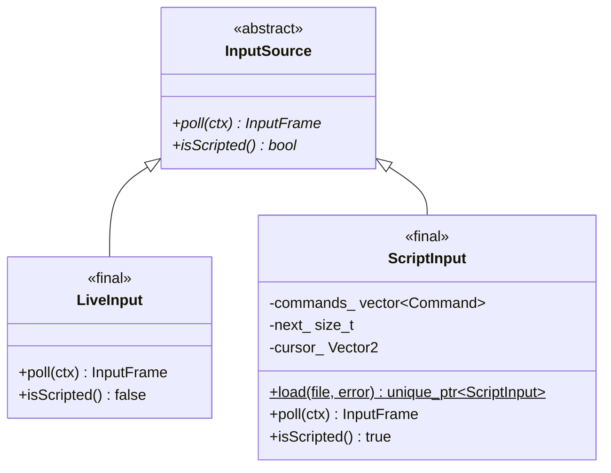

# input モジュール（`src/input/`）

## 1. 概要

マウス・キーボードの入力を、1 フレーム分のデータ（`InputFrame`）にします。入力の取得元は 2 つあり、どちらも同じ `InputFrame` を返すので、ゲームの側は区別しません。

| 取得元 | クラス | 使う時 |
|---|---|---|
| 実際のマウス・キーボード | `LiveInput` | 普段 |
| 入力スクリプト（テキストファイル） | `ScriptInput` | `--script <file>` を指定した時。自動での動作確認・スクリーンショット |

| ファイル | 内容 |
|---|---|
| [InputFrame.h](../../src/input/InputFrame.h) | `InputFrame`（1 フレーム分の入力） |
| [InputSource.h](../../src/input/InputSource.h) | `InputPollContext`、`InputSource`（基底クラス）、`LiveInput`、`ScriptInput` の宣言 |
| [LiveInput.cpp](../../src/input/LiveInput.cpp) | `LiveInput::poll` |
| [ScriptInput.cpp](../../src/input/ScriptInput.cpp) | 入力スクリプトの書式（ファイルの先頭のコメント）、`ScriptInput::load` と `poll` |

### 型の一覧と継承関係

| 型 | 種類 | 継承 |
|---|---|---|
| `InputFrame` | 構造体 | なし |
| `InputPollContext` | 構造体 | なし |
| `InputSource` | 抽象クラス | 基底 |
| `LiveInput` | クラス（`final`） | `InputSource` を継承 |
| `ScriptInput` | クラス（`final`） | `InputSource` を継承 |
| `ScriptInput::Kind` | 列挙型（private） | — |
| `ScriptInput::Command` | 構造体（private） | なし |

**このプログラムで継承を使っているのは、ここだけです。**

**背景**（根拠: `d771af6`「自動テスト（doctest）と入力スクリプトによる動作確認」、指示書「動作確認について」）: 手順 1 から、Claude が画面を見ずに動作を確かめられるよう、入力スクリプトで操作を再生し、スクリーンショットを保存する仕組みを作りました。ゲームの側が入力の取得元を区別しないよう、共通の基底クラスにしています。

---

## 2. `InputFrame`（構造体）

**役割**: 1 フレーム分の入力。

| メンバ | 型 | 説明 | ゲームの更新（`Match::update`）に渡るか |
|---|---|---|---|
| `cursorWorld` | `Vector2` | カーソルの**ワールド座標**（カメラで変換済み） | 渡る |
| `rightPressed` | `bool` | 右クリックした瞬間 | 渡る |
| `rightDown` | `bool` | 右クリックを押している間 | 渡る |
| `skillPressed` | `array<bool, 6>` | Q/W/E/R/D/F を押した瞬間 | 渡る |
| `escapePressed` | `bool` | Esc | `App` だけが使う |
| `toggleDebugPressed` | `bool` | F1 | `App` だけ |
| `reloadPressed` | `bool` | F5 | `App` だけ |
| `toggleFullscreenPressed` | `bool` | Alt + Enter | `App` だけ |
| `toggleCameraPressed` | `bool` | Y | `App` だけ |
| `centerCameraDown` | `bool` | Space を押している間 | `App` だけ（カメラ） |
| `screenshotRequest` | `optional<string>` | 入力スクリプトの `screenshot` | `App` だけ |
| `resetCooldownsRequested` | `bool` | 入力スクリプトの `resetcd` | `App` だけ |
| `exitRequested` | `bool` | 入力スクリプトの `exit` | `App` だけ |

### メンバ関数

| 関数 | 説明 |
|---|---|
| `void mergeNewer(const InputFrame& newer)` | 後から来た入力 `newer` をまとめる。**「押した瞬間」は OR で残し**、カーソルと「押している間」は `newer` にする |
| `void clearPressed()` | 「押した瞬間」の入力（`rightPressed`・`skillPressed`）を消す |

**背景**（根拠: InputFrame.h のコメント「ゲームの更新が走らなかったフレームの入力を取りこぼさないため」）: ゲームは 1/120 秒の固定刻みで進むので、描画が速い PC（144Hz など）では、ゲームを 1 回も進めないフレームがあります。そのフレームで押したキーを捨てないよう、`App::pendingInput_` にまとめておき、次にゲームを進めた時に渡します。逆に 1 フレームで 2 回以上進める時は、1 回目で「押した瞬間」を使ったら消します（`clearPressed`）。同じキーが 2 回押されたことにならないように。

**注意事項**: `mergeNewer` がまとめるのは、ゲームの更新に渡る項目だけです。Esc などは `App::handleGlobalKeys` が毎フレームすぐに処理します。

---

## 3. `InputPollContext`（構造体）

**役割**: 入力を取り出す時に、`App` から渡す情報。

| メンバ | 説明 |
|---|---|
| `camera` | `const Camera2D&`。カーソルの画面座標をワールド座標にするため |
| `simTime` | 入力スクリプトの時刻（`App::scriptClock_`）。入力スクリプトの命令の時刻と比べる |
| `uiWantsMouse` | マウスが UI（デバッグパネルなど）の上にある（Dear ImGui の `WantCaptureMouse`） |
| `uiWantsText` | UI で文字を入力中（Dear ImGui の `WantTextInput`） |

---

## 4. `InputSource`（抽象クラス）

| 関数 | 説明 |
|---|---|
| `virtual ~InputSource() = default` | `unique_ptr<InputSource>` で持つので、仮想デストラクタ |
| `virtual InputFrame poll(const InputPollContext& ctx) = 0` | 1 フレーム分の入力を取り出す。**毎フレーム 1 回**呼ぶ |
| `virtual bool isScripted() const = 0` | 入力スクリプトか。`true` なら、`App` は時間を 1/60 秒ずつ進め、実際のマウスを使わない（カーソルの閉じ込め・画面の端のカメラ）。リザルトの保存も `--results-dir` がある時だけにする |

---

## 5. `LiveInput`（クラス）

### `InputFrame poll(const InputPollContext& ctx) override`

raylib の関数で、今のマウスとキーボードを読みます。

| 入力 | 読み方 | 読まない時 |
|---|---|---|
| カーソル | `GetScreenToWorld2D(GetMousePosition(), camera)` | — |
| 右クリック | `IsMouseButtonPressed` / `IsMouseButtonDown` | **UI の上にカーソルがある時**（デバッグパネルを右クリックしてキャラが動かないように） |
| Q/W/E/R/D/F、Esc、F1、F5、Y、Space | `IsKeyPressed` / `IsKeyDown` | **UI で文字を入力中** |
| Alt + Enter | Enter を押した瞬間に、左右どちらかの Alt を押している | 同上 |

**注意事項**: UI の上にカーソルがあっても、スキルのキーは効きます（文字の入力中だけ止める）。

---

## 6. `ScriptInput`（クラス）

### 6.1 入力スクリプトの書式

1 行に 1 つの命令を書きます。`#` 以降はコメントです。時刻はプレイの開始からの秒数、座標はワールド座標です（自キャラは (0, 0) から始まる）。

| 命令 | 例 | 意味 |
|---|---|---|
| `move x y` | `0.5 move 600 0` | カーソルを (x, y) に置いて右クリック（移動） |
| `cast キー x y` | `1.0 cast Q 1200 0` | カーソルを (x, y) に置いてキーを押す |
| `cursor x y` | `1.0 cursor 300 300` | カーソルだけ動かす |
| `screenshot ファイル名` | `2.0 screenshot shot.png` | 画面を保存する（カレントディレクトリ） |
| `resetcd` | `2.5 resetcd` | 自キャラのクールダウンを 0 にする |
| `togglecamera` | `2.8 togglecamera` | Y キー |
| `escape` | `2.9 escape` | Esc キー（ポーズ / ポーズを解く） |
| `exit` | `3.0 exit` | 終了する |

例は [tests/scripts/](../../tests/scripts/) にあります（[30-tests.md](30-tests.md)）。

### 6.2 `ScriptInput::Kind`（列挙型）と `ScriptInput::Command`（構造体）

`Kind` は命令の種類（`Move`・`Cast`・`Cursor`・`Screenshot`・`ResetCooldowns`・`ToggleCamera`・`Escape`・`Exit`）です。`Command` は命令 1 つで、`time`（時刻）・`kind`・`slot`（`cast` のキー）・`point`（座標）・`text`（ファイル名）を持ちます。

### 6.3 メンバ変数

| 変数 | 説明 |
|---|---|
| `commands_` | 命令の一覧（時刻の順） |
| `next_` | 次に実行する命令の番号 |
| `cursor_` | 今のカーソルの位置（命令がない間も、最後に置いた位置を返す） |

### 6.4 メンバ関数

| 関数 | 説明 |
|---|---|
| `static unique_ptr<ScriptInput> load(const path& file, string& error)` | ファイルを読む。読めない行があれば「(ファイル名) の 3 行目を読めません: …」を `error` に入れて `nullptr`。空行・コメントだけの行は飛ばす。最後に命令を**時刻の順に並べ替える**（同じ時刻なら書いた順。`stable_sort`） |
| `InputFrame poll(const InputPollContext& ctx) override` | `ctx.simTime` までに時刻が来た命令をすべて実行し、1 フレーム分の入力にする |
| `bool isScripted() const override` | `true` |

**注意事項**:

- `move` は、そのフレームだけ `rightPressed` と `rightDown` を `true` にします。次のフレームは押していない扱いなので、右クリックの長押しはできません。
- 同じフレームに複数の `cast` があると、カーソルは**最後の命令の位置**になります。別々の位置に撃ちたい時は、時刻を 1/60 秒以上ずらしてください。
- 時刻はゲームの経過時間ではなく、**フレームの数 × 1/60 秒**です（`App::scriptClock_`）。ポーズ中も進みます。
- ファイルはテキストモードで開くので、改行は CRLF でも LF でもかまいません。
