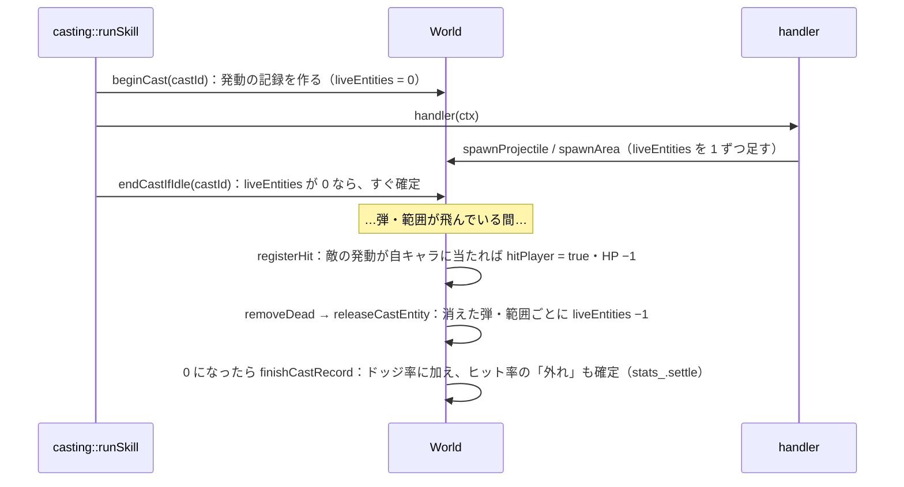
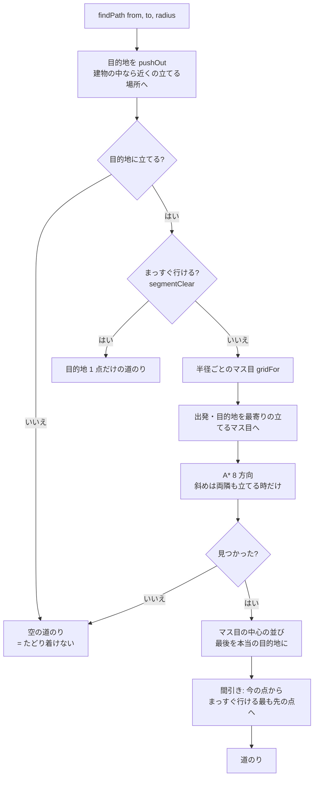

# game モジュール（1）: ゲームの世界

## 1. 概要

1 回のプレイの中身（キャラ・弾・範囲・設置物・演出・地形）と、それを 1 刻み進める処理です。中心は `World` クラスです。

| ファイル | 内容 |
|---|---|
| [World.h](../../src/game/World.h) / [.cpp](../../src/game/World.cpp) | `World`（中身をまとめて持ち、時間を進める）、`WorldRules` |
| [Unit.h](../../src/game/Unit.h) | `Unit`（キャラ 1 体）、`CastRequest`、`CastState`、`PropTargetKind` |
| [Entities.h](../../src/game/Entities.h) / [.cpp](../../src/game/Entities.cpp) | `Projectile`（弾）、`AreaEffect`（地面の範囲）、`Prop`（設置物）、`Vfx`（演出） |
| [StatusEffects.h](../../src/game/StatusEffects.h) / [.cpp](../../src/game/StatusEffects.cpp) | `StatusEffects`（状態異常と印） |
| [Terrain.h](../../src/game/Terrain.h) / [.cpp](../../src/game/Terrain.cpp) | `Terrain`（地形の当たり・押し出し・経路探索・ブッシュ） |

ヒット率・ドッジ率の集計（`CastStats`・`DodgeCount`）は [18-game-results.md](18-game-results.md)、スキルの発動の流れ（`casting::`）は [15-game-skills.md](15-game-skills.md) にあります。

### 型の一覧

すべて継承はありません。

| 型 | 種類 | 定義 |
|---|---|---|
| `WorldRules` | 構造体 | World.h |
| `World` | クラス | World.h |
| `World::CastRecord` | 構造体（private） | World.h |
| `PropTargetKind` | 列挙型 | Unit.h |
| `CastRequest`、`CastState`、`Unit` | 構造体 | Unit.h |
| `ProjectileVisual`、`AreaVisual`、`PropKind`、`VfxKind` | 列挙型 | Entities.h |
| `Projectile`、`AreaEffect`、`Prop`、`Vfx` | 構造体 | Entities.h |
| `StatusEffect` | 構造体 | StatusEffects.h |
| `StatusEffects` | クラス | StatusEffects.h |
| `Terrain` | クラス | Terrain.h |
| `Terrain::Grid` | 構造体（private） | Terrain.h |

### 設計の考え方

- **キャラはすべて同じ `Unit` 構造体**です。自キャラ・敵キャラ・ダミー・スキルショットの的の違いは、陣営（`team`）・キャラの設定の有無（`characterId`）・HP の有無（`maxHp`）だけです。誰が動かすか（プレイヤー・AI・ダミーの動き）は `World` の外（`Match` が持つ各コントローラー）が決め、`Unit` の `moveTarget` に書きます。
- **弾・範囲の「当たった時の処理」は `std::function` で持ちます**。弾の種類ごとにクラスを作らず、handler（スキルの処理）がラムダで処理を渡します。こうすると、新しいスキルを足しても `World` を変えずに済みます（推測）。
- **弾・範囲・設置物の追加は、刻みの区切りでまとめて行います**（`pending*`）。弾の `onHit` の中で新しい弾を出しても（ブランドの R の跳ね返りなど）、ループ中の配列が変わらないようにするためです（根拠: World.h のコメント「更新中に配列が変わらないように」）。

---

## 2. `World`（クラス）

**役割**: 1 回のプレイの中身をまとめて持ち、時間を進めます。`Match` が 1 つ持ちます。テストでは `World` だけを作って動かします。

**背景**（推測）: 手順 1 で練習場を作った時から、ゲームの中身の中心です。テストで画面を出さずに動かせるよう、描画や入力のことは知りません。

### 2.1 コンストラクタ

| 関数 | 説明 |
|---|---|
| `World(const GameData& data, Rectangle bounds)` | 障害物のないステージで作る（テストと、ステージのファイルが無い時用） |
| `World(const GameData& data, Terrain terrain)` | ステージの地形で作る |

`data` は参照を覚えるだけです。`World` より `GameData` が長く生きる必要があります（`App` が持つので問題ありません）。

### 2.2 `void update(float dt)`

ゲームを `dt` 秒進めます。固定の刻み（1/120 秒）で呼びます。

1. `time_ += dt`
2. すべてのキャラを進める（`updateUnit`）: 状態異常 → クールダウン → 被弾の光 → ブッシュから見える時間 → 詠唱（`casting::update`）→ 移動 → 障害物から押し出す
3. `flushSpawns`: 2 で出た弾・範囲・設置物を加える
4. `updateProjectiles`: 弾を進めて当てる
5. `updateAreas`: 範囲を進めて当てる
6. `updateProps`: 設置物の残り時間
7. `updateVfx`: 演出の残り時間
8. `flushSpawns`: 4〜6 で出た物を加える
9. `removeDead`: 消えた物を取り除き、発動の結果を確定する

**注意事項**: キャラの更新はキャラを加えた順です。上の 2 の中でスキルが出た場合、その弾は同じ刻みの 4 で 1 回目の移動をします。

### 2.3 追加・削除

| 関数 | 説明 |
|---|---|
| `EntityId addUnit(Unit unit)` | キャラを加え、通し番号を振って返す。**すぐに加わる** |
| `void removeUnit(EntityId id)` | キャラを取り除く（練習場のダミーを置き直す時用） |
| `EntityId spawnProjectile(Projectile p)` | 弾を加える（刻みの区切りで実際に加わる）。番号はすぐに振る。発動の記録に「まだ飛んでいる物」として 1 を足す |
| `EntityId spawnArea(AreaEffect a)` | 地面の範囲を加える（同上） |
| `EntityId spawnProp(Prop p)` | 設置物を加える（刻みの区切りで実際に加わる） |
| `void addVfx(Vfx vfx)` | 演出を加える（**すぐに加わる**。当たり判定が無いので、区切りを待たない） |
| `int newCastId()` | 新しい発動の番号（1 回の発動で出た弾・範囲をまとめて集計するため） |

**注意事項**:

- `units_` は `std::vector<Unit>` なので、`addUnit` / `removeUnit` の後は、それまでに得た `Unit*` や `Unit&` は使えません。弾の `onHit` などの中でキャラを足したり消したりしないでください。今はどの handler もしていません。
- `spawnProp` で加えた設置物は、同じ刻みの中では `props()` に見えません（`findProp` でも見つかりません）。

### 2.4 検索

| 関数 | 説明 |
|---|---|
| `Unit* findUnit(EntityId id)`（const 版もある） | 番号でキャラを探す。無ければ `nullptr` |
| `Prop* findProp(EntityId id)` | 番号で設置物を探す |
| `Unit* player()`（const 版もある） | 自キャラ（陣営が `Player` の最初のキャラ） |
| `const CharacterDef* characterOf(const Unit& unit) const` | キャラの設定。**毎回 id で `GameData` を引く**ので、設定ファイルを読み直した後も正しい内容を返す。ダミー・的は `nullptr` |
| `Unit* enemyAt(Vector2 point, Team myTeam, float tolerance)` | `point` の位置にいる敵（当たり判定の縁から `tolerance` まで広げて探す）。最も近いもの。**`myTeam` から見えない敵は選ばない** |
| `Unit* nearestEnemy(Vector2 from, Team myTeam, float maxDistance, string_view preferMark = {})` | `maxDistance` 以内で最も近い敵。`preferMark` の印が付いた敵がいれば、距離に関係なくそちらを先に選ぶ。見えない敵は選ばない（エズリアルの E の追尾弾） |
| `vector<Unit*> enemiesInCircle(Vector2 center, float radius, Team myTeam)` | 円にかかっている敵。**範囲の命中判定用なので、見えない敵も含む** |

### 2.5 ブッシュと見え方

| 関数 | 説明 |
|---|---|
| `bool canSee(Team observer, const Unit& target) const` | `observer` の陣営から `target` が見えるか。同じ陣営・見える時間（`revealTime`）が残っている・ブッシュの外なら見える。ブッシュの中なら、同じブッシュに `observer` の陣営のキャラがいる時だけ見える |
| `void revealFromBush(Unit& unit)` | ブッシュの中で対象指定のスキルを使った時に呼ぶ。`bushRevealTime` 秒だけ外から見えるようにする。ブッシュの外なら何もしない |

**背景**（根拠: 指示書「ステージ」、`8c72709`）: 「ブッシュの中のキャラは外から見えない。同じブッシュの中にいれば見える。ブッシュの中で対象指定のスキルを使った時だけ 3 秒ほど外から見える」という仕様です。弾・範囲はブッシュの中のキャラにも当たります（見えないだけ）。

### 2.6 命中と発動の記録

| 関数 | 説明 |
|---|---|
| `void registerHit(int castId, SkillSlot slot, string_view label, Unit& target)` | スキルが当たった時の共通処理。ヒット率に記録（`stats_.recordHit`）、被弾の光、ログ、命中の観察（テスト用）。**敵の発動が自キャラに当たったら**、その発動で 1 回目なら HP を 1 減らす |
| `void setHitObserver(HitObserver observer)` | 命中のたびに呼ばれる関数を登録する（テストで命中を数える時用） |
| `void beginCast(int castId, Team team, SkillSlot slot)` | 発動の記録を始める（`casting::runSkill` が handler の前に呼ぶ） |
| `void endCastIfIdle(int castId)` | 弾も範囲も出さなかった発動（ワープなど）は、ここで記録を閉じる（`runSkill` が handler の後に呼ぶ） |

#### 発動の記録（`CastRecord`）の仕組み

ドッジ率は「敵の 1 回の発動で出た弾・範囲が**すべて消えた**時点で、1 つでも自キャラに当たっていれば被弾、当たっていなければ回避」と数えます（根拠: 指示書「ドッジ率は、敵の 1 回の発動で出た弾や範囲がすべて消えた時点で回避／被弾を確定する」）。

- 弾が当たって次の弾を出す（ブランドの R の跳ね返り）場合、次の弾は前の弾が消える前に加わるので、`liveEntities` が 0 にならず、すべての跳ね返りが終わるまで確定しません。
- 制限時間が来た時に飛んでいる途中の発動は、確定していないので数えません。

### 2.7 その他

| 関数 | 説明 |
|---|---|
| `Vector2 clampToBounds(Vector2 point, float radius) const` | 点をステージの内側（半径 `radius` の円がはみ出さない位置）に収める。障害物は考えない |
| `Vector2 placeable(Vector2 point, float radius) const` | 点の近くで、キャラが立てる位置（`Terrain::pushOut`）。ワープ先・キャラの初期位置に使う |
| `void refreshUnitsFromData()` | 設定ファイルを読み直した後に、キャラの大きさ・移動速度・色・名前を反映する（ダミー・的は対象外） |
| `void setCooldownScale(Team team, float scale)` / `float cooldownScale(Team) const` / `float cooldownScaleFor(const Unit&) const` | 陣営ごとのクールダウンの倍率。0 ならクールダウンなし。負の値は 0 にする |
| `void setRules(const WorldRules&)` / `const WorldRules& rules() const` | モードごとのルール |

### 2.8 参照用のアクセサ

`data()`・`settings()`・`bounds()`・`terrain()`・`time()`（始めてからの秒）・`stats()`（ヒット率）・`dodge()`（ドッジ率）・`units()`・`props()`・`projectiles()`・`areas()`・`vfx()`。描画・HUD・AI・テストが使います。`units()` と `props()` は書き換えられる版もあります（スキルの処理が使う）。

### 2.9 非公開のメンバ関数

| 関数 | 説明 |
|---|---|
| `void updateUnit(Unit& unit, float dt)` | キャラ 1 体を進める。**硬直のある詠唱中**（`cast.active && cast.locksMovement`）と、拘束などで動けない間は移動しない（目的地は覚えておき、動けるようになったら再開する）。最後に、ワープなどで障害物にかかっていたら押し出す |
| `void moveAlongPath(Unit& unit, float dt)` | 目的地へ、壁を回り込む道のり（`path`）に沿って進む。目的地が変わった・道のりが無い・次の点へまっすぐ行けなくなった時は、道のりを作り直す。たどり着けなければ移動をやめる。1 刻みで進める距離を使い切るまで、点を順にたどる |
| `void updateProjectiles(float dt)` | 弾を進める。追尾弾は `updateHomingProjectile`。まっすぐの弾は、この刻みの通り道にかかった敵を**進む向きに近い順**に並べて当てる（関数の中の構造体 `Candidate` に、敵と「進む向きに沿った距離」を入れて並べる）。**貫通しない弾は最初の 1 体で止まる**（当たった位置まで戻して消す）。射程の端まで飛んだら `expireProjectile` |
| `void updateHomingProjectile(Projectile& p, float dt)` | 追尾弾を対象へ向けて進める。届けば当てて消える。対象がいなくなったら消える |
| `void hitWithProjectile(Projectile& p, Unit& target)` | 当たった相手を記録し、違う陣営なら `registerHit`、そして弾の `onHit`。**同じ陣営（自分自身）への到達は命中に数えない**（ブランドの R が自分に跳ね返る時） |
| `void expireProjectile(Projectile& p)` | 弾の `onExpire` を呼んで消す |
| `void updateAreas(float dt)` | 範囲を進める。`delay` 秒たったら発動（`onActivate`）。`duration` が 0 なら、発動の瞬間だけ範囲の敵に当てて消える。0 より大きければ、その間ずっと残り、**初めて入った敵に `onUnitHit`、中にいる敵に毎刻み `whileInside`** |
| `void hitWithArea(AreaEffect& a, Unit& target)` | 当たった相手を記録し、`registerHit` と `onUnitHit` |
| `void updateProps(float dt)` | 設置物の隠れている時間と残り時間を減らし、時間切れなら消す |
| `void updateVfx(float dt)` | 演出の残り時間を減らす |
| `void flushSpawns()` | `pending*` の弾・範囲・設置物を本体の配列へ移す |
| `void removeDead()` | 消えた弾・範囲は `releaseCastEntity` してから取り除く。設置物・演出も取り除く |
| `void releaseCastEntity(int castId)` | 発動で出た物が 1 つ消えた。0 になったら `finishCastRecord` |
| `void finishCastRecord(int castId)` | 発動の結果を確定する。ヒット率の「外れ」を確定（`stats_.settle`）し、敵の発動ならドッジ率に加える |
| `void damagePlayer(Unit& player)` | 自キャラの HP を 1 減らす。0 になったらダウン数を増やして全回復（演出「ダウン!」）。`maxHp` が 0（HP を使わないモード）なら何もしない |

### 2.10 メンバ変数

| 変数 | 説明 |
|---|---|
| `data_` | `const GameData*` |
| `terrain_` | 地形 |
| `time_` | 始めてからの秒 |
| `playerCooldownScale_` / `enemyCooldownScale_` | 陣営ごとのクールダウンの倍率（初期値 1） |
| `rules_` | モードごとのルール |
| `lastEntityId_` | 最後に振った通し番号 |
| `lastCastId_` | 最後に振った発動の番号 |
| `stats_` | 自キャラのヒット率（`CastStats`） |
| `dodge_` | ドッジ率（`DodgeCount`） |
| `casts_` | `unordered_map<int, CastRecord>`。結果が確定していない発動 |
| `hitObserver_` | 命中の観察（テスト用） |
| `units_` / `projectiles_` / `areas_` / `props_` / `vfx_` | 中身 |
| `pendingProjectiles_` / `pendingAreas_` / `pendingProps_` | 刻みの区切りで加える物 |

### 2.11 `World::CastRecord`（構造体）

| メンバ | 説明 |
|---|---|
| `team` | 発動したキャラの陣営 |
| `slot` | キー |
| `liveEntities` | まだ残っている弾・範囲の数 |
| `hitPlayer` | 自キャラに当たったか（敵の発動の時だけ意味がある） |

---

## 3. `WorldRules`（構造体）

| メンバ | 説明 |
|---|---|
| `movementSkillsOnly` | 自キャラは移動系のスキル（`movementSkill: true`）だけ使える |

**背景**（根拠: `712d7d8`、`f533230`）: 手順 2 では、スキルドッジで自キャラが移動系のスキルだけ使えるルールでした。その後、エマの R のように他のスキルで置いた物へワープするスキルも回避に使えるため、すべてのスキルを使えるように変えました。**仕組みは残してあり、今はどのモードでも使っていません**（テスト「「移動系だけ使える」ルールを有効にすると…」で動作は確かめています）。

---

## 4. Unit.h

### 4.1 `PropTargetKind`（列挙型）

設置物などを指定するスキル（エマの R）の対象の種類です。`None`・`Dove`（鳩）・`Hat`（帽子）・`Rabbit`（兎にした敵）。`toString` は設定ファイル（params の `targetKinds`）での表記（`"dove"` / `"hat"` / `"rabbit"`）を返します。

### 4.2 `CastRequest`（構造体）: スキル発動の依頼

キーを押した瞬間の情報です。対象指定のスキルでは、発動の流れが対象を選んで書き足します。

| メンバ | 説明 |
|---|---|
| `slot` | 押したキー |
| `cursor` | キーを押した時のカーソル位置（ワールド座標） |
| `targetUnit` | 対象指定のスキルの対象（兎になった敵もここ） |
| `propKind` / `propId` | 鳩・帽子を対象にする場合の種類と番号 |
| `doveCardOrigin` | エマの Q の溜めの間に R で鳩と入れ替わった時の、鳩の元の位置（鳩のカードは入れ替わる前の位置から出る。根拠: `e05707e`） |

### 4.3 `CastState`（構造体）: 詠唱中の状態

| メンバ | 説明 |
|---|---|
| `active` | 詠唱中か |
| `request` | 詠唱しているスキルの依頼 |
| `remaining` / `total` | 詠唱の残り時間と、詠唱時間 |
| `locksMovement` | 硬直（詠唱中は移動できない）。スキルの `lockMovement` |

### 4.4 `Unit`（構造体）: キャラ 1 体

| メンバ | 説明 |
|---|---|
| `id` | 通し番号（`addUnit` が振る） |
| `team` | 陣営 |
| `name` | 名前（ログ・画面） |
| `characterId` | キャラの設定の id。**ダミーと的は空** |
| `pos` | 位置 |
| `facing` | 向いている方向（長さ 1） |
| `radius` | 当たり判定の半径 |
| `baseMoveSpeed` | キャラの移動速度 |
| `color` | 体の色 |
| `moveTarget` | 目的地（右クリック・AI・ダミーの動きが書く）。着いたら空になる |
| `path` | 目的地までの道のり（壁を回り込む点の並び）。`World` が `moveTarget` から作る |
| `pathGoal` | `path` を作った時の `moveTarget`（変わったら作り直す） |
| `revealTime` | ブッシュの中でも外から見える残り時間 |
| `status` | 状態異常と印 |
| `cast` | 詠唱中の状態 |
| `pendingCast` | 射程外の対象へ近づいている途中のスキル |
| `bufferedCast` | 詠唱中に押されたスキル（詠唱が終わったら発動する。1 つだけ覚える） |
| `cooldowns` | 各キーのクールダウンの残り時間 |
| `hp` / `maxHp` | HP ゲージ（スキルドッジの自キャラ）。`maxHp` が 0 なら HP を使わない |
| `deaths` | HP が 0 になって全回復した回数（ダウン数） |
| `hitFlash` | 被弾した時の光る演出の残り時間 |
| `alive` | 生きているか。**今のゲームでは常に `true`**（誰も倒されない）。`false` のキャラは対象・当たり判定から外れる |
| `float moveSpeed() const` | 今の移動速度（`baseMoveSpeed` × スロウなどの倍率） |

**背景**（根拠: 指示書「被弾時の扱い」「HP が 0 になった後の無敵時間は無い。敵はダメージを受けない（倒せない）」）: HP は 5 段階で、5 回当たるとダウン数が 1 増えて全回復します。敵には HP がありません。

---

## 5. Entities.h / .cpp

### 5.1 `Projectile`（構造体）: 弾

まっすぐ飛ぶ弾と、対象を追尾する弾（`homingTarget` がある）の 2 種類です。

| メンバ | 説明 |
|---|---|
| `id` / `owner` / `team` | 番号・撃ったキャラ・陣営 |
| `castId` / `slot` / `label` | 発動の番号・キー・ログと表示の名前 |
| `pos` / `dir` | 位置と進む向き |
| `speed` | 弾速 |
| `radius` | 当たり判定の半径（幅の半分） |
| `maxDistance` / `traveled` | 飛ぶ距離と、飛んだ距離 |
| `age` | 出てからの時間（的の AI が「気づいたか」に使う） |
| `pierce` | `true` なら当たっても消えずに進む（**地形は常に貫通する**） |
| `homingTarget` | 追尾する対象（0 ならまっすぐ） |
| `visual` / `color` | 見た目の種類と色 |
| `drawOffsetForward` / `drawOffsetSide` | 見た目だけずらして描く量（当たり判定は `pos` のまま）。根拠: `b6c346c`（エマの 2 枚のカードが重なって 1 枚に見えないように） |
| `hitUnits` | 既に当たった相手（同じ相手には 1 回だけ当たる） |
| `onHit` | `function<void(World&, Projectile&, Unit&)>`。当たった時 |
| `onExpire` | `function<void(World&, Projectile&)>`。射程の端まで飛んだ時（今はどの handler も使っていない） |
| `alive` | 消えていないか |
| `bool hasHit(EntityId unit) const` | その相手に既に当たったか |

### 5.2 `AreaEffect`（構造体）: 地面の範囲

`delay` 秒後に発動します。`duration` が 0 なら発動の瞬間だけ判定し、0 より大きければその間ずっと残ります。

| メンバ | 説明 |
|---|---|
| `id` / `owner` / `team` / `castId` / `slot` / `label` | 弾と同じ |
| `origin` | 投げた位置（飛んでいく演出用） |
| `center` / `radius` | 範囲 |
| `delay` / `duration` / `elapsed` | 発動までの時間・残る時間・経過時間 |
| `activated` | 発動したか |
| `visual` / `color` | 見た目 |
| `hitUnits` | 当たった相手（残る範囲では「一度でも入った相手」） |
| `onActivate` | 発動した瞬間に 1 回（エマの W の帽子を置く） |
| `onUnitHit` | 相手ごとに 1 回 |
| `whileInside` | 残る範囲で、中にいる間ずっと（エマの D のスロウ） |
| `alive` | 消えていないか |
| `bool hasHit(EntityId unit) const` | その相手に既に当たったか |

### 5.3 `Prop`（構造体）: 設置物

エマの鳩・帽子です。エマの R の対象になります。

| メンバ | 説明 |
|---|---|
| `id` / `owner` | 番号・置いたキャラ |
| `kind` | `PropKind::Dove`（鳩）か `Hat`（帽子） |
| `pos` | 位置 |
| `lifetime` / `remaining` | 持続時間と残り時間 |
| `hiddenTime` | 0 より大きい間は描かず、対象にもできない（R で飛んで移動している最中） |
| `alive` | 消えていないか |

### 5.4 `Vfx`（構造体）: 演出

当たり判定は無く、残り時間が 0 になったら消えます。

| メンバ | 説明 |
|---|---|
| `kind` | `VfxKind`: `Burst`（光る円）・`Ring`（広がる輪）・`Teleport`（ワープ）・`ClickMarker`（右クリックの地点）・`Text`（文字） |
| `pos` / `pos2` | 位置（`Teleport` は移動前と移動後） |
| `radius` / `color` / `text` | 大きさ・色・文字 |
| `duration` / `remaining` | 長さと残り時間 |

`Text` の演出だけは、日本語を出すため HUD（Dear ImGui）が描きます。他は `Renderer` が描きます。

### 5.5 見た目の列挙型と関数

| 名前 | 説明 |
|---|---|
| `ProjectileVisual` | `Orb`（球）・`Ring`（輪）・`Crescent`（半月）・`Card`・`Beam`（光線）・`Bolt`（小さな弾）・`Dove`（鳩）。当たり判定はどれも同じ |
| `ProjectileVisual projectileVisualFromString(string_view)` | `"orb"` などを見た目にする（.cpp の中だけの表 `kProjectileVisuals` を引く）。知らない表記なら警告ログを出して `Orb`（ゲームでは、知らない表記は読み込みの時点でエラーになるので、普通は起きない） |
| `vector<string_view> projectileVisualNames()` | 弾の見た目の表記の一覧（params の `visual` の決まりに使う） |
| `AreaVisual` | `Explosion`（輪だけ）・`Telegraph`（予告円が少しずつ埋まる）・`ThrownHat`（帽子が飛ぶ）・`Caltrops`（鉄菱が飛んで残る） |
| `AreaVisual areaVisualFromString(string_view)` | `"explosion"` / `"telegraph"` / `"hat"` / `"caltrops"` を見た目にする（表 `kAreaVisuals` を引く）。知らない表記なら警告ログを出して `Explosion` |
| `vector<string_view> areaVisualNames()` | 範囲の見た目の表記の一覧（params の `visual` の決まりに使う） |
| `string_view displayName(PropKind)` | 「鳩」/「帽子」（ログ用） |
| `makeBurstVfx(pos, radius, color, duration = 0.35)` | 範囲が発動した時の、光って消える円 |
| `makeRingVfx(pos, radius, color, duration = 0.4)` | 広がりながら消える輪（命中・ダウン） |
| `makeTeleportVfx(from, to, color)` | ワープ（移動前と移動後の輪と、その間の線） |
| `makeClickMarkerVfx(pos)` | 右クリックした地点の、縮んで消える輪 |
| `makeTextVfx(pos, text, color)` | 少しずつ上へ浮かんで消える文字（「起爆!」「ダウン!」「スロウ」など） |

---

## 6. StatusEffects.h / .cpp

### 6.1 `StatusEffect`（構造体）

かかっている効果 1 つです。`type`・`remaining`（残り時間）・`duration`（付けた時の長さ）・`amount`（強さ）・`tag`（印の名前）・`source`（付けたキャラ）。

### 6.2 `StatusEffects`（クラス）

**役割**: キャラにかかっている状態異常と印の一覧。「移動できるか」「スキルを使えるか」「移動速度の倍率」を答えます。

| 関数 | 説明 |
|---|---|
| `void apply(const EffectSpec& spec, EntityId source)` | 効果を付ける。同じ種類（印は同じ `tag`）が既にあれば、**残り時間と強さの大きい方**に更新する（重ねがけしない） |
| `void update(float dt)` | 残り時間を減らし、時間切れの効果を消す |
| `void clear()` | すべて消す |
| `bool has(EffectType) const` | その種類がかかっているか |
| `float remaining(EffectType) const` | 残り時間（最も長いもの）。無ければ 0 |
| `bool hasMark(string_view tag) const` | その印が付いているか |
| `bool consumeMark(string_view tag)` | 印を消費する（起爆した時）。印が無ければ `false` |
| `bool canMove() const` | 移動できるか |
| `bool canCast() const` | スキルを使えるか |
| `bool isAirborne() const` | 打ち上げられているか（描く時に浮かせる） |
| `float moveSpeedMultiplier() const` | 移動速度の倍率。スロウと変身の `amount` のうち**最も強いものだけ**が効く（LoL と同じ。根拠: StatusEffects.h のコメント） |
| `const vector<StatusEffect>& list() const` | すべての効果（HUD の表示用） |

#### 効果ごとにできなくなること

| 効果 | 移動 | スキル | 移動速度 |
|---|---|---|---|
| スロウ | できる | できる | `1 − amount` |
| 拘束 | **できない** | できる | — |
| スタン | **できない** | **できない** | — |
| 打ち上げ | **できない** | **できない** | — |
| 変身 | できる | **できない** | `1 − amount` |
| 印 | できる | できる | 変わらない |

**注意事項**: 詠唱中にスタンなどでスキルを使えなくなると、詠唱は中断されます（`casting::update` → `cancelCast`）。

**背景**（根拠: 指示書「自キャラのスキルによる状態異常（変身・拘束・打ち上げなど）は、敵にもかかる。変身中や打ち上げ中の敵はスキルを撃てない」）: 敵にも自キャラにも同じ仕組みでかかります。

---

## 7. Terrain.h / .cpp

**役割**: ステージの地形（障害物・ブッシュ）。当たりと押し出し、経路探索、ブッシュの判定を行います。

**背景**（根拠: `8c72709`、指示書「ステージ」）: 手順 3 で、路地裏と森のステージのために作りました。

- 壁・建物・木などは**移動だけ**を妨げ、弾や範囲は止めない
- 障害物の向こうを右クリックすると、回り込む道を自動で探して進む（敵も同じ）
- 建物の中など立てない場所を指定したら、その近くの立てる場所まで進む
- 重なり合うブッシュは 1 つのブッシュとして扱う

### 7.1 経路探索の方法

ステージを 40 × 40（`kCellSize`）のマス目に分け、**キャラの半径ごとに「立てるマス目」の表を作って使い回します**（初めて使う時に作る）。その上で 8 方向の A* で道を探し、得られたマス目の並びを「まっすぐ進めるところはまっすぐ進む」ように間引きます。

### 7.2 メンバ関数

| 関数 | 説明 |
|---|---|
| `Terrain()` | 範囲が空の地形（使う前に、範囲を決めたものを代入する） |
| `explicit Terrain(Rectangle bounds)` | 障害物のない地形 |
| `explicit Terrain(const StageDef& stage)` | ステージの設定から作る（重なり合うブッシュをまとめる） |
| `Rectangle bounds() const` | ステージの範囲 |
| `const vector<Obstacle>& obstacles() const` / `const vector<Shape>& bushes() const` | 描画用 |
| `bool blocked(Vector2 pos, float radius) const` | 円が障害物かステージの外にかかるか。**触れているだけ（0.5 以内）ならかかっていない**とする |
| `Vector2 pushOut(Vector2 pos, float radius) const` | 障害物とステージの外から押し出した位置。障害物が並んでいて押し出した先が別の障害物にかかることがあるので、最大 8 回繰り返す。それでも出られなければ、最も近い立てるマス目の中心 |
| `bool segmentClear(Vector2 a, Vector2 b, float radius) const` | 円が `a` から `b` へまっすぐ進む間に、障害物にかからないか（半径の半分（4〜20）ごとに点を取って `blocked` を調べる） |
| `vector<Vector2> findPath(Vector2 from, Vector2 to, float radius) const` | 道のり（通る点の並び。最後が目的地）。たどり着けなければ空 |
| `int bushAt(Vector2 pos) const` | `pos` を含むブッシュの番号（重なり合うブッシュは同じ番号）。外なら −1 |
| `const Grid& gridFor(float radius) const`（private） | 半径（切り上げた整数）ごとの立てるマス目。初めて使う時に作り、`grids_` に覚える |
| `Vector2 cellCenter(int col, int row) const`（private） | マス目の中心の座標 |
| `void cellOf(Vector2 pos, int& col, int& row) const`（private） | 座標を含むマス目の番号 |
| `bool nearestFreeCell(const Grid&, int col, int row, int& outCol, int& outRow) const`（private） | 近い順に（四角い輪を広げながら）探して、最初に見つかった立てるマス目 |
| `void groupBushes()`（private） | 重なり合うブッシュに同じ番号を振る（素集合データ構造） |

### 7.3 `Terrain::Grid`（構造体）

`cols` × `rows` のマス目と、立てるかどうかの表（`free`。1 なら立てる）。`bool isFree(int col, int row) const` は範囲の外なら `false`。

### 7.4 .cpp の中だけの関数

| 関数 | 説明 |
|---|---|
| `closestPointInRect` | 長方形の中で、点に最も近い点 |
| `pointInShape` | 点が形の中（縁を含む）にあるか |
| `circleOverlapsShape` | 円が形に**めり込んでいるか**（触れているだけなら `false`） |
| `pushOutOfShape` | 円を形に触れるだけの位置まで押し出す（最も近い外側へ）。中心が長方形の中なら最も近い辺の外へ |
| `shapesOverlap` | 2 つの形が重なっているか（ブッシュをまとめる判断） |

### 7.5 注意事項

- `grids_` は `mutable` で、`const` の関数の中で作ります。複数のスレッドから同時に使うことは想定していません。
- マス目の表は半径ごとに作るので、半径の種類が多いと（ダミーのプリセットでいろいろな大きさを使うなど）メモリと最初の 1 回の時間が増えます。1 つの表は、5000 × 3200 のステージで 125 × 80 = 1 万マスです。
- 「触れているだけならかかっていない」という余裕（`kTouchTolerance = 0.5`）が無いと、壁に沿って歩く時に、押し出された位置がまた「かかっている」と判定されて動けなくなります（推測）。
