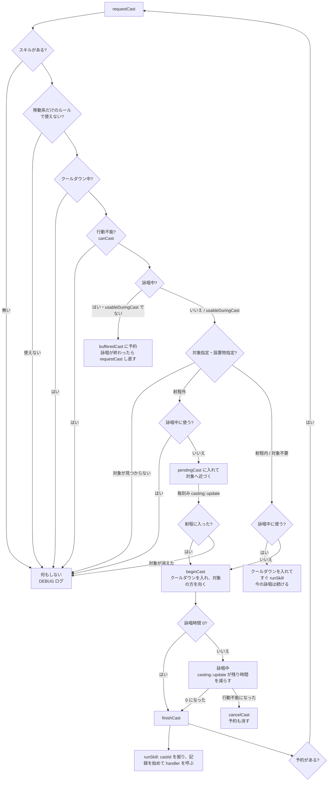

# game モジュール（2）: スキルの発動と処理

## 1. 概要

キーを押してからスキルが出るまでの流れ（`moba::casting`）と、出たスキルが何をするか（`moba::skills` の handler）です。

| ファイル | 名前空間 | 内容 |
|---|---|---|
| [game/SkillCasting.h](../../src/game/SkillCasting.h) / [.cpp](../../src/game/SkillCasting.cpp) | `moba::casting` | 発動の流れ（クールダウン・行動不能・対象・射程・詠唱・予約・接近） |
| [game/skills/Skill.h](../../src/game/skills/Skill.h) | `moba::skills` | handler の形（`SkillContext`・`SkillHandler`）、すべての handler と共通の部品の宣言 |
| [game/skills/SkillRegistry.cpp](../../src/game/skills/SkillRegistry.cpp) | `moba::skills` | 設定ファイルの `"handler"` の名前と、処理・params の決まりの対応表 |
| [game/skills/SkillParams.h](../../src/game/skills/SkillParams.h) / [.cpp](../../src/game/skills/SkillParams.cpp) | `moba::skills` | params の決まり（`ParamRule`）の形と、読み込む時のチェック（`checkSkillParams`） |
| [game/skills/SkillHelpers.cpp](../../src/game/skills/SkillHelpers.cpp) | `moba::skills` | 共通の部品（弾・範囲の作り方、効果の付け方、ワープ、クールダウンの短縮） |
| [game/skills/CommonSkills.cpp](../../src/game/skills/CommonSkills.cpp) | `moba::skills` | 複数のキャラで使い回せる汎用のスキル |
| [game/skills/EzrealSkills.cpp](../../src/game/skills/EzrealSkills.cpp) | `moba::skills` | like ezreal 固有（E） |
| [game/skills/EmmaSkills.cpp](../../src/game/skills/EmmaSkills.cpp) | `moba::skills` | like emma 固有（Q・W・R） |
| [game/skills/BrandSkills.cpp](../../src/game/skills/BrandSkills.cpp) | `moba::skills` | like brand 固有（R） |

### 型の一覧

すべて継承はありません。

| 型 | 種類 | 定義 |
|---|---|---|
| `casting::CastOutcome` | 列挙型 | SkillCasting.h |
| `skills::SkillContext` | 構造体 | Skill.h |
| `skills::SkillHandler` | 関数ポインタの型（`void (*)(SkillContext&)`） | Skill.h |
| `skills::ParamKind` | 列挙型 | SkillParams.h |
| `skills::ParamRule` | 構造体 | SkillParams.h |
| `skills::ParamRules` | 型の別名（`std::vector<ParamRule>`） | SkillParams.h |
| `HandlerEntry` | 構造体（SkillRegistry.cpp の中だけ） | SkillRegistry.cpp |
| `BounceParams`・`BounceState` | 構造体（BrandSkills.cpp の中だけ） | BrandSkills.cpp |

### キャラのスキルと handler の対応（コミット `0498fab` の時点の設定ファイル）

| キャラ | キー | スキル | handler | 対象の取り方 | ヒット率に数える |
|---|---|---|---|---|---|
| like emma | Q | カード | `emma_q` | 方向 | ○ |
| | W | 帽子 | `emma_w` | 地点（硬直なし） | ○ |
| | E | マジックビーム | `homing_projectile` | 対象 | |
| | R | マジックショー | `emma_r` | 設置物 | |
| | D | 鉄菱 | `ground_zone` | 地点 | ○ |
| like ezreal | Q | Mystic Shot | `projectile` | 方向 | ○ |
| | W | Essence Flux | `projectile` | 方向 | ○ |
| | E | Arcane Shift | `ezreal_e` | 方向 | |
| | R | Trueshot Barrage | `projectile`（貫通） | 方向 | ○ |
| | D | Flash | `blink` | 方向 | |
| like brand | Q | Sear | `projectile` | 方向 | ○ |
| | W | Pillar of Flame | `ground_blast` | 地点 | ○ |
| | E | Conflagration | `targeted_blast` | 対象 | |
| | R | Pyroclasm | `brand_r` | 対象 | |
| | D | Flash | `blink` | 方向 | |

各スキルの仕様は [character_traits.txt](../../character_traits.txt)、params の一覧は [data-files.md の 8 章](../data-files.md#8-handler-ごとの-params-一覧) にあります。

---

## 2. 発動の流れ（`moba::casting`）

### 2.1 全体の流れ



**背景**（根拠: `d771af6`「quick cast、詠唱・先行入力・射程外の対象への接近」、`6700cb2`「usableDuringCast」）: LoL やエターナルリターンの操作感（キーを押した瞬間に撃つ・詠唱中に押したスキルは詠唱後に出る・射程外の対象には近づいてから使う）を再現するための流れです。

### 2.2 公開関数（SkillCasting.h）

| 関数 | 説明 |
|---|---|
| `void orderMove(World& world, Unit& unit, Vector2 destination)` | 右クリックの移動命令。目的地をステージの内側に収めて `moveTarget` にする。射程外の対象への接近（`pendingCast`）はやめる。詠唱中に呼んでも、硬直が終わってから動き出す（移動は `World::updateUnit` が止めているだけなので） |
| `CastOutcome requestCast(World& world, Unit& caster, const CastRequest& request)` | スキルの発動を依頼する（上の図）。使えなければ DEBUG のログを出して何もしない。**自キャラも敵 AI も、この関数でスキルを使う**。戻り値はどうなったか（下の表）。敵 AI は `Rejected` かどうかで「撃てたか」を判断する。自キャラの操作・予約の発動・テストは戻り値を使わない |
| `void update(World& world, Unit& caster, float dt)` | 詠唱の進行と、射程外の対象への接近。`World::updateUnit` から毎刻み呼ばれる |
| `void cancelCast(World& world, Unit& caster, string_view reason)` | 詠唱を中断する。予約していたスキルも取り消す。**クールダウンは戻さない** |

#### `CastOutcome`（列挙型）: `requestCast` の結果

| 値 | 意味 | 上の図の行き先 |
|---|---|---|
| `Fired` | すぐに発動した（詠唱時間 0 のスキル・詠唱中でもすぐ使えるスキル） | `finishCast`（詠唱時間 0）・`runSkill`（詠唱中に使う） |
| `CastStarted` | 詠唱を始めた（詠唱が終わったら発動する） | 詠唱中 |
| `Buffered` | 詠唱中なので、今の詠唱が終わった後に使うよう予約した | `bufferedCast` |
| `Approaching` | 射程外の対象へ近づき始めた（射程に入ったら詠唱を始める） | `pendingCast` |
| `Rejected` | 使えなかった（スキルが無い・移動系だけのルール・クールダウン中・行動不能・対象がいない・詠唱中に射程外の対象を指定した） | 何もしない |

**背景**（根拠: 報告ファイルの B1、2026-10-30 の修正）: 以前は戻り値が無く、敵 AI は「詠唱中になったか・クールダウンが入ったか」で撃てたかを推測していました。詠唱時間 0・クールダウン 0 のスキルでは、撃てても「撃てなかった」と判断され、毎刻み撃ち続ける不具合があったため、結果を返すようにしました。

### 2.3 SkillCasting.cpp の中だけの関数

| 関数 | 説明 |
|---|---|
| `const SkillDef* skillOf(const World&, const Unit& caster, SkillSlot)` | キャラのそのキーのスキル（毎回 id で引く） |
| `bool needsTarget(Targeting)` | 対象指定（`Unit`）か設置物指定（`Prop`）か |
| `optional<Vector2> targetPosition(World&, const CastRequest&)` | 対象（敵・設置物）の今の位置。消えていれば `nullopt` |
| `bool resolvePropTarget(World&, const Unit& caster, const SkillDef&, CastRequest& request)` | 設置物指定のスキル（エマの R）の対象を、カーソルに最も近いものから選ぶ。選べるのは params の `targetKinds` の種類で、カーソルから `pickRadius`（既定 150）以内のもの。鳩・帽子は自分が置いた・隠れていないもの、兎は**見えている**変身中の敵 |
| `void runSkill(World&, Unit& caster, const SkillDef&, const CastRequest&)` | handler を実行する。発動の番号を振り、`World::beginCast`、ヒット率の対象なら `CastStats::recordCast`（**自キャラだけ**）、対象指定のスキルならブッシュから見えるようにする（`revealFromBush`）、handler を呼ぶ、`endCastIfIdle` |
| `bool usableDuringCurrentCast(const World&, const Unit& caster, const SkillDef& requested)` | 今の詠唱を中断せずにすぐ使えるスキルか。条件: 詠唱中・使いたいスキルの詠唱時間が 0・今詠唱しているスキルの `usableDuringCast` にある |
| `void finishCast(World&, Unit& caster)` | 詠唱を終えて `runSkill` する。**詠唱を始めた位置ではなく、今いる位置から発動する**（溜めの間に R で移動していれば移動先から。根拠: `6700cb2`）。予約があれば続けて `requestCast` |
| `void beginCast(World&, Unit& caster, const SkillDef&, const CastRequest&)` | クールダウンを入れ（`cooldown × 陣営の倍率`）、詠唱の状態にし、対象（無ければカーソル）の方を向く。詠唱時間が 0 ならすぐ `finishCast` |
| `kUnitPickTolerance = 60` | 対象指定で、カーソルと敵の当たり判定の間にこの距離までの隙間があっても対象にする |

### 2.4 注意事項

- **クールダウンは詠唱の始めに入ります**。詠唱中にスタンされて中断されても、クールダウンは戻りません。不発の時（対象が消えていた）は、一部の handler が自分でクールダウンを 0 に戻します（`targeted_blast`・`brand_r`・`emma_r`）。
- 予約（`bufferedCast`）は 1 つだけです。詠唱中に 2 回押すと、後に押した方だけが残ります。
- 射程外の対象へ近づく途中で、射程に入った時にスキルを使えない状態（スタンなど）だと、接近をやめて**スキルは出ません**（`update` の `if (!caster.status.canCast()) return;`）。
- 対象の向きを決めるのは `beginCast` の時（詠唱の始め）だけです。詠唱中に対象が動いても向きは変わりませんが、handler は発動の時の対象の位置を使います（`homing_projectile` は追尾する）。

---

## 3. handler の仕組み（Skill.h・SkillRegistry.cpp）

### 3.1 `SkillContext`（構造体）

handler に渡す情報です。

| メンバ | 型 | 説明 |
|---|---|---|
| `world` | `World&` | ゲームの世界 |
| `caster` | `Unit&` | 発動したキャラ |
| `def` | `const SkillDef&` | スキルの定義（params もここから読む） |
| `request` | `const CastRequest&` | 発動の依頼（カーソル・対象） |
| `castId` | `int` | 発動の番号（出す弾・範囲に付ける） |

**注意事項**: どれも参照なので、**handler の中でだけ**使えます。弾の `onHit` などのラムダに `ctx` をそのまま取り込んではいけません（後で呼ばれる時には無くなっている）。必要な値はコピーして取り込みます（例: `const std::vector<EffectSpec> effects = ctx.def.effects("onHit");` を値で取り込む）。

### 3.2 `SkillHandler` と対応表

```cpp
using SkillHandler = void (*)(SkillContext&);
```

`SkillRegistry.cpp` の `kHandlers`（`std::array<HandlerEntry, 11>`）が対応表です。`HandlerEntry`（.cpp の中だけの構造体）は 1 行分で、`name`（設定ファイルに書く名前）・`handler`（処理）・`rules`（params の決まりを返す関数 `ParamRules (*)()`）を持ちます。

| 関数 | 説明 |
|---|---|
| `SkillHandler findHandler(string_view name)` | 名前から処理を探す。無ければ `nullptr`（表を順に見る） |
| `bool handlerExists(string_view name)` | その名前があるか |
| `vector<string_view> handlerNames()` | すべての名前 |
| `optional<ParamRules> findParamRules(string_view name)` | 名前から params の決まりを探す。名前が無ければ `nullopt` |
| `findEntry`（.cpp の中だけ） | 名前で表の行を探す。無ければ `nullptr` |

**背景**（推測）: 継承（スキルごとのクラス）ではなく関数ポインタの表にしたのは、handler が状態を持たず、設定ファイルの名前から選ぶだけでよいためと考えられます。新しい handler を足す時は、Skill.h に宣言し、`kHandlers` に 1 行足し、**配列の大きさ（11）も 1 つ増やします**。

**背景**（根拠: SkillParams.h のコメント、claude_directive.txt の「設定・調整」）: 決まりを返す関数を処理と同じ行に置くのは、params を読む処理のすぐ近くに決まりを書き、書き忘れを防ぐためです。決まりは処理と同じファイル（`CommonSkills.cpp` など）の `...Rules` 関数にあります。

### 3.3 params の決まりと、読み込む時のチェック（SkillParams.h・SkillParams.cpp）

キャラのファイルを読む時、各スキルの params を、その handler の決まりで確かめます。`App` の構築時に `GameData::setSkillValidator(skills::checkSkillParams)` で渡され、`GameData::loadAll` から呼ばれます（`data` は `game/skills` を知らないため、関数を外から渡す形。[12-data.md](12-data.md)）。

**`ParamKind`（列挙型）**: 値の種類。

| 値 | 決まり | 主な項目 |
|---|---|---|
| `Positive` | 0 より大きい数 | 弾速・幅・半径・残る時間・探す距離（0 だと動きが成り立たない。`doveSpeed` は割り算に使う） |
| `NonNegative` | 0 以上の数 | 待ち時間（`delay` など。0 = すぐ）・`lingerTime`・`recentWindow` |
| `Ratio` | 0 以上 1 以下の数 | `cooldownRefundOnHit`・`slowAmount` |
| `AnyNumber` | どんな数でもよい | 見た目のずれ（`doveCardDrawOffset...`） |
| `PositiveInteger` / `NonNegativeInteger` | 1 以上 / 0 以上の整数 | `maxHitsPerTarget` / `bounces` |
| `Flag` / `Text` | `true` か `false` / 文字列 | `pierce` など / 印の名前 |
| `Choice` / `ChoiceList` | 決まった文字列のどれか / その配列 | `visual` / `targetKinds` |
| `Color` | `[R, G, B]` か `[R, G, B, A]`（各 0〜255 の整数） | `color` など |
| `Effects` | 効果の配列（各効果の決まりも確かめる） | `onHit` など |

**`ParamRule`（構造体）**: 項目 1 つの決まり。

| メンバ | 型 | 既定値 | 説明 |
|---|---|---|---|
| `key` | `string_view` | — | 項目名 |
| `kind` | `ParamKind` | `Positive` | 値の種類 |
| `required` | `bool` | `false` | `true` なら、書いていなければエラー |
| `choices` | `vector<string_view>` | 空 | `Choice` / `ChoiceList` の時に書ける文字列 |

| 関数 | 説明 |
|---|---|
| `ParamRule requiredParam(key, kind)` | 必ず書く項目の決まりを作る |
| `ParamRule optionalParam(key, kind)` | 省略できる項目の決まりを作る |
| `ParamRule choiceParam(key, kind, choices)` | 決まった文字列を書く項目（省略できる）の決まりを作る |
| `ParamRules joinRules(ParamRules base, const ParamRules& more)` | 決まりをつなげる（共通の部品の決まりに、handler 固有の決まりを足す時） |
| `SkillCheck checkSkillParams(const SkillDef& def)` | params を、その handler の決まりで確かめる。戻り値はエラーと警告の文の一覧（`SkillCheck`、[12-data.md](12-data.md)） |
| `ParamRules projectileBaseRules()` / `groundBlastBaseRules()`（SkillHelpers.cpp） | `makeProjectile` / `makeGroundBlast` が読む項目の決まり（各 handler の決まりの土台） |
| `ParamRules projectileRules()` など 11 個（各 handler のファイル） | handler ごとの決まり |

`checkSkillParams` の判定:

| 場合 | 結果 | 文の例 |
|---|---|---|
| handler が存在しない | エラー | `like_emma の R（マジックショー）: handler "x" は存在しません` |
| 必ず書く項目が無い | エラー | `…: params.hatRadius がありません（必ず書く項目です）` |
| 値が決まりを満たさない | エラー | `…: params.doveSpeed は 0 より大きい数にしてください（今: 0）` |
| 効果の誤り（知らない `type`・`duration` が無いか 0 以下・`amount` が 0〜1 の外・`mark` に `tag` が無い） | エラー | `…: params.onHit の 1 番目の効果: duration は 0 より大きい数にしてください（今: 0）` |
| 決まりに無い項目名（効果の中の知らない項目名も） | 警告 | `…: params.doveSped は handler "emma_r" では使いません（書き間違いかもしれません。この項目は無視します）` |

.cpp の中だけの関数: `where`（「キャラ ID の キー（スキル名）」の文）、`shown`（値を 40 文字までの文にする）、`checkNumber`・`checkColor`・`checkEffects`・`checkValue`（種類ごとの判定）、`choiceText`（選択肢を並べた文）。

**注意事項**:

- 決まりを確かめた後の params だけが handler に渡るので、handler の中では値の範囲を確かめなくてよい（Skill.h のコメント）。ただし、テストなど `setSkillValidator` を呼ばない使い方では確かめられないので、`num` の既定値で動き続ける作りは残しています。
- 決まりを足し忘れた項目は「使わない項目」として警告になります。新しい項目を読む時は、必ず決まりも足してください。

### 3.4 共通の部品（SkillHelpers.cpp）

| 関数 | 説明 |
|---|---|
| `Vector2 aimDirection(const SkillContext&)` | 発動者からカーソルへの向き（重なっていれば今の向き） |
| `Vector2 aimPoint(const SkillContext&)` | カーソルの位置（射程より遠ければ射程の端） |
| `Projectile makeProjectile(const SkillContext&, Vector2 origin, Vector2 dir, float range)` | 直線の弾を作る。params の `speed`（必須）・`width`（必須。半分が当たり判定の半径）・`pierce`・`visual`・`color`（既定はキャラの色）を使う。**World にはまだ加えない** |
| `AreaEffect makeArea(const SkillContext&, Vector2 center)` | 範囲の共通部分（発動者・陣営・発動の番号・名前・中心・`color`）を作る。半径や時間は呼んだ側で決める |
| `AreaEffect makeGroundBlast(const SkillContext&, Vector2 center)` | 遅れて爆発する範囲（予告円つき）を作る。params の `delay`・`radius`（必須）・`onHit`・`cooldownRefundOnHit`。クールダウンの短縮は**何体に当たっても 1 回だけ**（1 体目に当たった時） |
| `void applyEffects(World&, Unit& target, const vector<EffectSpec>&, EntityId source)` | 効果を付け、効果の名前の文字演出を出す（印は文字を出さない） |
| `bool detonateMark(World&, Unit& target, string_view markTag, Color)` | 印があれば消費して起爆の演出（「起爆!」）を出す。`markTag` が空なら何もしない |
| `void teleport(World&, Unit& unit, Vector2 destination, Color)` | 瞬間移動とワープの演出。**建物の中などなら、近くの立てる位置**にする |
| `void refundCooldown(World&, Unit& unit, SkillSlot, float ratio)` | クールダウンを、**本来のクールダウン（倍率込み）の `ratio` 分**だけ短くする（0.3 = 30%）。根拠: 指示書「命中するとスキル CD が○%解消は、そのスキル自身のクールダウンを、本来のクールダウン（倍率込み）の○%分だけ短くする」 |

---

## 4. 汎用のスキル（CommonSkills.cpp）

| handler | 関数 | 動き | 主な params |
|---|---|---|---|
| `projectile` | `handleProjectile` | カーソルの方向へ、射程まで直線に飛ぶ弾。当たると印を起爆し、効果を付ける | `speed`・`width`・`pierce`・`visual`・`color`・`onHit`・`detonateMark` |
| `homing_projectile` | `handleHomingProjectile` | 対象を追尾する弾（**必ず当たる**）。対象がいなければ不発（クールダウンは戻さない） | 同上（`pierce` なし） |
| `blink` | `handleBlink` | カーソルの位置（射程より遠ければ射程の端）へ瞬間移動 | `color` |
| `ground_zone` | `handleGroundZone` | 地点に投げ、`flightTime` 後に着地して `duration` の間残る範囲。中にいる間スロウ（出た後も `lingerTime` 残る）。初めて入った時に `onHit` | `flightTime`・`radius`・`duration`・`visual`・`color`・`slowAmount`・`lingerTime`・`onHit` |
| `ground_blast` | `handleGroundBlast` | 地点が `delay` 後に爆発する（予告円つき） | `delay`・`radius`・`color`・`onHit`・`cooldownRefundOnHit` |
| `targeted_blast` | `handleTargetedBlast` | 対象の敵とその周りに、すぐに範囲効果。対象がいなければ不発でクールダウンを戻す | `radius`・`color`・`onHit` |

**注意事項**: `ground_zone` のスロウは、中にいる間 毎刻み `lingerTime` の長さのスロウを付け直します（`StatusEffects::apply` は長い方に更新するので、出た後 `lingerTime` 秒で切れる）。

---

## 5. キャラ固有のスキル

### 5.1 like ezreal の E: `handleEzrealE`（EzrealSkills.cpp）

**動き**: `handleBlink` でワープした後、ワープ先から `boltSearchRange` 以内で最も近い敵に追尾弾を撃つ。`boltPreferMark` の印が付いた敵を優先する。追尾弾が当たると `boltDetonateMark` の印を起爆する。

**params**: `boltEnabled`・`boltSearchRange`・`boltSpeed`・`boltWidth`・`boltPreferMark`・`boltDetonateMark`・`color`

**背景**（根拠: `46688e0`「エズリアル E: 詠唱 0.25 秒。追尾弾でも W の印が起爆する」）: LoL のエズリアルの E（Arcane Shift）を再現したものです。

### 5.2 like emma の Q: `handleEmmaQ`（EmmaSkills.cpp）

**動き**:

1. エマのカード（直線の弾）を投げる。当たると Q のクールダウンを `cooldownRefundOnHit` 分短くする。**何体に当たっても短縮は 1 回だけ**（W と同じ。カードを貫通（`pierce: true`）にした時も 1 体目だけ。根拠: 報告ファイルの B2、2026-10-30 の修正）
2. 今いる鳩（1 羽まで）は、**どれだけ離れていても**カードになって狙った地点へ飛ぶ。鳩は消える
3. エマの位置に新しい鳩を置く（`doveLifetime` 秒）
4. 同じ敵にエマのカードと鳩のカードの**両方**が当たると、`doubleHitEffects`（スロウ）

**仕組み**: 敵ごとに「どのカードが当たったか」を `shared_ptr<map<EntityId, int>>` のビット（1 = エマのカード、2 = 鳩のカード）で記録し、両方のカードの `onHit` で共有します。3 になった瞬間に追加効果を付けます。

**params**: `speed`・`width`・`visual`・`color`・`cooldownRefundOnHit`・`doveLifetime`・`doveCardSpeed` / `doveCardRange`（省略時はエマのカードと同じ。根拠: `27c5357`）・`doveCardColor`・`doubleHitEffects`・`doveCardDrawOffsetForward` / `Side`

**溜めの間に R で鳩と入れ替わった時**（根拠: `e05707e`・`b6c346c`）: 鳩のカードは入れ替わる前の鳩の位置（= 今のエマの位置）から出ます（`request.doveCardOrigin`）。2 枚のカードがぴったり重なって 1 枚に見えないよう、鳩のカードは見た目だけ後ろにずらして描きます。

### 5.3 like emma の W: `handleEmmaW`

**動き**: 地点が少し遅れて爆発し（`makeGroundBlast`）、爆発した瞬間に（`onActivate`）その場に帽子を置く（R の対象）。帽子は 1 つまでで、古い帽子は消える。当たると W のクールダウンが短くなる（何体に当たっても 1 回）。

**params**: `delay`・`radius`・`hatLifetime`・`color`・`onHit`・`cooldownRefundOnHit`

**背景**（根拠: `46688e0`「エマ W: 投げる演出をやめ、指定地点の予告円 → 爆発 → 帽子が残る形に変更」、`c659b6c`「エマの W は lockMovement: false」）。

### 5.4 like emma の R: `handleEmmaR`

**動き**: 鳩・帽子・兎（変身させた敵）のどれかを指定して、その位置へ瞬間移動し、対象ごとの追加効果を出す。

| 対象 | 動き | params |
|---|---|---|
| 鳩 | エマと鳩の位置が入れ替わる。鳩はエマの元の位置へ飛び、**通り道の敵**に効果（拘束）。鳩は残り時間を最初に戻して残る（飛んでいる間は描かない） | `doveSpeed`・`dovePathWidth`・`doveOnHit` |
| 帽子 | エマと帽子の位置が入れ替わる。帽子はエマの元の位置へ飛んで爆発し、範囲の敵に効果（打ち上げ）。帽子は残り時間を最初に戻して残る | `hatFlightTime`・`hatRadius`・`hatOnHit` |
| 兎 | 兎の位置（の少し手前）へ移動し、兎の周りの敵に効果（変身） | `rabbitRadius`・`rabbitOnHit` |

共通の params: `pickRadius`・`targetKinds`（発動の流れが対象を選ぶのに使う）・`color`

- 対象が消えていれば不発で、クールダウンを戻します（`cancelAndRefund`）。
- **R の前の右クリックの移動指示は捨てます**。R の後は、新しく右クリックするまで移動先にとどまります（根拠: `4b95e07`）。
- Q の溜めの間に鳩を対象にした場合は、Q の依頼に `doveCardOrigin` を書き込みます（5.2）。

**背景**（根拠: `46688e0`「エマ R: 鳩・帽子と位置を入れ替えた後、鳩・帽子は残り時間を戻して残る」）。

**EmmaSkills.cpp の中だけ**: `kDoveColor`（鳩の色）、`cancelAndRefund(ctx, reason)`（クールダウンを 0 に戻して INFO のログを出す）。

### 5.5 like brand の R: `handleBrandR`（BrandSkills.cpp）

**動き**: 対象の敵へ火炎弾（追尾弾）を放つ。火炎弾は当たるたびに次の対象を選んで跳ね返る（`bounces` 回まで）。

**次の対象の選び方**（`chooseNextTarget`。今当たった相手から `bounceRange` 以内。順位が小さいほど優先、同じ順位なら近い方）:

1. まだ一度も当たっていない敵
2. 直近 `recentWindow` 秒以内に当たっていない敵
3. 自分（ブランド）
4. 当たった回数が上限（`maxHitsPerTarget`）に達していない敵（他に跳ね返り先が無い時の最後の手段）

当たった回数が上限に達した敵は選びません。跳ね返り先が無ければ終わります。

**仕組み**: 1 回の発動で共有する設定（`BounceParams`）と途中経過（`BounceState`）を `shared_ptr` で持ち、`spawnBounce` が作る火炎弾の `onHit` で、次の火炎弾を `spawnBounce` します（`onHit` の中で弾を出すので、`World` は区切りでまとめて加える）。すべての火炎弾は同じ `castId` なので、跳ね返りが全部終わるまで発動の結果は確定しません。

| 型・関数（.cpp の中だけ） | 説明 |
|---|---|
| `BounceParams` | 発動したキャラ・陣営・発動の番号・キー・名前・弾速・半径・`bounceRange`・`recentWindow`・`maxHitsPerTarget`・色・効果 |
| `BounceState` | 残りの跳ね返り回数・敵ごとの当たった回数・最後に当たった時刻 |
| `EntityId chooseNextTarget(World&, const BounceParams&, const BounceState&, const Unit& current)` | 上の順位で次の対象を選ぶ。無ければ `kInvalidId` |
| `void spawnBounce(World&, shared_ptr<const BounceParams>, shared_ptr<BounceState>, Vector2 from, EntityId targetId)` | 火炎弾を 1 つ出す |

**params**: `speed`・`width`・`color`・`bounces`・`maxHitsPerTarget`・`bounceRange`・`recentWindow`・`onHit`

**背景**（根拠: `712d7d8`「R: 跳ね返る火炎弾」、テスト「ブランド R: 敵が 1 体なら敵と自分の間を跳ね返り、同じ敵には 3 回まで当たる」）: LoL のブランドの R は、敵が 1 体の時に敵と自分の間を跳ね返ります。それを再現するため、自分も跳ね返り先に入れています。自分に戻った火炎弾は命中に数えません（`World::hitWithProjectile`）。

---

## 6. 新しい handler を作る時

[data-files.md の「新しい handler を作る時」](../data-files.md#新しい-handler-を作る時) の手順に加えて、次の点に気を付けてください。

1. 数値はすべて `ctx.def.num` / `numOr` などで params から読む（C++ に書かない）
2. 弾・範囲は `makeProjectile` / `makeArea` で作ると、`castId`・陣営・名前が正しく入る
3. ラムダに取り込むのは値だけ（`ctx` の参照を取り込まない）
4. 不発で何も出さない時、クールダウンを戻すかを決める（`cancelAndRefund` の形）
5. 弾も範囲も出さないスキル（ワープなど）は、何もしなくてよい（`runSkill` が `endCastIfIdle` で記録を閉じる）
6. `SkillRegistry.cpp` の配列の大きさを増やし、params の決まり（`...Rules` 関数）も同じ行に書く。0 を許すか・負を許すかは、その値の意味で決める（[data-files.md の「params の値の決まり」](../data-files.md#params-の値の決まり)）
7. テスト（`tests/test_world.cpp`）を足す。期待値は設定ファイルの値から計算する（[30-tests.md](30-tests.md)）
