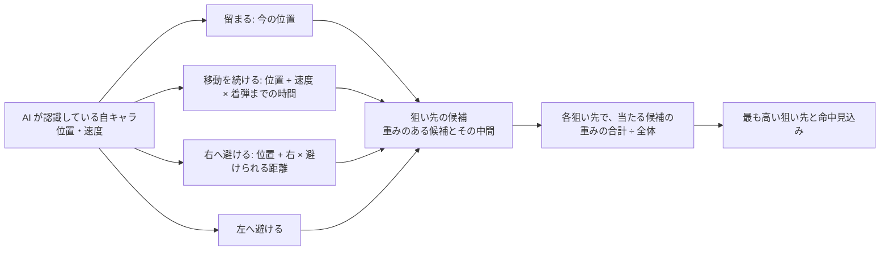
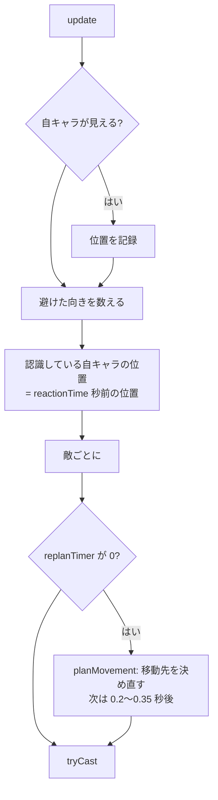
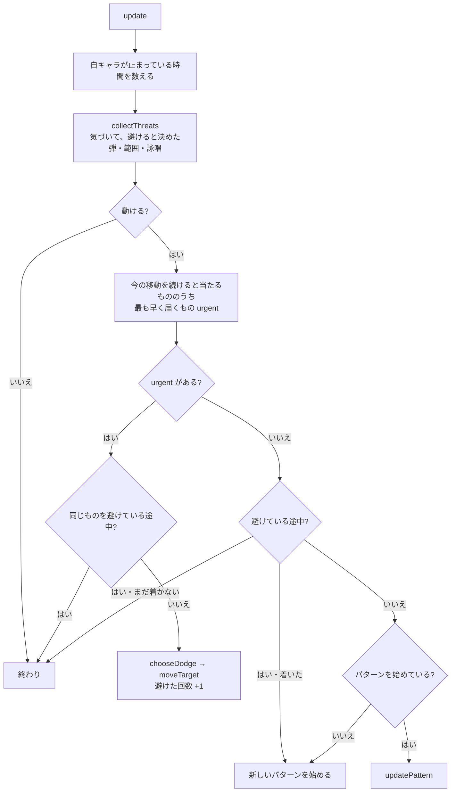

# game モジュール（3）: AI（`src/game/ai/`、名前空間 `moba::ai`）

## 1. 概要

2 つの AI があります。どちらも `Match` が持ち、毎刻み `update(World&, dt)` を呼びます。AI は `Unit` の `moveTarget` を書き換えて動かし、スキルは自キャラと同じ `casting::requestCast` で使います。

| AI | クラス | モード | 内容 |
|---|---|---|---|
| 敵 AI | `EnemyDirector` | スキルドッジ | 1〜5 体の敵を動かし、自キャラにスキルを撃たせる |
| 的の AI | `SkillShotTarget` | スキルショット | 1 体の的を動き回らせ、自キャラのスキルを避けさせる |

| ファイル | 内容 |
|---|---|
| [Aim.h](../../src/game/ai/Aim.h) / [.cpp](../../src/game/ai/Aim.cpp) | 狙いの計算（どこへ撃てば当たりやすいか）。`World` に依存しない |
| [PlayerObserver.h](../../src/game/ai/PlayerObserver.h) / [.cpp](../../src/game/ai/PlayerObserver.cpp) | 敵 AI が見ている自キャラの動き（位置の履歴・避けた向きの記録） |
| [EnemyAI.h](../../src/game/ai/EnemyAI.h) / [.cpp](../../src/game/ai/EnemyAI.cpp) | `EnemyDirector`（スキルドッジの敵 AI） |
| [SkillShotTarget.h](../../src/game/ai/SkillShotTarget.h) / [.cpp](../../src/game/ai/SkillShotTarget.cpp) | `SkillShotTarget`（スキルショットの的の AI） |

### 型の一覧

すべて継承はありません。

| 型 | 種類 | 定義 |
|---|---|---|
| `AimShape` | 列挙型 | Aim.h |
| `AimModel`・`AimTarget`・`AimWeights`・`AimResult` | 構造体 | Aim.h |
| `PlayerObserver` | クラス | PlayerObserver.h |
| `PlayerObserver::Sample`・`Shot` | 構造体（private） | PlayerObserver.h |
| `EnemyDirector` | クラス | EnemyAI.h |
| `EnemyDirector::Brain` | 構造体（private） | EnemyAI.h |
| `TargetPattern` | 列挙型 | SkillShotTarget.h |
| `SkillShotTarget` | クラス | SkillShotTarget.h |
| `SkillShotTarget::Threat`・`PatternState` | 構造体（private） | SkillShotTarget.h |

### 賢さ（難易度）の考え方

**背景**（根拠: 指示書「出現する敵の数や、敵の動き方は難易度調整によって変わる（数を増やす難易度、動きを賢くする難易度の 2 種類のベクトル）」「難しいほど賢く動くし、ランダムな動きを混ぜて…」）:

- スキルドッジは「敵の数（1〜5）」と「敵の賢さ（1〜5）」の 2 つの軸
- スキルショットは「的の賢さ（1〜5）」に「避け方」と「動き方」の 2 つの軸
- 賢さごとの数値は `data/ai.jsonc` にあり、コードには書きません

**乱数**: どちらの AI も `std::mt19937` を持ち、`setup` でプレイの乱数の種（`MatchConfig::seed`）を入れます。同じ種で同じ操作をすれば、同じ動きになります。

---

## 2. 狙いの計算（Aim.h / .cpp）

**役割**: 敵 AI が「どこへ撃てば当たりやすいか」を計算します。`World` に依存しない計算だけなので、テストで直接確かめられます（根拠: Aim.h の先頭）。

**考え方**（根拠: Aim.h の先頭）: 着弾した時に自キャラがいそうな位置の候補を 4 つ挙げ（その場に留まる・今の移動を続ける・弾を見て右へ避ける・左へ避ける）、賢さに応じて重みを付けます。候補の位置とその中間を狙い先として試し、**重み付きで何割の候補に当たるか**（命中見込み）が最も高い所を選びます。

### 2.1 型

| 型 | メンバ | 説明 |
|---|---|---|
| `AimShape` | `Line` / `Circle` | 直線に飛ぶ弾（方向指定）／地点に遅れて発生する円（地点指定） |
| `AimModel` | `shape`・`range`・`windup`（詠唱時間）・`speed`・`halfWidth`（直線）・`radius`・`delay`（円。詠唱を含めた発動までの時間） | スキルの当たり方 |
| `AimTarget` | `pos`・`velocity`（AI が認識している位置と速度）・`moveSpeed`・`radius` | 狙う相手 |
| `AimWeights` | `stay`・`keepMoving`・`dodgeRight`・`dodgeLeft` | 着弾時に相手がいそうな位置の重み |
| `AimResult` | `aimPoint`・`expectedHit`（0〜1）・`timeToImpact` | 狙いの結果 |

### 2.2 関数

| 関数 | 説明 |
|---|---|
| `optional<AimModel> aimModelFor(const SkillDef& def)` | スキルの定義から当たり方を作る。方向指定 → `Line`（params の `speed`・`width` が要る）、地点指定 → `Circle`（`radius` と、`delay` か `flightTime` が要る）。計算に使えないスキル（対象指定など）は `nullopt` |
| `optional<AimResult> chooseAim(Vector2 shooter, const AimModel&, const AimTarget&, const AimWeights&, float playerReactionTime)` | 最もよい狙い先。相手が射程外なら `nullopt`。避ける距離は「反応してから動ける距離」と「当たり判定から出るのに十分な距離（の 1.6 倍）」の小さい方。`playerReactionTime` より早く着弾する弾は、避けられない想定になる |
| `bool wouldHit(Vector2 shooter, const AimModel&, Vector2 aimPoint, Vector2 p, float targetRadius)` | `aimPoint` を狙って撃った時、位置 `p` の相手に当たるか |

`chooseAim` の中では、候補の位置と重みを、関数の中の構造体 `Candidate`（`pos`・`weight`）の配列で持ちます。

**注意事項**: 直線の弾の着弾までの時間は、「移動を続けた先までの距離」でもう一度見積もります（1 回だけ）。この計算は地形を見ません（弾は地形を通り抜けるので、狙いに地形は関係しない）。

---

## 3. `PlayerObserver`（クラス）

**役割**: 敵 AI が見ている自キャラの動き。

- **反応の遅れ**を再現するため、少し前の位置・速度を取り出せるように、位置の履歴（2 秒分）を持ちます
- 賢さが最大の AI（`adaptive`）のために、弾を撃たれた時に自キャラが**左右どちらへ避けやすいか**を数えます

**背景**（根拠: PlayerObserver.h の先頭、`712d7d8`）。

| 関数 | 説明 |
|---|---|
| `void clear()` | 記録をすべて消す |
| `void record(float time, Vector2 pos)` | 位置を記録する（自キャラが見えている間、毎刻み）。2 秒より古い記録は捨てる |
| `bool hasSamples() const` | 位置の記録が 1 つでもあるか（自キャラが一度も見えていなければ `false`） |
| `Vector2 positionAt(float time) const` | ある時刻の位置（記録の間は補間。前・後なら最初・最後の位置）。**記録が無ければ (0, 0)** なので、使う側が先に `hasSamples()` で確かめる（`EnemyDirector::seenPlayerPosition`） |
| `Vector2 velocityAt(float time) const` | ある時刻の速度（0.1 秒前の位置との差） |
| `void noteShot(float time, Vector2 playerPos, Vector2 shotDir)` | 敵が直線の弾を撃った時に呼ぶ |
| `void update(float time)` | 撃ってから 0.4 秒たった弾について、自キャラが弾の向きに対して横へ 40 以上動いていれば、その向きを数える（毎刻み） |
| `float rightBias() const` | 右へ避ける割合（0〜1）。最初は 0.5（左右とも 1 から数える） |

| メンバ変数・定数 | 説明 |
|---|---|
| `samples_`（`deque<Sample{time, pos}>`） | 位置の履歴 |
| `shots_`（`deque<Shot{time, playerPos, dir}>`） | 避けた向きをまだ調べていない弾 |
| `rightCount_` / `leftCount_` | 右・左へ避けた回数（1 から数える。0 で割らないように） |
| `kHistorySeconds = 2`・`kDodgeCheckDelay = 0.4`・`kDodgeThreshold = 40`（.cpp） | 履歴の長さ・避けた向きを調べるまでの時間・「避けた」とみなす横の距離 |

**注意事項**: 自キャラがブッシュに隠れている間は記録しないので、`positionAt` は最後に見えた位置を返し続けます。これで「最後に見えた位置を狙う」動きになります（根拠: 指示書「自キャラがブッシュに隠れると、敵は最後に見えた位置を狙う」）。

---

## 4. `EnemyDirector`（クラス）: スキルドッジの敵 AI

**役割**: すべての敵の移動とスキルを決めます（根拠: EnemyAI.h の先頭）。

- **移動**: スキルの射程に応じた距離を保ちながら自キャラを追う。賢いほど横移動が多く、他の敵と離れて囲むように動く
- **スキル**: 使えるスキルの中から、命中見込み × 優先度が最も高いものを選んで撃つ

**背景**（根拠: `712d7d8`「敵 AI: 着弾時の自キャラの位置を予測して狙う（留まる / 移動継続 / 回避先）。数値は data/ai.jsonc」、指示書の要件「それぞれの敵は自キャラを追いかける、自分の持つスキルができるだけ当たるように動く」）。

**未実装**（根拠: 指示書「地形を意識した敵の撃ち方（自キャラの背面が壁なら横に広いスキルを優先する、など）は、まだ実装していない」）: 地形を意識した撃ち方。

### 4.1 毎刻みの処理（`update`）

### 4.2 移動先の決め方（`planMovement`）

1. 自キャラ（認識している位置）から見た、今の敵の方向を基準にする
2. `flank` なら、他の敵と 70 度より近い方向にいる時は、離れる向きへずらす（最大 35 度。`spreadDirection`）
3. その方向へ `engageRange`（使うスキルの**最短の射程** × `engageRangeRatio`。350〜`maxEngageRange`）だけ離れた位置を目標にする
4. `strafe` が 0 より大きければ、横へ `300 × strafe` だけずらす。向きは 0.6〜1.6 秒ごとにランダムに変える
5. ステージの内側に収めて `moveTarget` にする（壁の向こうなら `World` が回り込む）

### 4.3 撃ち方（`tryCast`）

1. 詠唱中・行動不能なら撃たない
2. 次に撃ってよい時刻（`nextCastTime`）の前なら撃たない。ただし `punishCC` で、**自キャラが見えていて動けない**なら待たない。その場合も、最後に撃ってから `punishMinInterval`（ai.jsonc。既定 1 秒）は空ける（クールダウンの無いスキルで撃ち続けないように。テスト「punishCC の敵は、動けない自キャラにも punishMinInterval の間隔を空けて撃つ」）
3. 使えるスキル（`usedByEnemy`・クールダウンが 0・`aimModelFor` が作れる）ごとに `chooseAim` し、命中見込み × `aiPriority` が最も高いものを選ぶ
4. 命中見込みが `minHitChance` 未満なら、`nextCastTime + castIntervalMax` までは待つ（待ちすぎない）
5. 狙いのぶれ（0〜`aimError`）を加える。直線の弾は横方向にだけ、円は全方向へ
6. `casting::requestCast` で撃つ。結果が `Rejected`（使えなかった）なら、ここで終わる（次の刻みで撃ち直す）
7. 撃てたら（`Rejected` 以外）、次の時刻を `castIntervalMin`〜`Max` 後にする。直線の弾で、自キャラが見えていたなら `noteShot`

**狙う相手の位置と速度**は、`reactionTime` 秒前の位置と、その時の速度です。自キャラが動けない時は速度 0、重みは「留まる」だけにします（`aimWeights(true)`）。自キャラが一度も見えていない時（最初からブッシュに隠れている時）は、位置の記録が無いので、自キャラの今の位置を使います（`seenPlayerPosition`。移動先を決める時も同じ）。

**背景**（根拠: 報告ファイルの D4、2026-10-30 の修正）: 以前は、位置の記録が無い時に (0, 0) を自キャラの位置として狙い・移動していました。開始の位置やステージの配置が変わった時に、(0, 0) を狙い続けないようにしました。

### 4.4 メンバ

| 関数 | 説明 |
|---|---|
| `void setup(const AiConfig& config, int aiLevel, uint32_t seed)` | 賢さの設定を選び、乱数の種を入れ、記録を消す。**敵を加える前に呼ぶ** |
| `void addEnemy(EntityId unitId)` | 敵を 1 体加える。最初に撃つ時刻（`firstCastDelay` + 0〜1 秒）と横移動の向きを決める |
| `void update(World& world, float dt)` | すべての敵を動かし、撃てるなら撃たせる |
| `const AiLevel& level() const` | 使っている賢さの設定（リザルト・デバッグパネル） |
| `size_t enemyCount() const` | 敵の数 |
| `void planMovement(World&, Brain&, Unit& enemy, Vector2 seenPlayer)`（private） | 4.2 |
| `void tryCast(World&, Brain&, Unit& enemy, const Unit& player, bool playerVisible)`（private） | 4.3 |
| `Vector2 spreadDirection(World&, const Brain&, Vector2 seenPlayer, Vector2 away) const`（private） | 他の敵と同じ方向から攻めないように、方向をずらす |
| `float engageRange(const World&, const Unit& enemy) const`（private） | 自キャラと保つ距離 |
| `AimWeights aimWeights(bool playerStuck) const`（private） | 賢さの設定から重みを作る。`adaptive` なら避ける向きの重みを `rightBias` で左右に分ける |
| `Vector2 seenPlayerPosition(const Unit& player, float now) const`（private） | AI が認識している自キャラの位置（`reactionTime` 秒前の、見えていた位置）。位置の記録が無ければ、自キャラの今の位置 |
| `float uniform(float min, float max)`（private） | min 以上 max 未満の乱数（max ≦ min なら min） |

| メンバ変数 | 説明 |
|---|---|
| `config_` / `level_` | ai.jsonc の設定と、選んだ賢さ（**コピーして持つ**ので、プレイ中に ai.jsonc を変えても、そのプレイには効かない） |
| `rng_` | 乱数 |
| `observer_` | 自キャラの動き |
| `brains_` | 敵ごとの状態 |

### 4.5 `EnemyDirector::Brain`（構造体）

| メンバ | 説明 |
|---|---|
| `unitId` | 敵の番号 |
| `nextCastTime` | 次にスキルを撃ってよい時刻 |
| `lastCastTime` | 最後にスキルを撃った時刻（`punishCC` の最低限の間隔に使う。まだ撃っていなければ −∞） |
| `replanTimer` | 次に移動先を決め直すまでの時間 |
| `strafeTimer` / `strafeSign` | 横移動の向きを変えるまでの時間と、向き（+1 / −1） |

### 4.6 .cpp の中だけ

| 名前 | 説明 |
|---|---|
| `kStrafeDistance = 300`・`kMinEngageRange = 350`・`kFlankAngle = 70°`・`kMaxFlankShift = 35°` | 横移動の幅・近づく距離の下限・囲む動きの角度 |
| `wrapAngle(float)` | 角度の差を −π〜π に収める |
| `fromAngle(float)` | 角度の向きの、長さ 1 のベクトル |

### 4.7 注意事項

- 「撃てたか」は、`requestCast` の戻り値（`casting::CastOutcome`）で判断します。`Rejected` の時は `nextCastTime` を変えないので、次の刻みでまた撃とうとします。詠唱時間 0・クールダウン 0 のスキルでも、撃てれば `castInterval` の間隔を空けます（テスト「詠唱時間もクールダウンも 0 のスキルでも、敵は撃つ間隔（castInterval）を守る」）。- 敵は自キャラのスキルで状態異常にかかります（変身中・打ち上げ中は撃てない）。ダメージは受けません。

---

## 5. `SkillShotTarget`（クラス）: スキルショットの的の AI

**役割**: 的（1 体。スキルを撃たない）を動かします。毎刻み、次のどちらかを行います（根拠: SkillShotTarget.h の先頭）。

- **回避**: 自キャラの弾・範囲に気づくと（反応の遅れの後）、確率で、当たらない位置へ避ける。賢い的は、自キャラの詠唱（構え）を見た時点で、弾・範囲が出る前に避け始める
- **移動**: 避けていない間は、動き方のパターンを 1 つずつ行う。1 つ終わるたびに、重みで次のパターンを選ぶ

自キャラからは `maxDistance` より離れず、`minDistance` より近づきません。反応の遅れはどの賢さでも 0.15 秒より短くなりません。

**背景**（根拠: `d3277b8`、`a20c8d7`、指示書「スキルショット」）: 指示書の「ランダムな方向に動く / または自キャラが打つ方向指定スキルを避けるように動く」「難しいほど賢く動くし、ランダムな動きを混ぜて」を、「避け方」と「動き方」の 2 つの軸にしたものです。接近して切り返すパターンは、ユーザーのスキルドッジの戦略の例から作りました（根拠: 指示書）。

### 5.1 毎刻みの処理（`update`）

### 5.2 気づき方と判断（`collectThreats`・`decide`）

- 弾・範囲は、出てから `reactionTime` 秒たつと「気づく」
- 気づいた弾・範囲ごとに 1 回だけ、`dodgeChance` の確率で「避ける / 避けない」を決める（同じ弾で迷わない）
- 追尾する弾（対象指定のスキル）は避けられないので、気にしない
- `readCast` なら、自キャラの詠唱中のスキル（ヒット率に数えるもの）を、カーソルの方向・位置へ出ると考えて「気づく」。詠唱ごとに番号（マイナスの数）を振る
- 詠唱を見て決めた判断は、その詠唱から出た弾・範囲に引き継ぐ（詠唱が終わってから 0.3 秒以内に出た、まだ判断していない最も新しい発動）
- 消えた弾・範囲・詠唱の判断は捨てる

### 5.3 避け方（`endangers`・`chooseDodge`）

- `endangers`: 的が今の移動先へ進み続けると、弾・範囲に当たるか。直線の弾は「弾が届く時刻の的の位置」で判定する（届く時刻は、動いた先までの距離で 2 回見積もり直す）
- `chooseDodge`: 避ける先の候補を作り、**障害物で止まらず・自キャラから離れすぎず・着くまでに他の弾・範囲にも当たらない**候補を選ぶ
  - 直線の弾: 左右の 2 か所（近い順）。`sideRandom` の確率で遠い側
  - 円の範囲: 中心から外へ向かう方向と、その ±35°・±70°・±110°
  - 安全な候補が無ければ、せめて障害物で止まらない候補。それも無ければ避けない

弾を見てから避け始めて間に合わない時（速い弾・範囲の真ん中など）は当たります（根拠: 指示書「弾を見てから避け始めて間に合わない時…は当たる」）。

### 5.4 動き方のパターン

| パターン | `TargetPattern` | 動き |
|---|---|---|
| 往復 | `Strafe` | 自キャラから見て左右に、同じ幅で切り返す（`strafeSwings` 回・`strafeWidth` の幅）。2 回切り返した後は、`rhythmBreak` の確率でリズムを崩す（2.5 倍動く / 4 分の 1 だけ動いてすぐ切り返す） |
| 接近 | `Approach` | 自キャラへ近づき、撃たれそうになったら（近づききった・射程に入った・射程の中で自キャラが止まった・構えた）、`reactionTime` の後に急に左右へ 250〜400 動く。切り返し終わったら次のパターン |
| ランダム | `Wander` | 自キャラの周りの、今の方向から ±75° 以内のランダムな位置へ動く（障害物・ブッシュの中は選ばない） |
| 停止 | `Stop` | `stopTime` の間、立ち止まる |

- 次のパターンは `weightStrafe` などの重みで選びます。ただし**自キャラから `maxDistance` より離れていれば接近**にします。接近を選んでも、もう十分に近ければ往復にします。
- 6 秒より長く続いたパターンは打ち切ります（壁に引っかかった時など）。

### 5.5 メンバ関数

| 関数 | 説明 |
|---|---|
| `void setup(const SkillShotConfig&, int aiLevel, uint32_t seed)` | 賢さの設定を選び、乱数の種を入れ、状態をすべて消す。**的を決める前に呼ぶ** |
| `void setTarget(EntityId unitId)` | AI で動かす的を決める |
| `Vector2 startPosition(Vector2 playerPos)` | 的を最初に置く位置（自キャラから `minDistance` と `maxDistance` の真ん中の距離の、ランダムな方向） |
| `void update(World&, float dt)` | 5.1 |
| `EntityId unitId() const` | 的の番号 |
| `const SkillShotLevel& level() const` / `const SkillShotConfig& config() const` | 使っている設定 |
| `bool dodging() const` / `int dodgeCount() const` | 避けている途中か・避け始めた回数（デバッグ表示・ログ） |
| `TargetPattern pattern() const` / `string patternLabel() const` | 今のパターンと、その説明（「往復（残り 3 回・幅 200）」など） |
| `collectThreats`・`decide`・`endangers`・`chooseDodge`（private） | 5.2・5.3 |
| `startPattern`・`updatePattern`・`nextSwing`・`updateApproach`・`wander`（private） | 5.4 |
| `Vector2 sideStep(const World&, const Unit& self, const Unit& player, float& side, float distance) const`（private） | 自キャラに対して横へ `distance` 動く移動先。壁際などでほとんど動けなければ反対側（`side` の符号を変える） |
| `Vector2 keepInRange(const World&, const Unit& self, Vector2 playerPos, Vector2 destination) const`（private） | 移動先を、自キャラとの距離・ステージの範囲・立てる位置に収める |
| `float playerSkillRange(const World&, const Unit& player) const`（private） | 自キャラのヒット率に数えるスキルの、最も長い射程（`maxDistance` まで）。接近の「射程に入った」に使う |
| `float uniform(float min, float max)`（private） | 乱数 |
| `string_view displayName(TargetPattern)`（自由関数） | 「往復」「接近」「ランダム」「停止」 |

### 5.6 メンバ変数

| 変数 | 説明 |
|---|---|
| `config_` / `level_` / `rng_` / `unitId_` | 設定（コピー）・賢さ・乱数・的の番号 |
| `pattern_` / `patternActive_` | 今のパターンの状態と、始めているか |
| `playerStillTime_` | 自キャラが止まっている（移動も詠唱もしていない）時間 |
| `dodging_` / `dodgeKey_` / `dodgeCount_` | 避けている途中か・避けている物の番号・避けた回数 |
| `decisions_` | 気づいた物ごとの、避けるかどうか |
| `playerWasCasting_` / `castSerial_` / `inherited_` / `inheritedUntil_` | 詠唱を見て避けるための記録（前の刻みで詠唱中だったか・詠唱の通し番号・引き継ぐ判断・その期限） |

### 5.7 private の構造体

| 構造体 | メンバ |
|---|---|
| `Threat` | `key`（発動の番号。詠唱はマイナス）・`shape`・直線: `start`・`dir`・`length`・`speed`・`halfWidth`・円: `center`・`radius`・`wait`（直線: 弾が動き出すまで、円: 発動まで） |
| `PatternState` | `kind`・`elapsed`・往復: `swingsLeft`・`swingIndex`・`width`・`side`・接近: `stopDistance`・`prevDistance`・`playerWasMoving`・`jukeDelay`（マイナスならまだ切り返しを決めていない）・`juking`・停止: `stopTime` |

### 5.8 .cpp の中だけの定数

`kWanderAngle = 75°`（ランダムの移動先の角度の幅）・`kMinWanderStep = 120`（これより近い移動先は選ばない）・`kInheritTime = 0.3`（詠唱の判断を引き継ぐ時間）・`kPatternTimeout = 6`（パターンの打ち切り）。

### 5.9 注意事項

- 的は「キャラ」ではないので、`characterId` が空です。状態異常（自キャラのスキル）はかかります（根拠: 指示書）。
- 反応の遅れの下限（0.15 秒）は、読み込む時に `kMinTargetReactionTime` で収めています（[12-data.md](12-data.md)）。AI の中では確かめていません。
