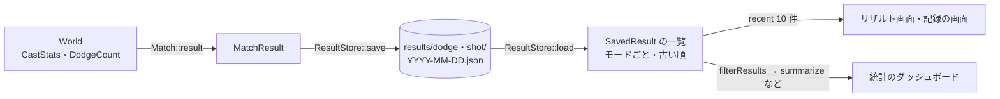

# game モジュール（5）: 集計・リザルトの保存・統計

## 1. 概要

プレイ中の成績の集計（ヒット率・ドッジ率）、プレイの結果の保存と読み込み、保存した結果の統計の計算です。画面（リザルト画面・記録・統計のダッシュボード）は [20-ui.md](20-ui.md) にあります。

| ファイル | 内容 |
|---|---|
| [CastStats.h](../../src/game/CastStats.h) / [.cpp](../../src/game/CastStats.cpp) | `HitCount`・`DodgeCount`・`CastStats`（プレイ中の集計） |
| [ResultStore.h](../../src/game/ResultStore.h) / [.cpp](../../src/game/ResultStore.cpp) | `ResultStore`（results フォルダへの保存と読み込み）、`SavedResult`・`LocalTimestamp`・`ResultScore` |
| [ResultStats.h](../../src/game/ResultStats.h) / [.cpp](../../src/game/ResultStats.cpp) | 統計の計算（絞り込み・要約・移動平均・自己ベスト・日ごと・賢さごと・キーごと） |

保存のルールとファイルの形式は [results.md](../results.md) にもまとめてあります。

### 型の一覧

すべて継承はありません。

| 型 | 種類 | 定義 |
|---|---|---|
| `HitCount`・`DodgeCount` | 構造体 | CastStats.h |
| `CastStats` | クラス | CastStats.h |
| `LocalTimestamp`・`SavedResult`・`ResultScore` | 構造体 | ResultStore.h |
| `ResultStore` | クラス | ResultStore.h |
| `StatsFilter`・`StatsSummary`・`DayStat`・`LevelStat` | 構造体 | ResultStats.h |

### データの流れ

---

## 2. プレイ中の集計（CastStats.h / .cpp）

### 2.1 数え方の決まり

| 成績 | 数え方 | 根拠 |
|---|---|---|
| ヒット率 | 自キャラの 1 回の発動（`castId`）で、**1 体以上に当たれば「命中」1 回**。多段ヒット・複数の弾も 1 回 | 指示書「1 回の発動で弾が複数出る場合も、どれか 1 つでも当たれば命中 1 回と数える」 |
| ヒット率の対象 | `countsForHitRate: true` のスキル（方向指定・地点指定の攻撃スキル）だけ | 指示書（Claude 判断） |
| ドッジ率 | 敵の 1 回の発動で出た弾・範囲が**すべて消えた時点**で、自キャラに当たっていれば被弾、当たっていなければ回避 | 指示書「ドッジ率の定義」 |
| リザルトの集計 | 制限時間の終了時に**飛んでいる途中**の発動は数えない | 指示書（確認済み）。プレイ中の上部の表示は、撃った時点で数える |

### 2.2 `HitCount`（構造体）

| メンバ | 説明 |
|---|---|
| `casts` | 発動した数 |
| `hits` | 当たった数 |
| `float rate() const` | 命中率（0〜1）。1 回も発動していなければ 0 |

### 2.3 `DodgeCount`（構造体）

| メンバ | 説明 |
|---|---|
| `total` | 結果が確定した発動の数 |
| `dodged` | 1 つも当たらなかった発動 |
| `hit` | 当たった発動 |
| `float rate() const` | ドッジ率（`dodged / total`）。確定した発動が無ければ 0 |

`DodgeCount` は `World::finishCastRecord` が直接数えます（[14-game-world.md の「発動の記録」](14-game-world.md#発動の記録castrecordの仕組み)）。

### 2.4 `CastStats`（クラス）

**役割**: 自キャラのヒット率をキーごとに数えます。「当たらずに弾・範囲がまだ残っている発動」を覚えておき、リザルトではそれを除けるようにします（根拠: CastStats.h の先頭）。

| 関数 | 説明 |
|---|---|
| `void recordCast(int castId, SkillSlot slot)` | 集計対象のスキルを発動した（`casting::runSkill` が自キャラの時だけ呼ぶ）。発動数を 1 増やし、「結果が出ていない」に入れる |
| `void recordHit(int castId)` | その発動が当たった（`World::registerHit` が呼ぶ）。**集計対象でない castId と、同じ発動の 2 回目以降は無視**。当たった時点で結果が出る |
| `void settle(int castId)` | その発動で出た物がすべて消えた（`World::finishCastRecord` が呼ぶ）。当たっていなければ、ここで「外れ」が確定する |
| `void reset()` | 集計を 0 に戻す（デバッグパネルの「集計をリセット」） |
| `const HitCount& slot(SkillSlot) const` / `HitCount total() const` | キーごと・合計の数（**飛んでいる途中も含む**。プレイ中の表示用） |
| `HitCount settledSlot(SkillSlot) const` / `HitCount settledTotal() const` | 結果が出た発動だけの数（リザルト用） |

| メンバ変数 | 説明 |
|---|---|
| `slots_` | キーごとの `HitCount` |
| `castSlots_` | 集計対象の castId → キー |
| `hitCasts_` | 命中として数えた castId |
| `unsettled_` | 当たっておらず、弾・範囲がまだ残っている castId |

**注意事項**: `castSlots_` と `hitCasts_` は 1 回のプレイの間、増え続けます（消しません）。5 分のプレイでも数百件なので問題になりません。

---

## 3. リザルトの保存（ResultStore.h / .cpp）

**背景**（根拠: `89cebb4`、指示書「リザルトの保存」）:

- 保存するのは、スキルドッジとスキルショットを**制限時間まで遊んだプレイだけ**（ポーズからメニューに戻った・リスタートしたプレイは保存しない）
- 保存先は `results/<モード>/<日付>.json`。1 日の上限 20 件はモードごとに数え、超えたら古いものから上書き
- 「6 か月分（約 180 日分）」は暦の日数で数え、今日を含めて 180 日より前の日の結果を、起動時と保存時に消す
- 読めないファイルは名前に `.broken` を付けて残し、上書きしない

### 3.1 定数

| 定数 | 値 | 説明 |
|---|---|---|
| `kMaxResultsPerDay` | 20 | 1 日・1 モードあたりの保存数の上限 |
| `kResultKeepDays` | 180 | 結果を残す日数 |
| `kRecentResultCount` | 10 | リザルト画面・記録の画面に出す直近の件数 |
| `kFormatVersion`（.cpp） | 1 | 保存する JSON の形式の版（形式を変えた時に読み分けるため。今は書くだけで、読む時には見ていない） |

### 3.2 構造体

| 型 | メンバ | 説明 |
|---|---|---|
| `LocalTimestamp` | `date`（`YYYYMMDD`）・`text`（「2026-10-25 22:40:12」） | 保存した日時（ローカル時刻） |
| `SavedResult` | `playedAt`（保存した日時の文字列）・`date`・`result`（`MatchResult`） | 保存した結果 1 件 |
| `ResultScore` | `count`・`total`・`rate()` | 並べ替えに使うスコアの数（スキルドッジ: 避けた数 / 総数、スキルショット: 当たった数 / 総数） |

### 3.3 自由関数

| 関数 | 説明 |
|---|---|
| `LocalTimestamp localNow()` | 今のローカル時刻 |
| `ResultScore scoreOf(const MatchResult&)` | 結果のスコア（スキルドッジはドッジ率、それ以外はヒット率） |
| `bool rankedHigher(const SavedResult& a, const SavedResult& b)` | 記録の並び順で `a` が上か。**割合の高い順 → 総数の多い順 → 新しい順**（`playedAt` の文字列の大きい順）。根拠: 指示書 |
| `optional<string> resultFolderName(GameMode)` | 保存するモードのフォルダ名（`"dodge"` / `"shot"`）。練習場は `nullopt`（保存しない） |
| `void appendWithDailyLimit(vector<SavedResult>& day, SavedResult, size_t limit)` | 1 日分に加え、上限を超えたら古いものから消す |
| `int daysBetween(int from, int to)` | 暦の日数の差（`std::chrono` で計算。同じ日なら 0、`to` が前ならマイナス） |
| `vector<int> selectExpiredDates(const vector<int>& dates, int today, int keepDays)` | 残す期間を過ぎた日（`daysBetween(date, today) >= keepDays`） |
| `json toJson(const SavedResult&)` | 保存用の JSON にする。キーごとのヒット率は発動のあったキーだけ。モードに関係する項目だけ（スキルドッジ: `enemies`・`dodge`・`hitsTaken`・`deaths`、スキルショット: `target`） |
| `optional<SavedResult> savedResultFromJson(const json&, string& error)` | JSON から読む。日付は `playedAt` の「YYYY-MM-DD」から作る。読めなければ `nullopt` |

### 3.4 `ResultStore`（クラス）

**役割**: results フォルダへの保存と読み込み。読み込んだ結果は、モードごとにメモリにも持ちます（古い順）。`App` が 1 つ持ちます。

| 関数 | 説明 |
|---|---|
| `explicit ResultStore(path dir)` | 保存先のフォルダを覚える（読み込みは `load`） |
| `void load(int today)` | 保存されている結果をすべて読み込み、残す期間を過ぎた日のファイルを消す。ファイルは名前順（= 日付順）に読む。読めないファイルは `.broken` を付けて名前を変え、エラーに足す。読めない 1 件は警告を出して飛ばす |
| `optional<SavedResult> save(const MatchResult&, const LocalTimestamp& at)` | 結果を保存する。その日の結果に加え、上限を超えたら古いものから消し、**その日のファイルを丸ごと書き直す**。書いたらメモリの一覧も更新し、期間を過ぎた日を消す。保存しないモード・書けなかった時は `nullopt` |
| `vector<SavedResult> recent(GameMode, size_t count) const` | そのモードの直近の結果（**新しい順**）を `count` 件まで |
| `const vector<SavedResult>& all(GameMode) const` | そのモードのすべての結果（古い順）。練習場や、まだ無いモードは空の一覧 |
| `const path& dir() const` | 保存先 |
| `const vector<string>& errors() const` | 直近の読み込み・保存で起きたエラー（記録の画面に赤字で出す） |
| `path dayFile(const string& folder, int date) const`（private） | 日付ごとのファイルの場所 |
| `void removeExpired(const string& folder, int today)`（private） | 期間を過ぎた日のファイルを消し、メモリからも外す。中身が空のファイルも消せるよう、フォルダの中のファイル名の日付も見る |

| メンバ変数 | 説明 |
|---|---|
| `dir_` | 保存先のフォルダ |
| `results_` | `map<string, vector<SavedResult>>`。フォルダ名（モード）ごとの、すべての結果（古い順） |
| `errors_` | エラー |

### 3.5 .cpp の中だけの関数

| 関数 | 説明 |
|---|---|
| `toDays(int date)` | `YYYYMMDD` を `std::chrono::sys_days` にする |
| `dayFileName(int date)` | 「2026-10-25.json」 |
| `dateFromDayFileName(const path&)` | ファイル名から日付を読む（形が違えば `nullopt`。`.broken` の付いたファイルは読まない） |
| `toJson(const HitCount&)` / `hitCountFromJson(const json&)` | `{"casts", "hits"}` の読み書き |
| `modeName(GameMode)` / `modeFromName(string_view)` | モードの保存名（`"sandbox"` / `"dodge"` / `"shot"`） |
| `writeDayFile(const path&, const vector<SavedResult>&)` | 1 日分を JSON の配列として書く。**一時ファイル（`.tmp`）に書いてから置き換える**（書いている途中で落ちても、元のファイルが壊れないように） |

### 3.6 注意事項

- 保存の判断（入力スクリプトの時は保存しない、など）は `App::saveResult` が行います。`ResultStore` は、渡された結果をそのまま保存します。
- 「今回の結果」の識別には `playedAt`（秒までの日時の文字列）を使います（リザルト画面の強調・順位）。
- 結果の日付はファイル名ではなく `playedAt` から読みます。

---

## 4. 統計の計算（ResultStats.h / .cpp）

**役割**: 保存した結果を条件で絞り込み、集計します。画面に依存しない計算だけなので、テストで直接確かめられます（根拠: ResultStats.h の先頭、`0498fab`）。

**平均の考え方**（根拠: ResultStats.h、指示書「平均は数を合計してから割る」）: プレイごとの割合の平均ではなく、数を合計してから割ります。総数の少ないプレイに引っぱられないようにするためです。

**自己ベストの考え方**（根拠: 同上「自己ベストは総数 10 以上のプレイから選ぶ（1 / 1 = 100% のようなプレイを除くため）」）。どの成績が上かは、記録の順位表と同じ `rankedHigher`（割合 → 総数 → 新しい順）で決めます。数字の欄の自己ベスト・TOP 3・グラフの「自己ベストを更新」の印は、すべてこの決まりに揃えています（根拠: 報告ファイルの C4、2026-10-30 の修正。以前はグラフの印だけが「割合が上がった時」で、同じ割合のプレイの扱いが食い違っていた）。

### 4.1 定数

| 定数 | 値 | 説明 |
|---|---|---|
| `kMinTotalForBest` | 10 | 自己ベスト・TOP 3 に数えるのに必要な総数 |
| `kMovingAverageWindow` | 10 | 成績の推移の移動平均の回数 |
| `kCompareDays` | 7 | 「直近 7 日」と「その前の 7 日」を比べる |

### 4.2 構造体

| 型 | メンバ | 説明 |
|---|---|---|
| `StatsFilter` | `mode`・`characterId`・`stageId`・`level`（賢さ）・`enemyCount`・`targetRadius`・`targetMoveSpeed`・`periodDays` | 絞り込みの条件。**0 や空の項目は「すべて」** |
| `StatsSummary` | `plays`・`playedSeconds`・`total`（全部の合計）・`recent`（直近 7 日の合計）・`previous`（その前の 7 日の合計）・`recentPlays`・`previousPlays`・`best`（自己ベスト。無ければ `nullptr`） | ダッシュボードの数字の欄 |
| `DayStat` | `date`・`plays`・`score` | 1 日分の集計 |
| `LevelStat` | `level`・`name`（保存した時の賢さの名前）・`plays`・`score` | 賢さ 1 段階分の集計 |

### 4.3 関数

| 関数 | 説明 |
|---|---|
| `bool matchesFilter(const SavedResult&, const StatsFilter&, int today)` | 条件に合うか。賢さはスキルドッジなら `aiLevel`、スキルショットなら `targetLevel`。的の大きさ・速さは 0.5 の誤差まで同じとみなす。期間は今日を含めて `periodDays` 日 |
| `vector<const SavedResult*> filterResults(const vector<SavedResult>& all, const StatsFilter&, int today)` | 条件に合う結果（古い順）。**`all` の要素へのポインタ**を返す |
| `StatsSummary summarize(const vector<const SavedResult*>&, int today)` | 要約する。直近 7 日は今日を含む 0〜6 日前、その前の 7 日は 7〜13 日前。自己ベストは `rankedHigher` で最も上のもの |
| `vector<float> movingAverage(const vector<float>& values, size_t window)` | 移動平均（それまでの最大 `window` 回の平均。最初の方は、ある分だけで平均する） |
| `vector<size_t> personalBestUpdates(const vector<const SavedResult*>&)` | 自己ベストを更新したプレイの位置。それまでの自己ベストより `rankedHigher` で上なら更新とする（割合が同じでも総数が多ければ更新、割合も総数も同じなら新しい方が上なので更新）。**最後の更新が、必ず `summarize` の自己ベスト・`topResults` の 1 位と同じプレイになる** |
| `vector<const SavedResult*> topResults(const vector<const SavedResult*>&, size_t n)` | 成績の高い順（`rankedHigher`）に `n` 件 |
| `vector<DayStat> dailyStats(const vector<const SavedResult*>&)` | 日ごとの集計（古い順。プレイした日だけ） |
| `vector<LevelStat> levelStats(const vector<const SavedResult*>&)` | 賢さごとの集計（低い順。プレイした賢さだけ）。名前は新しい結果のもので上書き |
| `array<HitCount, 6> hitsBySlot(const vector<const SavedResult*>&)` | キーごとの、自キャラのヒット率の合計 |
| `levelOf`・`add`・`countsForBest`（.cpp の中だけ） | 賢さを取り出す・スコアを足す・自己ベストに数えられるか |

### 4.4 注意事項

- `filterResults` が返すポインタは、`ResultStore` の中の一覧を指します。結果を保存すると一覧が並べ替えられるので、**ポインタは同じフレームの中でだけ**使ってください。統計の画面は毎フレーム計算し直しています。
- 統計の「すべての期間」は、保存している 180 日分です（それより古い結果は消えているため）。
