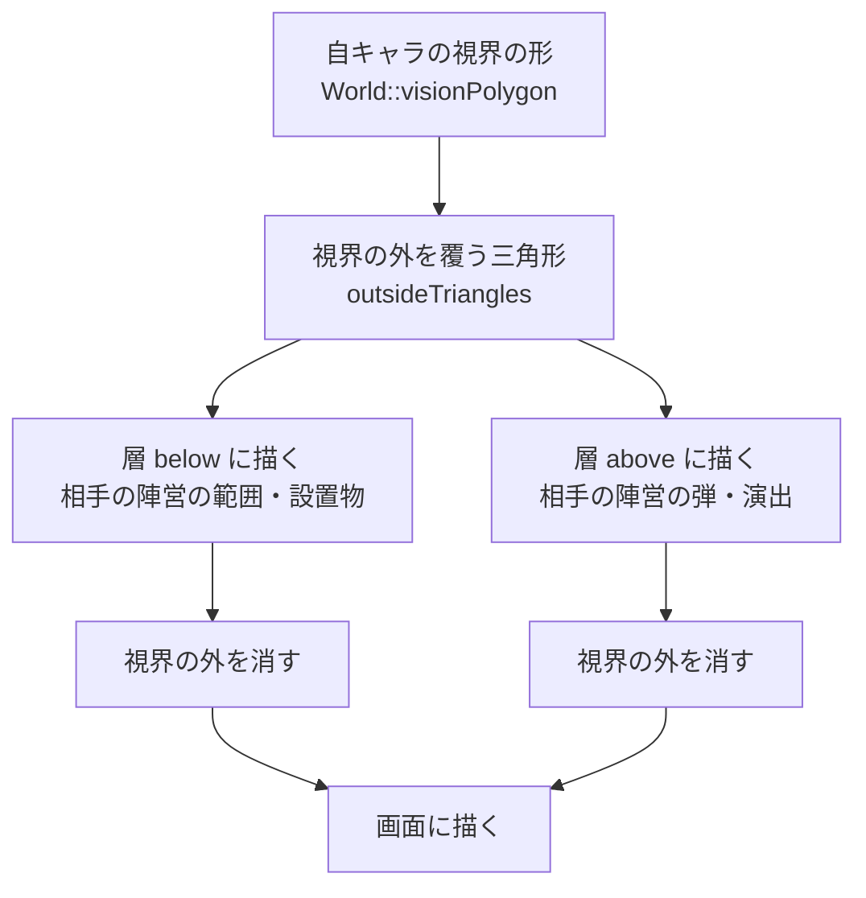

# render モジュール（`src/render/`）

## 1. 概要

ゲーム画面の描画です。2 つの描き方を使い分けます。

| 描くもの | 使うライブラリ | 座標 | ファイル |
|---|---|---|---|
| 床・障害物・キャラ・弾・範囲・演出（図形）・視界の外の暗さ | raylib（`DrawCircleV` など） | **ワールド座標**（`drawWorld` の中で `BeginMode2D(camera)` して描く） | [Renderer.h](../../src/render/Renderer.h) / [.cpp](../../src/render/Renderer.cpp) |
| キャラ名・HP・状態異常・スキルバー・残り時間・画面外の矢印・操作説明（文字） | Dear ImGui の `ImDrawList` | **画面座標**（ピクセル） | [Hud.h](../../src/render/Hud.h) / [.cpp](../../src/render/Hud.cpp) |

カメラの動かし方の計算は [CameraControl.h](../../src/render/CameraControl.h) / [.cpp](../../src/render/CameraControl.cpp) にあります。

**背景**（根拠: Renderer.h のコメント「文字は日本語を出すため、Hud.cpp で Dear ImGui を使って描く」）: 文字はすべて Dear ImGui で描いています。補足（推測）: raylib の文字描画で日本語を出すには、使う文字をあらかじめフォントに読み込んでおく必要があり、メニューと同じ Dear ImGui の日本語フォントを使う方が簡単なためと考えられます。

### 型の一覧

すべて継承はありません。

| 型 | 種類 | 定義 |
|---|---|---|
| `RenderOptions` | 構造体 | Renderer.h |
| `VisionLayers` | クラス | Renderer.h |
| `CameraControlInput` | 構造体 | CameraControl.h |

### 依存

`render` は `game`（`World`・`Match` を読むだけ）と `data`、文字の倍率のために `ui/UiScale.h` を使います。**描画の関数はゲームの状態を変えません**（ゲームの状態はすべて `const` の参照で受け取る。`VisionLayers` だけは描画先なので書き換える）。

---

## 2. ゲーム画面の描画（Renderer.h / .cpp）

### 2.1 `RenderOptions`（構造体）

| メンバ | 説明 |
|---|---|
| `showHitboxes` | 弾・範囲の当たり判定の円を描く（settings.jsonc の `showHitboxes`。デバッグパネルで一時的に切り替えられる） |
| `fogDarkness` | 視界の外を暗くする強さ（settings.jsonc の `fogDarkness`。0〜1） |

### 2.2 `void drawWorld(const World& world, const Camera2D& camera, const RenderOptions& options, VisionLayers& layers)`

ゲーム画面を描きます。`BeginDrawing` の中、**`BeginMode2D` の外**で呼びます（中で描画先を切り替えるため、自分で `BeginMode2D(camera)` する）。

画面に描く順番（後のものが上に重なる）:

1. 床（マス目の線。細い線は 100、太い線は 500 ごと）と、ステージの外枠
2. 障害物
3. 自分の陣営の地面の範囲・設置物
4. 層 `below`（相手の陣営の範囲・設置物。視界の中の部分だけ）
5. キャラ（**自キャラの陣営から見えないキャラは描かない**。見えるかどうかはキャラの中心で決めるので、体の一部が視界の外に出ていても描き、その部分は 9 で暗くなる）
6. ブッシュ（半透明で、キャラの上に重ねる。中にいるキャラが草に隠れて見える）
7. 自分の陣営の弾・演出（文字の演出を除く）
8. 層 `above`（相手の陣営の弾・演出。視界の中の部分だけ）
9. 視界の外を `fogDarkness` の黒で覆う

**背景**（根拠: 指示書「視界」、claude_improve_and_answer.txt の 2026/11/03）: 視界の外は暗く、地形だけを描きます。相手の陣営の弾・範囲・設置物は、視界に入った部分だけ見えます（範囲も、視界の中の部分だけ）。自分の陣営の物は視界の外でも描きます（暗くはなる）。

**相手の陣営の物を視界の中だけ描く方法**: 画面と同じ大きさの描画先（`VisionLayers` の 2 枚）に描き、視界の外を覆う三角形を「色も不透明度も 0 にする」混ぜ方（`rlSetBlendFactors(RL_ZERO, RL_ZERO, ...)`）で描いて消してから、画面に重ねます。描画先には、色に不透明度を掛けた値（premultiplied alpha）で描き（`BLEND_CUSTOM_SEPARATE`）、画面に重ねる時は `BLEND_ALPHA_PREMULTIPLY` を使います。普通の混ぜ方で透明な描画先に半透明の色を描くと、不透明度が 2 回掛かって薄くなるためです。層を 2 枚にしているのは、範囲はキャラより下、弾はブッシュより上という、今までの重なり方を変えないためです。

**視界の外を覆う三角形**（`outsideTriangles`）: 視界の形の、隣り合う 2 本の光線ごとに、光線の先から画面の隅より遠い所までを 2 つの三角形で埋めます。隣り合う光線の間の角度は 1° 以下なので、どの四角形もへこみません。三角形は重ならないので、半透明の黒で塗っても、暗さにむらが出ません。

**注意事項**:

- 全視界の時（`World::rules().fullVision`）と、自キャラがいない時は、視界の外は無い（すべて見える）ものとして描きます。
- 描画先には MSAA（ふちのギザギザを減らす処理）がかからないので、相手の陣営の範囲・弾のふちは、自分の陣営の物より少しギザギザします。
- 3D の描画にする時は、この描画の部分（層と三角形）を作り直します。視界の形の計算（`game/Vision`）はそのまま使えます。

### 2.3 `VisionLayers`（クラス）

相手の陣営の物を、自キャラの視界の中だけ描くための描画先（画面と同じ大きさの `RenderTexture2D` 2 枚）です。`App` が持ちます。

| 関数 | 説明 |
|---|---|
| `void ensureSize(int width, int height)` | 描画先を用意する。大きさが変わっていれば作り直す（ウィンドウの大きさを変えた時）。`drawWorld` が毎フレーム呼ぶ |
| `void release()` | 描画先を解放する。**ウィンドウを閉じる前に呼ぶ**（`App::shutdownWindow`）。閉じた後は解放できないので、デストラクタでは解放しない |
| `below()` / `above()` | キャラより下に重ねる層（範囲・設置物）/ ブッシュより上に重ねる層（弾・演出） |

コピーはできません（同じ描画先を 2 回解放しないように）。

### 2.4 Renderer.cpp の中だけの関数

定数: `kGroundColor`（床の色）・`kGridMinor` / `kGridMajor`（細い線・太い線の色）・`kHitboxColor`（当たり判定の円の色）。

| 関数 | 説明 |
|---|---|
| `lerpColor(Color a, Color b, float t)` | 色を混ぜる |
| `drawTriangleBothSides(a, b, c, color)` | 頂点の並び順に関係なく三角形を描く（raylib は反時計回りの三角形しか描かないため、両方の順で描く） |
| `drawBird(pos, dir, size, color)` | 鳩の形 |
| `drawHat(pos, size)` | 帽子の形 |
| `drawCaltrop(pos, size, color)` | 鉄菱 1 つ（四角を 2 つ 45° ずらして重ねた星形。真ん中は明るい）。`size` は当たり判定の半径と同じ |
| `drawLifetimeArc(pos, radius, ratio, color)` | 残り時間の円弧 |
| `drawGround(const World&)` | 床とステージの外枠 |
| `fillShape(const Shape&, Color)` / `outlineShape(const Shape&, float thickness, Color)` | 形（長方形・円）を塗る / 縁を描く |
| `inset(const Shape&, float amount)` | 形を内側へ縮めたもの（建物の屋根など） |
| `drawObstacle(const Obstacle&)` | 障害物。種類ごとに見た目だけ変える（建物 = 屋根つきの灰色、壁 = 明るい灰色、箱 = 茶色で × 印、木 = 緑） |
| `drawBush(const Shape&)` | ブッシュ（半透明の緑） |
| `drawArea(const AreaEffect&, bool showHitboxes)` | 発動前: 範囲の輪と、見た目ごとの予告（予告円が埋まる・帽子や鉄菱が弧を描いて飛ぶ）。発動後: 残る範囲（円と残り時間の円弧と、まだ踏まれていない鉄菱を本当の位置に 1 つずつ。円は鉄菱をまいた範囲の目安で、当たり判定ではない。`showHitboxes` なら鉄菱ごとの当たり判定の円も） |
| `drawProp(const Prop&)` | 設置物と残り時間の円弧。飛んで移動している最中（`hiddenTime > 0`）は描かない |
| `drawRabbit(pos, radius)` | 兎（変身させた敵）の形 |
| `drawUnit(const Unit&, float time)` | キャラ。影 → 体（変身中は兎）→ 外周の輪 → 向きの線 → 被弾の光 → 状態異常の輪（拘束 = 紫、スロウ = 青）→ 印（回る黄色の輪）。打ち上げ中は 45 だけ浮かせて描く |
| `drawProjectile(const Projectile&, bool showHitboxes)` | 弾を、見た目の種類ごとの形で描く。`drawOffsetForward` / `Side` を足した位置に描き、当たり判定の円は本当の位置に描く |
| `drawVfx(const Vfx&)` | 演出を、残り時間に合わせて薄くしながら描く |
| `outsideTriangles(origin, rays, farDistance)` | 視界の外を覆う三角形（3 つの頂点ずつ並べたもの） |
| `fillTriangles(triangles, color)` | 三角形の並びを塗る |
| `distanceToFarthestScreenCorner(origin, camera)` | 点から画面の隅までの最も遠い距離（ワールド座標）。三角形を画面の外まで伸ばすのに使う |
| `drawInsideVision(target, camera, outside, drawContents)` | 描画先に `drawContents` で描き、視界の外を消す |
| `compositeLayer(layer)` | 描画先を画面に重ねる（描画先の絵は上下が逆さまなので、高さをマイナスにして読む） |

#### キャラの見分け方（`drawUnit`）

| キャラ | 外周の輪 | 体の色 |
|---|---|---|
| 自キャラ | 白（細い） | キャラの色 |
| 敵キャラ（`characterId` がある敵） | 赤（太い） | キャラの色を赤寄りにしたもの（自キャラと同じキャラでも見分けやすいように） |
| ダミー・的（`characterId` が無い敵） | 暗い赤（細い） | 設定の色 |

---

## 3. HUD（Hud.h / .cpp）

### 3.1 `void drawHud(const Match& match, const Camera2D& camera, CameraMode cameraMode)`

ゲーム画面に重ねる表示をすべて描きます。`rlImGuiBegin()` と `rlImGuiEnd()` の間で呼びます。Dear ImGui の**背景の描画リスト**（`GetBackgroundDrawList`）に描くので、メニューやパネルより下に描かれます。

| 引数 | 説明 |
|---|---|
| `match` | 今のプレイ |
| `camera` | ワールド座標を画面の位置に直すためのカメラ |
| `cameraMode` | 操作説明に出す今のカメラ |

描くもの:

1. キャラ名・HP・状態異常（`drawUnitLabels`）
2. 画面外の敵と自キャラの矢印（`drawOffscreenIndicators`）
3. スキルバーと詠唱バー（`drawSkillBar`）
4. スキルドッジ: 残り時間・ドッジ率・被弾・ダウン（`drawDodgePanel`）／スキルショット: 残り時間・ヒット率（`drawShotPanel`）
5. 操作説明（`drawHelp`）

### 3.2 Hud.cpp の中だけの関数

| 関数 | 説明 |
|---|---|
| `toImColor(Color, float alpha = 1)` | raylib の色を Dear ImGui の色にする |
| `drawCenteredText(ImDrawList*, ImVec2 center, float size, ImU32 color, const string& text)` | 中央揃えで影付きの文字を描く。`size` は倍率を掛ける前の大きさ（中で `px()` を掛ける） |
| `toScreen(Vector2 world, const Camera2D&)` | ワールド座標を画面の位置にする |
| `drawHpBar(ImDrawList*, const Unit&, ImVec2 topCenter)` | HP ゲージ（`maxHp` 個の区切り）。戻り値はゲージの下端の y |
| `drawUnitLabels(ImDrawList*, const World&, const Camera2D&)` | 見えるキャラの名前（敵キャラは赤）・HP・状態異常の残り時間。自キャラがブッシュの中にいる時と、撃って見えるようになっている時は「（ブッシュ: ）隠れている / 見えている」も出す。最後に文字の演出（少しずつ上へ浮かぶ）を描く。相手の陣営の文字の演出は、自キャラの視界の中にある時だけ（`World::canSeePoint`） |
| `drawOffscreenIndicators(ImDrawList*, const World&, const Camera2D&)` | 画面の外にいる敵キャラ（赤）と自キャラ（緑。カメラを固定しない時に出ることがある）の方向を、画面の端に矢印と名前で示す。ダミー・的と、見えない敵は示さない |
| `drawSkillBar(ImDrawList*, const World&)` | 画面下中央の Q〜F。準備完了ならキーを大きく、クールダウン中はキーを左上に小さく出し、残り秒数を中央に出して、残りの割合だけ暗くする。スキルが無いキーは灰色。「移動系だけ」のルールで使えないスキルは斜線。詠唱中（0.05 秒より長い詠唱）は、上に詠唱バーとスキル名 |
| `drawDodgePanel(ImDrawList*, const Match&)` | 画面上部。残り時間（10 秒以下は赤）、ドッジ率（％と「避けた数 / 総数」）、被弾、ダウン |
| `drawShotPanel(ImDrawList*, const Match&)` | 画面上部。残り時間、ヒット率。**撃った時点で数える**（`stats().total()`。飛んでいる途中も含む） |
| `drawHelp(ImDrawList*, CameraMode, bool escPauses, bool fullVision)` | 画面左上の操作説明（今のカメラと、Esc がポーズかメニューか）。全視界なら最後に「視界: 全視界」も出す |

### 3.3 ピクセルの大きさと倍率

Hud.cpp の先頭のコメントのとおり、**画面に出すピクセル単位の大きさ（文字の大きさ・枠・余白）にはすべて `ui::px()` で倍率を掛けます**。キャラ名の位置のうち、ゲームの世界の距離（`unit.radius` など）で決まる部分は、カメラが拡大するので掛けません。詳しくは [dpi-scaling.md](../dpi-scaling.md) と [20-ui.md](20-ui.md) の `UiScale`。

スキルバーの大きさ（キーの四角の大きさ 58・下の余白 44）は、練習場のパネルと共通の定数として `ui/HudLayout.h` にあります（[20-ui.md の 6 章](20-ui.md#6-スキルバーの大きさhudlayouth)）。

---

## 4. カメラ（CameraControl.h / .cpp）

**役割**: カメラの注視点の計算。描画とは独立した計算だけで、テストで確かめられます（[tests/test_camera.cpp](../../tests/test_camera.cpp)）。カメラ自体（`Camera2D`）は `App` が持ちます。

**背景**（根拠: `0575b7f`、指示書「操作」）: LoL と同じく「自キャラに固定」と「固定しない」の 2 つ。固定しない時は、自キャラが動いてもカメラは動かず、カーソルを画面の端に置くとその方向へ動きます。Space を押している間は、どちらでも自キャラを画面の中央に映します。

### 4.1 `CameraControlInput`（構造体）

| メンバ | 説明 |
|---|---|
| `mouse` | カーソルの位置（ウィンドウ内の実ピクセル） |
| `screenWidth` / `screenHeight` | 画面の大きさ |
| `edgeMargin` | 画面の端からこの幅（実ピクセル。`px()` を掛けた後）まで近づくとカメラが動く |
| `edgeScrollEnabled` | 画面の端でカメラを動かしてよいか（ウィンドウが選ばれていて、カーソルが UI の上に無く、入力スクリプトでない時） |
| `centerHeld` | Space を押している間 |

### 4.2 関数

| 関数 | 説明 |
|---|---|
| `Vector2 edgeScrollDirection(const CameraControlInput&)` | 画面の端によってカメラが動く向き（長さ 1。端に無ければ 0）。角では斜め |
| `Vector2 nextCameraTarget(CameraMode mode, Vector2 current, Vector2 playerPos, const CameraControlInput&, float scrollSpeed, Rectangle bounds, float dt)` | 次のフレームの注視点。固定・Space の時は自キャラの位置。固定しない時は、端に応じて `scrollSpeed × dt` だけ動かし、**注視点をステージの範囲の中に収める** |

### 4.3 カメラの拡大率（`App::updateCamera`）

`camera.zoom = 画面の高さ / settings.cameraViewHeight` です。ウィンドウの大きさに関係なく、画面の縦に同じ距離（既定 2000。2026-11-14 に 1500 から変更）が映ります。そのため、ゲームの世界の図形には `px()` を掛ける必要がありません。文字・ボタンの倍率（`px()`）もウィンドウの高さに比例するので（[20-ui.md](20-ui.md) の 4 章）、解像度を変えても、ゲームの世界と HUD の大きさの割合は変わりません。
