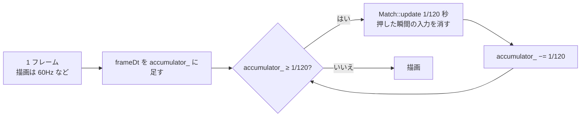

# 全体に共通する設計

モジュールをまたいで共通の決まりと、変更する時に知っておくべきことをまとめます。

## 1. 座標と単位

| 項目 | 決まり |
|---|---|
| 座標系 | 画面と同じ。**+X が右、+Y が下** |
| 原点 | ステージの中央が (0, 0)。自キャラは (0, 0) から始まる（障害物と重なれば近くへずらす） |
| 角度 | +X 方向が 0 度、**画面上の時計回りが正**（raylib の描画関数と同じ）。`geo::perpendicular(dir)` は進む向きの**右手側** |
| 距離 | ゲーム内単位（LoL と同じ単位。100 がおよそエターナルリターンの 1m）。根拠: Geometry.h の先頭 |
| 時間 | 秒（`float`） |
| 速さ | ゲーム内単位 / 秒 |
| 割合 | 0〜1（0.4 = 40%）。画面に出す時に 100 を掛ける |
| 画面のピクセル | 実ピクセル。拡大率 100% の時の大きさで書き、`ui::px()` で倍率を掛ける（[20-ui.md](20-ui.md)） |
| 日付 | `YYYYMMDD` の `int`（2026 年 10 月 25 日なら 20261025）。ログとリザルトで同じ |

ゲームの世界の座標（ワールド座標）と画面の座標の変換は、raylib の `Camera2D` で行います（`GetScreenToWorld2D` / `GetWorldToScreen2D`）。入力（`LiveInput`）がカーソルをワールド座標にしてからゲームに渡すので、`game/` の中は画面の座標を知りません。

## 2. 時間の進め方

- ゲームは **1/120 秒の固定の刻み**で進めます（`App::kFixedDt`）。描画のフレームレートに左右されないようにするためです（根拠: App.h のコメント）。60Hz の画面なら 1 フレームに 2 回、144Hz なら 1 フレームに 0〜1 回進みます。
- 1 フレームの経過時間の上限は 0.25 秒です（ウィンドウを動かしている間などに止まった後、ゲームが一気に進まないように）。
- **入力スクリプトの時は、1 フレームを 1/60 秒とみなします**（実際の経過時間を使わない）。PC の速さに関係なく、毎回同じ結果になるようにするためです（根拠: App.cpp のコメント）。
- ゲームを進めなかったフレームの「押した瞬間」の入力は、次に進める時まで取っておきます（`InputFrame::mergeNewer`。[13-input.md](13-input.md)）。
- ポーズ中・リザルト画面ではゲームを進めません（`App::frame` が `Playing` の時だけ `updateMatch` を呼ぶ）。
- 演出（`Vfx`）の残り時間も、ゲームの刻みで減ります。ポーズ中は演出も止まります。

テストも同じ 1/120 秒刻みで `World::update` / `Match::update` を呼びます（各 Fixture の `run`）。

## 3. 乱数と再現性

| 乱数を使う所 | 種 |
|---|---|
| スキルドッジの敵の配置・敵のキャラの選び方 | `MatchConfig::seed`（`Match::setupSkillDodge` の中の `std::mt19937`） |
| 敵 AI の判断（ぶれ・間隔・横移動） | 同じ種（`EnemyDirector::rng_`） |
| 的の AI の判断（パターン・避けるかどうか） | 同じ種（`SkillShotTarget::rng_`） |
| 乱数の種そのもの | `seed` が 0 なら `std::random_device` で決める（`Match` のコンストラクタ） |

- 乱数の種は、プレイの開始時にログに出し（`[match] スキルドッジを開始: … 乱数の種 N`）、リザルトにも保存し、デバッグパネルにも出します。
- **同じ種・同じ入力なら、同じ展開になります**。不具合を再現する時は、ログの種を `--seed N` に渡し、入力スクリプトで同じ操作をします（根拠: 指示書「スキルドッジの開始時には乱数の種（同じ展開を再現して調べるため）をログに記録する」）。
- 「もう一度」「リスタート」「キャラの切り替え」は、新しい種で始めます（`seed = 0` にしてから `startMatch`）。
- 練習場では乱数を使いません。

**注意事項**: 実際の操作では、フレームごとの経過時間が毎回違うので、刻みの区切りに入力が入るタイミングも変わります。同じ種でも、人が操作した場合は完全には同じになりません。

## 4. エラー処理の方針

このプログラムは C++ の例外をほとんど投げません。失敗は戻り値で返し、ログと画面に出して、できるだけ動き続けます。

| 場面 | 扱い | 例 |
|---|---|---|
| 起動に必要なものが無い | ダイアログを出して終了（終了コード 1・2） | data フォルダが無い・引数の誤り・入力スクリプトが読めない |
| 設定ファイルが読めない | **前回の内容を使い続け**、ERROR のログとメニューの赤字 | JSON の書き方の誤り・必須の項目が無い |
| 設定ファイルの値がおかしい | 範囲に収める・既定値にする。警告（WARN）とメニューの赤字 | 知らない `cameraMode`・範囲外の数 |
| params の書き忘れ・効果の書き方の誤り | 既定値で続ける（誤った効果は飛ばす）。そのスキルを初めて使った時に、WARN のログとメニューの赤字（設定ファイルを読み直すまで 1 回だけ） | `SkillDef::num`、`parseEffects`、`DataWarnings` |
| handler の名前の誤り | メニューの赤字。そのスキルを使うと何も起きない（ERROR のログ） | `App::validateData`、`casting::runSkill` |
| スキルが使えない | 何もしない。DEBUG のログに理由 | クールダウン中・射程外・対象がいない |
| リザルトのファイルが読めない | `.broken` を付けて残し、上書きしない。記録の画面に赤字 | `ResultStore::load` |
| 書き込みに失敗 | ログとエラーの一覧に出し、続ける | リザルトの保存・sandbox.jsonc の保存 |
| クラッシュ | 原因をログに書いてから終わる | `platform::installCrashHandler` |

例外を捕まえているのは、JSON の読み込み（`nlohmann::json::exception`）と、リザルトの 1 件の読み込み（`std::exception`）だけです。

## 5. ログ

[11-core.md の Log](11-core.md#6-logh--cppmobalog) に仕組みがあります。ここでは使い方の決まりをまとめます。

### 5.1 分類名（`log::info("分類", ...)` の第 1 引数）

| 分類 | 内容 | 主なファイル |
|---|---|---|
| `app` | 起動・終了・画面の切り替え・スクリーンショット | App.cpp・main.cpp |
| `data` | 設定ファイルの読み込み・誤り | GameData.cpp・CharacterDef.cpp・EffectSpec.cpp・Entities.cpp |
| `match` | プレイの開始と結果 | Match.cpp |
| `world` | キャラ・設置物の配置と消滅 | World.cpp |
| `skill` | スキルの発動・詠唱・不発・起爆・クールダウンの短縮 | SkillCasting.cpp・skills/*.cpp |
| `hit` | 命中 | World.cpp |
| `dodge` | 被弾・ダウン・発動の結果 | World.cpp |
| `status` | 状態異常 | SkillHelpers.cpp |
| `move` | 移動先にたどり着けない | World.cpp |
| `bush` | ブッシュから見えるようになった | World.cpp |
| `ai` | 敵 AI・的の AI の判断 | EnemyAI.cpp・SkillShotTarget.cpp |
| `input` | キー・右クリック・入力スクリプト | PlayerController.cpp・ScriptInput.cpp |
| `camera` | カメラの切り替え・カーソルの閉じ込め | App.cpp |
| `results` | リザルトの保存・読み込み・削除 | ResultStore.cpp・App.cpp |
| `sandbox` | ダミーの置き直し | Sandbox.cpp |
| `ui` | 文字の倍率・フォント | App.cpp・Fonts.cpp・DebugPanel.cpp |
| `platform` | IME | Platform.cpp |
| `perf` | 5 秒ごとの FPS と処理時間 | App.cpp |
| `raylib` | raylib 自身のログ | App.cpp |
| `log` / `crash` | ログファイルの開始・削除 / クラッシュ | Log.cpp・Platform.cpp |

### 5.2 レベルの使い分け

- 1 回の発動で 1 行程度の主な出来事（発動・命中・開始・終了）は INFO
- 調べる時だけ要る途中経過（詠唱の開始・AI の判断・使えなかった理由）は DEBUG
- 毎刻み出るもの（右クリックの長押し）は TRACE
- 発動の番号 `castId=N` を、発動・命中・結果のログに入れると、1 回の発動を追いかけられます

## 6. 設定ファイルの再読み込みと、データの寿命

- `App` が 1 秒ごとに `GameData::reloadIfChanged()` を呼び、ファイルの更新日時が変わっていれば読み直します。F5 で強制的に読み直せます。
- 読み直すと、`GameData` の中のキャラ・ステージの構造体は**作り直されます**。そのため、次の決まりを守っています。
  - `CharacterDef*`・`SkillDef*`・`StageDef*` をメンバとして覚えない。必要な時に id で引き直す（`World::characterOf`、`casting::skillOf`）
  - handler がラムダに取り込む値（効果の一覧・数値）は、**コピーして**取り込む
  - AI の設定（`EnemyDirector::config_`・`SkillShotTarget::config_`）はプレイの開始時にコピーする（プレイの途中で ai.jsonc を変えても、そのプレイには効かない）
- プレイ中に読み直した時は、キャラの大きさ・速さ・色・名前（`World::refreshUnitsFromData`）と、練習場のダミー（`Match::refreshDummiesIfChanged`）を反映します。**ステージの地形は反映しません**（次のプレイから）。
- 読み直した時のスキルの数値は、次に発動した時から使われます（飛んでいる弾は、出した時の値のまま）。

## 7. 拡張の手順

### 7.1 キャラを足す

**背景**（根拠: 指示書「実装の進め方」）: 手順 7 はキャラの追加です。「仕様が定まっていないキャラは実装しない（敵として出す場合も）」「メニューのキャラの並び順は、以降のキャラは実装した順に末尾へ足す」が決まりです。

1. [character_traits.txt](../../character_traits.txt) にキャラとスキルの仕様が決まっているか確かめる
2. `data/characters/<id>.jsonc` を作る。既存のキャラのファイルをまねる。`menuOrder` は既存の最大より大きくする
3. 既存の handler（[15-game-skills.md の表](15-game-skills.md#4-汎用のスキルcommonskillscpp)）で作れるスキルは、`handler` と `params` を書くだけ
4. 足りない動きだけ、新しい handler を作る（7.2）
5. スキルドッジで敵として出すスキルには `usedByEnemy: true`。敵 AI が狙えるのは、方向指定（`speed`・`width` がある）と地点指定（`radius` と `delay` か `flightTime` がある）のスキルだけ
6. ヒット率に数えるスキルには `countsForHitRate: true`
7. `test_character_data.cpp` の並び順のテストを直し、スキルのテストを `test_world.cpp` に足す
8. [data-files.md](../data-files.md) の 8 章（新しい handler の params）を更新する

### 7.2 handler（スキルの動き）を足す

1. `src/game/skills/<キャラ>Skills.cpp`（汎用なら `CommonSkills.cpp`）に `void handleXxx(SkillContext& ctx)` を書く
2. `Skill.h` に宣言を足す
3. `SkillRegistry.cpp` の `kHandlers` に名前と関数を足し、**配列の大きさを 1 増やす**
4. 書き方の注意は [15-game-skills.md の 6 章](15-game-skills.md#6-新しい-handler-を作る時)

### 7.3 状態異常を足す

1. `data/EffectSpec.h` の `EffectType` に値を足し、`EffectSpec.cpp` の `kEffectNames` に表記と画面の名前を足す（配列の大きさも増やす）
2. `game/StatusEffects.cpp` の `canMove` / `canCast` / `moveSpeedMultiplier` に、その効果で何ができなくなるかを足す
3. 見た目が要るなら `render/Renderer.cpp` の `drawUnit` に足す

### 7.4 弾・範囲の見た目を足す

1. `game/Entities.h` の `ProjectileVisual` / `AreaVisual` に値を足し、`Entities.cpp` の `...FromString` に表記を足す
2. `render/Renderer.cpp` の `drawProjectile` / `drawArea` に描き方を足す

### 7.5 ステージを足す

`data/stages/<id>.jsonc` を足すだけです（コードの変更は不要）。メニューに自動で出ます。障害物の種類を足す時は、`StageDef.h` の `ObstacleKind` と `Renderer.cpp` の `drawObstacle` を変えます。

### 7.6 モードを足す

1. `game/MatchConfig.h` の `GameMode` と `displayName` に足し、必要な設定を `MatchConfig` に足す
2. `game/Match.cpp` のコンストラクタの `switch` に準備を足す（必要なら AI などの部品を `Match` に持たせ、`Match::update` で呼ぶ）
3. `ui/MainMenu.cpp` に選択肢と設定を足す
4. 結果を保存するなら、`ResultStore.cpp` の `modeName`・`resultFolderName`・`toJson`・`savedResultFromJson`・`scoreOf`、記録と統計の画面のタブを足す
5. `app/CommandLine.cpp` の `--mode` と `App::configFromCommandLine` に足す

### 7.7 メニューの項目を足す

1. 選んだ値を持つ所（多くは `MatchConfig`）にメンバを足す
2. `ui/MainMenu.cpp` に部品を足す
3. 使う所（`Match` など）で読む
4. 結果と一緒に保存するなら、`ResultStore.cpp` の `toJson` / `savedResultFromJson` に足す（古いファイルには無い項目なので、読む時は既定値を決める）

## 8. コードの書き方の決まり

[claude_directive.txt](../../claude_directive.txt) の「その他、注意点や要望」とユーザーの共通設定より。

| 決まり | 内容 |
|---|---|
| 書式 | ルートの [.clang-format](../../.clang-format) に従い、clang-format で整形する |
| 説明コメント | すべての関数・クラス・構造体・列挙型に `///` で書く（VSCode でポップアップに出る）。ヘッダーで宣言する関数は宣言の上、.cpp の中だけで使う関数は定義の上。分かりにくい引数・戻り値には `@param` / `@return` |
| コメントの言葉 | 日本語 |
| 名前 | ファイル名・型は UpperPascalCase（`World`・`SkillCasting`）、関数・変数は lowerCamelCase（`requestCast`・`moveTarget`）、クラスの private のメンバ変数は末尾に `_`（`units_`）、定数は `k` で始める（`kFixedDt`）、列挙型の値は UpperPascalCase。ユーザーの共通の命名規則（変数 lower_snake_case・定数 UPPER_SNAKE_CASE）とは違うが、このプロジェクトでは例外としてこの形に決めている（根拠: 指示書、2026-10-30） |
| プリコンパイル済みヘッダー | 使わない（`#include` の書き忘れに気づけなくなるため） |
| 可読性 | 性能だけでなく、Claude と人がデバッグしやすいように、ある程度の読みやすさも考える |
| 資料 | 修正の背景・原因・修正方法などは `docs/` に Markdown で残す |

## 9. 性能について

- ゲームの更新は 1 秒に 120 回です。キャラは多くても十数体（スキルドッジは自キャラ + 敵 5 体、練習場はプリセットのダミーの数）、弾・範囲は多くても数十なので、当たり判定は総当たり（すべての弾 × すべてのキャラ）で行っています。
- 経路探索（A*）は、目的地が変わった時・道のりが塞がれた時だけ行います。右クリックの長押しでも 0.1 秒に 1 回、敵 AI の移動先の決め直しも 0.2〜0.35 秒に 1 回です。
- マス目の表は半径ごとに 1 回だけ作ります（最初に使う時に少し時間がかかる）。
- 5 秒ごとに FPS・更新と描画の時間・最も遅いフレームをログ（`[perf]`、DEBUG）に出します。

## 10. 前提と制約

| 前提 | 内容 |
|---|---|
| OS | Windows 10 / 11 だけ（`core/Platform.cpp` と `core/Log.cpp` が Windows API を使う。フォントも Windows のフォントフォルダから読む） |
| コンパイラ | MSVC（Visual Studio Build Tools）。`build.bat` が `vswhere` で探す |
| スレッド | 1 つ。ログだけは `mutex` で守っているが、他は複数のスレッドを想定していない |
| 入力 | マウスとキーボードだけ（ゲームパッドは対象外） |
| 保存するもの | リザルト（results/）と、sandbox.jsonc の `"preset"` の値だけ。他の設定はゲームから書き換えない（デバッグパネルの変更は一時的） |
