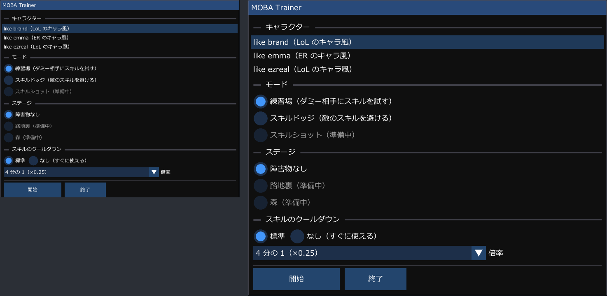
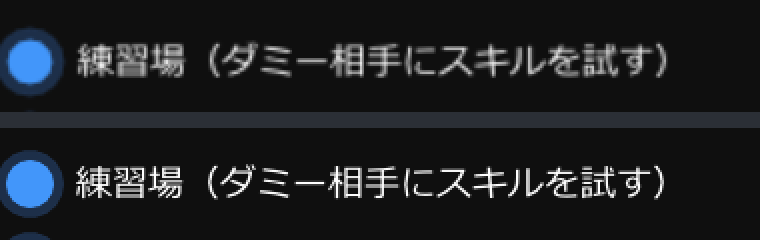
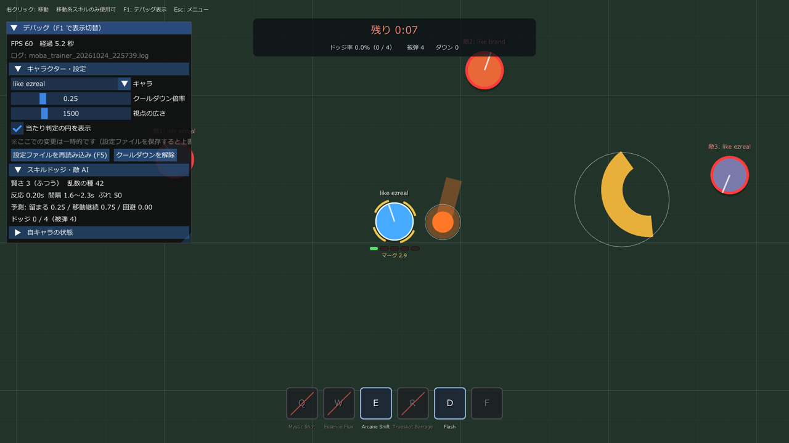

# 画面の文字が小さく表示される問題と、Windows の拡大率への対応

| 項目 | 内容 |
|---|---|
| 対応日 | 2026-10-24 |
| 影響があった環境 | Windows の「拡大/縮小」を 100% より大きくしている PC（高解像度のノート PC など） |
| 関係する設定 | `data/settings.jsonc` の `uiScale` と `window` |

## まとめ

- **起きていたこと**：ゲームの文字・ボタン・ウィンドウが、ほかのアプリより小さく表示されていました（約 3 分の 2 の大きさ）。
- **原因**：Windows の「拡大/縮小」（この PC では 150%）を、ゲームが反映していませんでした。
- **対応**：ゲーム自身が拡大率を読み取り、文字・ボタン・ウィンドウを大きく描くようにしました。文字はぼやけず、くっきり表示されます。

---

## 1. 起きていたこと

拡大率 150%・解像度 2560×1600 の PC で、ゲームのメニューやゲーム中の表示が、VSCode やエクスプローラーなどのほかのアプリに比べて明らかに小さく表示されていました。



*左：修正前（メニューの幅 580 ピクセル）　右：修正後（幅 870 ピクセル。1.5 倍）*

## 2. 背景：Windows の「拡大/縮小」の仕組み

画面の解像度が高いと、同じピクセル数の文字でも物理的には小さく見えます。そこで Windows には、表示全体を拡大する設定があります（設定 → システム → ディスプレイ →「拡大/縮小」）。この PC は 150% です。

この拡大を「誰が行うか」によって、アプリは 2 種類に分かれます。

| | DPI 非対応のアプリ | DPI 対応のアプリ |
|---|---|---|
| 拡大するのは | Windows（アプリが描いた画面を、画像として引き伸ばす） | アプリ自身（大きな文字で描き直す） |
| 見た目 | 大きくなるが、少しぼやける | くっきり |
| 例 | 古いアプリ | VSCode、エクスプローラー、最近のゲーム |

> **DPI**（dots per inch）は 1 インチあたりのドット数で、Windows では拡大率を表すのに使われます。拡大率 100% = 96 DPI、150% = 144 DPI です。

## 3. 原因

このゲームは描画に raylib を使っており、raylib は内部で GLFW というライブラリを使っています。**GLFW は起動時に、Windows へ「このアプリは DPI 対応です（拡大は自分で行います）」と伝えます。** そのため、Windows はこのゲームを拡大しません。

ところが、ゲームのコードは自分で拡大していませんでした。その結果、

1. Windows は拡大しない（DPI 対応だと伝えているため）
2. ゲームも拡大しない（拡大率を見ていなかったため）

となり、ゲームだけが拡大率 100% のまま描かれていました。拡大率 150% のほかのアプリと並べると、3 分の 2 の大きさに見えます。

> **補足：raylib の `GetWindowScaleDPI()` を使わなかった理由**
>
> raylib には拡大率を返す `GetWindowScaleDPI()` がありますが、`FLAG_WINDOW_HIGHDPI` を付けて起動しない限り、常に 1.0 を返します（raylib 6.0 の `rcore_desktop_glfw.c`）。`FLAG_WINDOW_HIGHDPI` を付けると、マウス座標や描画の座標系まで raylib が変えてしまい、影響する範囲が大きくなります。そこで今回は使わず、Windows から拡大率を直接取得しました。

## 4. Windows 側での回避策（参考。現在は不要）

ゲーム側を直す前の回避策として、Windows の互換性設定でも表示を大きくできます（FF14 などで使われる方法と同じです）。

1. `build\release\moba_trainer.exe` を右クリック →「プロパティ」
2. 「互換性」タブ →「高 DPI 設定の変更」
3. 「高い DPI スケールの動作を上書きします」にチェックを入れ、「拡大縮小の実行元」を「システム」にする

これは、ゲームを「DPI 非対応のアプリ」として扱わせ、Windows に引き伸ばしてもらう方法です。そのため、**大きくはなりますが、文字や図形が少しぼやけます**。



*同じ部分を 2 倍に拡大したもの。上：互換性設定「システム」（Windows が引き伸ばすため、輪郭がにじむ）　下：ゲーム側の修正後（くっきり）*

> **注意**：ゲーム側の修正後は、この互換性設定は不要です。設定したままだと、ゲームは拡大率を 100% と受け取ってしまい、Windows の引き伸ばしでぼやけたままになります。設定している場合は、チェックを外してください。

## 5. 修正内容

### 5.1 拡大率を取得する

Windows の `GetDpiForWindow()` で、ウィンドウがあるモニターの DPI を取得し、96 で割って拡大率にします（150% なら 144 ÷ 96 = 1.5）。

- `platform::windowDpiScale()`（`src/core/Platform.cpp`）

### 5.2 文字・ボタン・余白を大きく描く

画面に出す部品は、すべて「Windows の拡大率 × `uiScale`」の倍率で大きく描きます。

| 描くもの | 方法 |
|---|---|
| メニュー・リザルト・デバッグパネル（Dear ImGui） | `ui::setScale()` で、Dear ImGui の `FontScaleDpi`（文字の大きさ）と `ScaleAllSizes()`（余白・枠の太さ）に倍率を設定する |
| HUD（スキルバー・残り時間・キャラ名・HP ゲージなど、自前で描くもの） | ピクセル単位の値をすべて `ui::px()` に通して、倍率を掛ける |
| ゲームの世界（キャラ・弾・範囲） | **対象外**。カメラがウィンドウの大きさに合わせて拡大するため、もともと大きさが合っている |

### 5.3 ウィンドウの大きさ

`data/settings.jsonc` の `window`（拡大率 100% の時の大きさ。既定は 1600×900）に拡大率を掛けます。画面からはみ出さないよう、作業領域（タスクバーを除いた範囲）の 85% に収まるまで縮めて、画面の中央に置きます。

| 拡大率 | 作業領域 | ウィンドウ |
|---|---|---|
| 100% | 1920×1040 | 1600×900 は高さが収まらないので、1572×884 |
| 150% | 2560×1528 | 2400×1350 は幅が収まらないので、2176×1224 |

ウィンドウは大きさを決めるまで隠しておき（`FLAG_WINDOW_HIDDEN`）、起動時にちらつかないようにしています。

### 5.4 別のモニターへ移動した時

毎フレーム拡大率を確認し、変わった時（拡大率の違うモニターへウィンドウを移動した時など）は倍率を設定し直します。ウィンドウの大きさは変えません。

### 5.5 好みで大きさを調整する（`uiScale`）

`data/settings.jsonc` の `uiScale` で、Windows の拡大率よりさらに大きく・小さくできます。保存すると、ゲームの起動中でも反映されます。

```jsonc
// 1.0 = Windows の設定どおり、1.2 = それより 2 割大きく、0.8 = 2 割小さく
"uiScale": 1.0,
```

倍率は次のように決まります。

| 対象 | 倍率 |
|---|---|
| 文字・ボタン・余白 | Windows の拡大率 × `uiScale` |
| ウィンドウの大きさ | Windows の拡大率（作業領域の 85% まで） |



*修正後のスキルドッジの画面（拡大率 150%）。デバッグパネル・スキルバー・残り時間・キャラ名・HP ゲージが 1.5 倍で描かれている*

## 6. 関係するファイル

| ファイル | 役割 |
|---|---|
| `src/core/Platform.cpp` | Windows から拡大率（`windowDpiScale`）と作業領域（`monitorWorkArea`）を取得する |
| `src/ui/UiScale.h` / `UiScale.cpp` | 倍率の管理（`ui::scale` / `ui::px` / `ui::setScale`）と、ウィンドウの大きさの計算（`ui::fitWindowSize`） |
| `src/app/App.cpp` | 起動時のウィンドウの大きさ、拡大率の変化への追従、設定の再読み込み時の反映 |
| `src/render/Hud.cpp` | HUD のピクセル値を `ui::px()` で拡大する |
| `src/ui/MainMenu.cpp`、`ResultScreen.cpp`、`DebugPanel.cpp` | ウィンドウの幅やボタンの大きさを `ui::px()` で拡大する |
| `data/settings.jsonc` | `uiScale` と `window` |
| `tests/test_ui_scale.cpp` | ウィンドウの大きさの計算のテスト（5.3 の表の例を含む） |

## 7. 今後コードを書く時の注意

画面に何かを描く時は、次のルールを守ってください。

| 書くもの | `ui::px()` を通すか |
|---|---|
| `ImDrawList::AddText()` の文字の大きさ、座標、幅、余白、線の太さなど、画面のピクセル値 | **通す** |
| `ImGui::SetNextWindowSize()` やボタンの大きさなど、Dear ImGui に渡すピクセル値 | **通す** |
| `ImGui::PushFont(nullptr, size)` の `size` | 通さない（Dear ImGui が自動で倍率を掛ける） |
| ゲームの世界の座標・距離（キャラの半径など） | 通さない（カメラが拡大する） |

```cpp
// 良い例
dl->AddText(font, ui::px(15.0f), ui::px(12.0f, 10.0f), color, text);
ImGui::Button("開始", ui::px(140.0f, 36.0f));

// 悪い例（拡大率 150% の画面で、3 分の 2 の大きさに見えてしまう）
dl->AddText(font, 15.0f, ImVec2{12.0f, 10.0f}, color, text);
ImGui::Button("開始", ImVec2{140.0f, 36.0f});
```

## 8. 確認方法

- **ログ**：起動時に、次のような行が出ます。

  ```
  [INFO ] [ui] 文字・ボタンの倍率を 1.50 にしました（Windows の拡大率 150% × 設定の uiScale 1.00）
  [INFO ] [app] ウィンドウを開きました: 2176x1224（Windows の拡大率 150%）
  ```

- **自動テスト**：`build\release\moba_tests.exe` を実行します（`tests/test_ui_scale.cpp` でウィンドウの大きさの計算を確認しています）。
- **目で見て確認**：Windows の拡大率を変えて起動し、ゲームの文字の大きさが、ほかのアプリとそろっていることを確認します。
